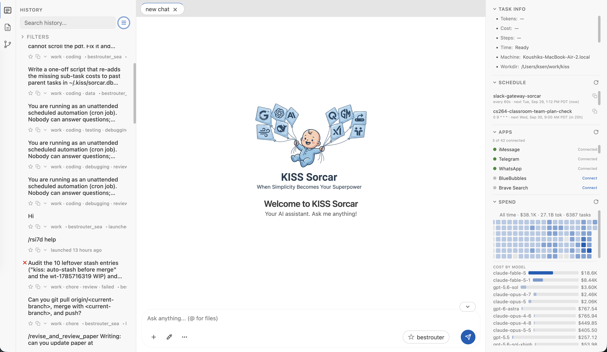
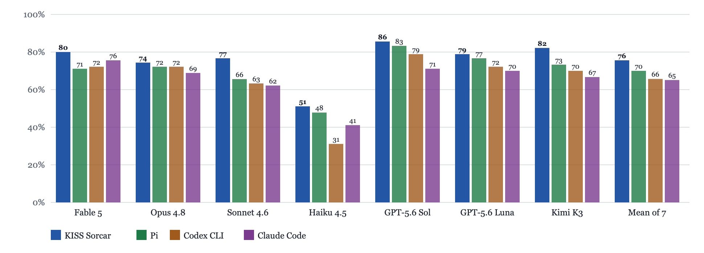

<div align="center">

<picture>
  <source media="(prefers-color-scheme: dark)" srcset="https://raw.githubusercontent.com/ksenxx/kiss_ai/main/assets/KISS-Sorcar-Logo-Dark.png">
  <source media="(prefers-color-scheme: light)" srcset="https://raw.githubusercontent.com/ksenxx/kiss_ai/main/assets/KISS-Sorcar-Logo.png">
  
</picture>

[](https://pypi.org/project/kiss-agent-framework/)
[](LICENSE)
[](https://www.python.org/)
[](https://kisssorcar.github.io/)
[](https://arxiv.org/abs/2604.23822)

*"Everything should be made as simple as possible, but not simpler." — Albert Einstein*

</div>

# KISS Sorcar

### Open-source general-purpose AI agent for long-horizon tasks and AI discovery

**KISS Sorcar is a free, simple, local-first, bring-your-own-key AI agent framework.** It runs as a browser/mobile web app served by a local daemon, and offers a Python client API for scripting tasks. Your prompts and code go directly to the model provider or local endpoint you configure, never through our servers. Multi-model workflows take a paragraph of prompt, not a pipeline: complex AI systems and techniques can be replaced with a paragraph of prompt in KISS Sorcar.

```bash
curl -fsSL https://raw.githubusercontent.com/ksenxx/kiss_ai/main/scripts/install.sh | bash
```

This README is the quick start. The detailed references are:

- [FEATURES.md](FEATURES.md): the complete feature inventory, checked against the source tree.
- [src/kiss/server/README.md](src/kiss/server/README.md): every `sorcar.run()` option, tools, hooks, and the Sorcar Extension Agent authoring guide.
- [src/kiss/agents/third_party_agents/README.md](src/kiss/agents/third_party_agents/README.md): the messaging and service agents, sign-in, and worked examples.
- [MODELS.md](MODELS.md): the full per-provider model list.
- [kisssorcar.github.io/docs](https://kisssorcar.github.io/docs/): installation, CLI, API, and messaging guides.

______________________________________________________________________

<details>
<summary><strong>Table of Contents</strong></summary>

- [Terminal-Bench 2.0](#terminal-bench-20-kiss-sorcar-vs-pi-codex-cli-and-claude-code)
- [What is in the Name](#what-is-in-the-name)
- [Installation](#installation)
- [Using KISS Sorcar](#using-kiss-sorcar)
  - [Web and mobile app](#web-and-mobile-app)
  - [The `kiss-web` daemon](#the-kiss-web-daemon)
  - [Python client API](#python-client-api)
  - [Sorcar Extension Agents (SEAs)](#sorcar-extension-agents-seas)
  - [Skills, MCP servers, and customization](#skills-mcp-servers-and-customization)
- [Messaging & Third-Party Agents](#messaging--third-party-agents)
- [Models Supported](#models-supported)
- [Contributing](#contributing)
- [License](#license)
- [Citation](#citation)

</details>

<div align="center">
  
</div>

## Terminal-Bench 2.0: KISS Sorcar vs Pi, Codex CLI, and Claude Code

The [HarnessTax](https://harnesstax.github.io/) study (Pan, Yang, Arabzadeh, Chiang, Stoica, Zaharia; UC Berkeley and Arena Intelligence) holds the model fixed, swaps the harness between Claude Code, Codex CLI, and Pi, and finds that the harness moves cost far more than it moves what gets solved. We added KISS Sorcar to their Terminal-Bench 2.0 table: the same 30 sampled tasks, the same seven models, three attempts per task, graded by the official Terminal-Bench 2.0 verifier, with the system prompt cut to 727 words of coding rules (`papers/kisssorcar/evidence/tb2_prompt.txt`). Averaged over the seven models, **KISS Sorcar solved 75.6% of attempts; Pi 70.0%, Codex CLI 65.7%, Claude Code 65.1%**, with the best point estimate on every model.

| Model | KISS Sorcar solved | $/att. | Pi solved | $/att. | Codex CLI solved | $/att. | Claude Code solved | $/att. |
|---|---:|---:|---:|---:|---:|---:|---:|---:|
| Claude Fable 5 | **80.0** | 1.50 | 71.1 | 1.08 | 72.2 | 0.98 | 75.6 | 1.55 |
| Claude Opus 4.8 | **74.4** | 1.21 | 72.2 | 0.76 | 72.2 | 0.85 | 68.9 | 0.90 |
| Claude Sonnet 4.6 | **76.7** | 2.23 | 65.6 | 0.61 | 63.3 | 0.55 | 62.2 | 0.67 |
| Claude Haiku 4.5 | **51.1** | 0.39 | 47.8 | 0.25 | 31.1 | 0.21 | 41.1 | 0.26 |
| GPT-5.6 Sol | **85.6** | 0.69 | 83.3 | 0.42 | 78.9 | 0.76 | 71.1 | 1.35 |
| GPT-5.6 Luna | **78.9** | 0.05 | 76.7 | 0.04 | 72.2 | 0.06 | 70.0 | 0.10 |
| Kimi K3 | **82.2** | 1.14 | 73.3 | 0.38 | 70.0 | 0.45 | 66.7 | 0.52 |
| **Mean of 7 models** | **75.6** | 1.03 | 70.0 | 0.51 | 65.7 | 0.55 | 65.1 | 0.77 |

*Terminal-Bench 2.0, the study's 30-task sample, three attempts per task: percentage of attempts solved and cost per attempt in USD. KISS Sorcar: 630 attempts run on 25 September 2026, no turn cap, $50 budget per attempt, providers' default request parameters. The other three columns are the study's published numbers (100-turn cap, high reasoning effort, priced on a 1 September list). Bold marks the best point estimate per row.*

<div align="center">
  
</div>

Thirty tasks is a small sample (the pooled 95% interval, 63.8 to 85.9, contains all three published means), so we reran Pi ourselves, paired, on Claude Fable 5 with no turn cap and the same price table. On the study's 30 tasks KISS Sorcar solved 80.0% of attempts to Pi's 68.9%, a gap of **+11.1 points (95% interval +3.3 to +20.0)** for five cents more per attempt; on the 57 tasks the study did not sample, 82.5% to 71.9%, a gap of **+10.5 points (+2.9 to +18.7)** for 63 cents more. Only Pi was rerun, on one model, and the benchmark exercises the loop, six tools, and the coding rules with the discovery procedures, memory, reviewer, and IDE features switched off. Full write-up: [The Harness Tax, Audited](https://kisssorcar.github.io/blog/harness-tax-terminal-bench-blog.html); method and intervals: [the paper](https://kisssorcar.github.io/assets/kiss_sorcar.pdf), Section 5; per-attempt records: `papers/kisssorcar/evidence/tb2_trials.json`; the runners live in the separate `benchmarkings` package (a sibling checkout, or `KISS_BENCHMARKINGS_DIR`), which the paper scripts under `papers/kisssorcar/` locate.

## What is in the Name

**KISS Agent Framework** is a deliberately small agent runtime organized around the [KISS principle](https://en.wikipedia.org/wiki/KISS_principle) ("Keep it Simple, Stupid").
The name "Sorcar" pays homage to [P. C. Sorcar](https://en.wikipedia.org/wiki/P._C._Sorcar), the legendary Bengali magician, evoking the idea of an agent that performs feats that appear magical yet are grounded in disciplined engineering.
Note: **Sorcar** also means government in Bengali.

## Installation

### Install

```bash
curl -fsSL https://raw.githubusercontent.com/ksenxx/kiss_ai/main/scripts/install.sh | bash
```

The one-liner clones or updates `~/.kiss/kiss_ai` and runs its `install.sh` from the directory you ran the command in, so the daemon serves that directory (unless that directory is inside `~/.kiss` or the brand's home, as when the daemon updates itself from its own clone: then it serves your home directory). From a checkout, the same thing is:

```bash
git clone https://github.com/ksenxx/kiss_ai.git && cd kiss_ai && ./install.sh
```

The installer targets macOS and Linux on `x86_64`, `aarch64`, and `arm64`. `install.sh` copies the runtime into `~/.kiss/kiss`: the Python environment (uv), the library byte-compiled to `.pyc` files, the files a runtime reads as Python scripts (the bundled SEAs under `src/kiss/agents/seas/`, the channel and cron SEAs, `_version.py`) kept as source, and the web app frontend (`src/kiss/webapp/media/`). It then installs the `sorcar` CLI (with the `rsorcar` and `sorcar-docker` launchers) in `~/.local/bin`, Playwright's Chromium and cloudflared, refreshes `~/.kiss/MODEL_INFO.json`, registers the `kiss-web` daemon as your user service (launchd on macOS, a systemd user unit on Linux) serving the directory it was run from, sets a random remote-access password on the first install (printed in a box of `*` at the end of every run, after the app has opened, and stored in `~/.kiss/config.json`), and opens the web app at `http://127.0.0.1:8787` as a standalone app: its own window with no address bar or tabs (Chromium's app mode, run by `kiss-app` from the app's venv in Google Chrome, Chromium, Edge or Brave if installed, else in Playwright's Chromium, under its own profile in `~/.kiss/webapp-profile`), plus a launcher in your applications menu (`~/.local/share/applications/kiss-sorcar.desktop` on Linux, `~/Applications/KISS Sorcar.app` on macOS) named and iconed after the brand; the running window carries that icon in the dock or taskbar as well (the Linux entry names the window's X11 class and Wayland app id; the macOS bundle is a clone of the browser's, its binary and frameworks copied rather than symlinked, since Chromium's sandboxed helper processes read only their own bundle's real path, re-signed under the brand's identity and refreshed whenever the browser updates). Once the window is up the installer opens the folder holding that launcher in the file manager so you can see where the app is and pin it. Without such a browser it falls back to the default browser; on a remote machine it prints the cloudflared URL to open on your own device instead. A browser on the machine itself needs no password; from any other device type that password into the web app (the daemon checks it on every command such a browser sends). The Settings panel shows it in a plain text box you can edit: the new password is in force as soon as it is saved, with no restart (other devices then sign in again with it), and an empty box turns remote access off. Re-running `install.sh` updates the app in place, keeps the password (so the one your devices know stays valid), and restarts the daemon only when no task is running; from a shell, `~/.kiss/kiss/.venv/bin/python -m kiss.core.remote_password --rotate` draws a new random one. On a machine that also has a white-label brand home (a `~/.<brand>` directory with post-install hooks, or the one the running service was started from), the installer repeats itself into that home as well, each home keeping its own app copy (named after the home: `~/.s10s/s10s`), model catalog and password, and starts the brand's daemon rather than the stock one. Whatever fails during a run (a hook, a brand home's install, a daemon that does not come up) is recorded in `.install-problems` under the home of the daemon the run starts (a nested brand home's failures are folded in, prefixed with that home) and shown as a notification in the web app for up to a week, or until a run succeeds. `./install.sh --non-interactive` takes the default answer to every question, `KISS_SKIP_LAUNCH=1` skips starting the daemon and opening the app, `KISS_HOME` overrides the state directory, and the log is in `~/.kiss/install.log`.

When a new release is available, the update toast in the web app offers **Update** and **Update when idle**; the daemon installs an idle update as soon as no task is running. If the update fails, run the installation command again. It will not delete your history. After an install or update the chat panel shows the tips from `src/kiss/TIPS.md` once per version. An update on a machine that still has the retired VS Code extension tries to uninstall it (through the `code`, `code-insiders`, `cursor` and `code-server` CLIs, or the one `KISS_CODE_CLI` names; if a copy remains, the terminal tells you to remove it from the Extensions view) and, for a week, the web app shows a "VS Code extension removed" notice pointing to the app; its **Do not show this** checkbox silences it for good. All state (history database, settings, memories, TLS material) lives in `~/.kiss`; `KISS_HOME` overrides the directory, and a white-label brand names its own through `home_dir` in `brand.json`. Executable scripts in `~/.kiss/post-install.d/` run in name order at the end of every install; a failing hook is reported and the install still completes. Branding (`src/kiss/webapp/media/brand.json` and a git-ignored `.brand/` overlay for white-label builds) and the installer's steps are described in [FEATURES.md](FEATURES.md#20-installation-deployment-docker-and-release).

### Docker

```bash
./sorcar-docker [PORT] [--rebuild]
```

This builds a plain Debian image (`Dockerfile`) and starts a container whose entrypoint (`scripts/docker-startup.sh`) clones the repository (the private `kiss.git` when `GH_TOKEN` is set, else the public `kiss_ai.git`), runs `install.sh`, sets the web app password (`KISS_WEB_PASSWORD`, or a generated one printed in `docker logs`) and serves the web app on port 8787 (host port `PORT`, 8787 by default); the API keys in your environment are forwarded. State persists in the `kiss-sorcar-web-home` volume. Open `https://localhost:PORT`; the certificate is self-signed, so accept it once or install `/ca.crt`. Inside a container the Settings panel hides the LAN and tunnel URL bars, since the container's daemon is reached only through the published port.

### Python package install

If you only want the Python package (the `kiss-web` daemon, the Python client API, and the messaging-agent entry points):

```bash
pipx install kiss-agent-framework
# or
uv tool install kiss-agent-framework
```

KISS Sorcar requires **Python 3.13+**.

### Configure model access

Provide at least one model backend. You can use environment variables such as:

```bash
export ANTHROPIC_API_KEY=...
export OPENAI_API_KEY=...
export ZAI_API_KEY=...
export MOONSHOT_API_KEY=...
export TOGETHER_API_KEY=...
export OPENROUTER_API_KEY=...
export GEMINI_API_KEY=...
```

Claude models can also run through Amazon Bedrock: name the model `bedrock/<Bedrock model or inference-profile id>` (for example `bedrock/us.anthropic.claude-opus-4-6-v1:0`, with the usual `-high`/`-max` effort suffixes) and set either a Bedrock API key or an AWS access key pair, plus the region:

```bash
export AWS_BEARER_TOKEN_BEDROCK=...   # Bedrock API key (bearer token), or:
export AWS_ACCESS_KEY_ID=...
export AWS_SECRET_ACCESS_KEY=...
export AWS_SESSION_TOKEN=...          # temporary credentials only
export AWS_REGION=us-east-1           # default when unset
```

Bedrock models are priced as their `claude-*` catalog entry, which holds the `global.` profile rate; a geographic (`us.`, `eu.`, `apac.`, `jp.`, `au.`) or in-region (`anthropic.`) id of a Claude 4.5-or-later model is billed 10% above it, as on AWS's price list. The catalog does not list Bedrock ids; to pick one in the web app, add it under **Settings → Custom Models** (name only, no endpoint) and it appears in the model picker from the next daemon start.

You can also set API keys, a custom model endpoint, and custom HTTP headers in the Settings panel of the web app. The **Custom Models** section of the Settings panel registers your own models (a local vLLM/Ollama endpoint, or a provider model not in the bundled catalog); entries are stored in `~/.kiss/MY_MODELS.json` and appear in the model picker alongside the bundled catalog. The **Bedrock** section after it holds the Bedrock API key, AWS access key pair, session token and region. The **Claude Code** section after that is for the `cc/*` models, which run the `claude` CLI: it shows whether that CLI is logged in and how it will bill (`claude auth status`), holds the switch **Bill my Claude subscription for cc/ models** (on by default: the CLI is run without `ANTHROPIC_API_KEY` / `ANTHROPIC_AUTH_TOKEN`, so a `claude login` on a Pro or Max plan pays for the turn instead of API tokens; off, the CLI inherits the daemon's environment and an API key bills per token) and an optional subscription token from `claude setup-token` (`CLAUDE_CODE_OAUTH_TOKEN`) for a machine where nobody ran `claude login`. The **Codex** section after that does the same for the `codex/*` models, which run the `codex` CLI: it shows whether that CLI is logged in and how it will bill (`codex login status`), holds the switch **Bill my ChatGPT subscription for codex/ models** (on by default: the CLI is run without `OPENAI_API_KEY` / `CODEX_API_KEY`, so it bills the ChatGPT plan it is logged in to, and a turn is refused when the CLI's saved login is an API key from `codex login --with-api-key`, which would bill per token anyway; off, `OPENAI_API_KEY` bills per token), a **Sign in with ChatGPT** button that starts `codex login --device-auth` on the daemon's machine and shows the link and one-time code to enter in any browser (the way to log a headless machine in to a Plus/Pro plan), and a box for a Codex access token (`CODEX_ACCESS_TOKEN`, ChatGPT Business/Enterprise) for a machine where nobody ran `codex login`. Both CLIs are driven as plain models: their own tools, MCP servers, hooks and project instructions are switched off and they work with Sorcar's system prompt and tools, like every other model (Codex is handed Sorcar's tools as a `kiss` MCP server, so one `codex/*` step can make several tool calls, each executed by Sorcar; `finish` ends the step). The API Keys, Custom Models, Bedrock, Claude Code and Codex sections start collapsed every time Settings opens. Settings opens for the machine the chat header's machine drop-down names: for a registered machine the form shows and saves that machine's keys, settings and custom models (the daemon forwards the commands over the registered link), and hides what only concerns this daemon (its URLs and the Update, Reset Server and Update Models buttons); the form's text fields and custom-model list are blanked while it switches machines, so one machine's password and keys never show under another's name.

The picker also lists four bundled router agents under the `Router` group: **`autorouter`** runs its routing session on `openrouter/moonshotai/kimi-k3` (pre-run classification off, web tools and memory on), splits a task into units that have a mechanical acceptance check and dispatches those to the cheapest model tier (small, medium, frontier) that passes the check, escalating on failure, keeps guarded and uncheckable work and the final acceptance of the whole on the frontier tier, and switches its own model only at phase boundaries; **`bestrouter`** runs every task on `claude-fable-5-1` and has `gpt-6-astra` review the result read-only; **`orautorouter`** and **`orbestrouter`** are the same two routers restricted to the OpenRouter vendor, so a single OpenRouter key runs them: `orautorouter`'s tiers hold only `openrouter/...` models (the OpenRouter twins of the autorouter's candidates, in the same order) and `orbestrouter` works on `openrouter/anthropic/claude-fable-5.1` with `openrouter/openai/gpt-6-astra` reviewing. They are Sorcar Extension Agents (see below), not models.

## Using KISS Sorcar

KISS Sorcar has two client interfaces, both served by one local daemon: the **web/mobile app** and the **Python client API**. A third interface, the **`sorcar` terminal command**, runs a SorcarAgent directly in the current directory without the daemon: `sorcar -t "Summarize README.md"` runs an inline task, `sorcar -f task.txt` runs the file's content as the task (exactly one of `-t`/`-f` is required; see `sorcar --help` for the model, budget, and work-dir flags).

### Web and mobile app

Open the web app in a browser and type or speak your task. The chat interface provides:

- `@` file/folder mentions with ranked completion from a persistent index of your working directory and home directory.
- **Git worktree isolation** that the agent manages itself, with no setting to toggle: inside a git checkout, the agent calls its `create_worktree` tool before its first change to a tracked file, which moves the task onto a private `kiss/wt-*` branch checked out under `<repo>/.kiss-worktrees/` (an edit to a tracked file of the checkout outside a worktree is refused), and `commit_and_merge` once the work is verified, which commits the branch with a generated message and squash-merges it into the branch the task started from (the bundled `/merge` agent resolves conflicts). A worktree a task leaves unmerged is offered to you with a Merge / Discard bar.
- A pre-run **task classifier** that marks a task involving neither software development nor Internet search as simple, so it runs with a lite system prompt. The classifier and the agent's `decide` tool use the `~typesafe/jev-latest` decisions model through OpenRouter when the "Use Jev (decisions model)" setting is on (the default) and an OpenRouter key is configured.
- A model picker, per-task budget caps, chat history with tags (at most three per task, always including `secret` for a trajectory that carries a credential) and per-chat summaries (double-click a chat's title, or click its pencil button, to retype it; your text replaces the generated summary on every device until you clear it, and a collapsed chat shows when its latest task finished), ordered with running tasks first and then by when each task finished, newest first (a task with no completion time yet, because it is still running or predates that column, counts from its launch instead; a chat ranks by the newest such time among its tasks, and the same time drives a row's "3 hours ago" label and the date filter), filterable by state, date, SEA, machine, working directory and tag (each task row's details show, where known, its working directory, model and parallel mode, then the machine it ran on with its budget cap and the agent it ran as, then its chat, task and parent ids), a **Task Info** view (tokens, cost, steps, time, working directory, budget, model, and the ids of the chat, the task and its parent), a `machine: directory` header above the chat with two drop-downs (both stay on screen at phone widths, the directory wrapping onto a second line when the machine name needs the room): the **machine** the chat's next task runs on (this one or any registered machine that answered the daemon's last ping, each shown by the name you gave it or, when you registered it by its address, by its own host name; a remote pick is green, red once the machine is reported down; the pick is sent with each task and kept across reloads, and changing it while a task runs leaves that task where it is and routes the next one) and the **working directory** (one daemon-wide directory, persisted in `~/.kiss/config.json`, that every task from every surface runs in unless the `run()` call or the task's SEA names another, as the channel agents' `~/.kiss/channel_work` does; the drop-down lists the current directory, then every directory picked before that still exists, newest first, and a **Choose ...** entry that opens a folder picker; a pick there or the Explorer's "Set as Working Directory" check mark changes it for all connected clients at once; while the machine drop-down names a registered machine, the directory drop-down lists that machine's own working directory and the directories picked there before, a pick there changes that machine's working directory and leaves this one's alone, **Choose ...** browses that machine's folders, and the Explorer and Source Control views show that machine's working directory and repository, with files opened from them read and saved there), and inline rendering of tool-generated images.
- **Image and PDF attachments** via the picker, paste, or drag-and-drop.
- **Persistent agent memory** (on by default): Markdown pages under `~/.kiss/memories` with a vector index, plus a per-repository memory for tasks run inside a git checkout. Toggle it in Settings or with `KISS_USE_MEMORY=0`.
- Wake-word voice chat ("Abracadabra, …") via the mic button, including steering a running agent by voice.
- Live steering: inject a message into a running agent or switch its model mid-run; wrap the message in `<task>…</task>` to queue it as the next task instead.
- When an agent asks you a question, every surface brings its tab forward and the composer becomes the answer box; a tab that is not in front shows a `?` badge ("Waiting for your answer") until the question is answered on any device, the task ends, or the tab closes.
- Tab mirroring: every connected browser shows the same chat tabs (the daemon owns the one canonical tab list and binds each chat to at most one tab), and a sub-agent opens a nested tab of its own on every client that closes when it finishes. There is no row of chat tabs: the chat on screen is the one you pick in the Chats panel or open with **+**, and a group strip under it lists that chat's sub-agent tabs; on the mobile web app's file screen the strip also lists the file, browser and terminal tabs the task opened (its chat screen lists just the chat and its sub-agents); the strip is hidden for a single conversation. The desktop web app splits the window instead: the chat on the left keeps the strip, and the content tabs get a row of their own on the right.
- A **Browser tab** that streams a real browser running next to the daemon to every surface; an agent's `show_browser()` moves the page it is browsing into that tab when a login, CAPTCHA, or live demo needs you. When the chat on screen is bound to a registered machine, the Browser button opens a page of that machine's browser instead, and the tab is labelled with the machine.
- Scheduled automations: ask in plain language ("every weekday at 9am, summarize my unread Slack messages") and the built-in cron agent (`kiss-cron` from the shell) creates, lists, pauses, resumes, or removes the schedule; the Schedule panel does the same with buttons. Schedules are kept in Pacific time, and a job can deliver its result to a messaging channel. A job's prompt may be a slash command (`/recommendations now`), which runs that SEA directly, and an `in_chat` job submits its prompt as a message typed into a new chat. Every installation is seeded once with two such jobs, a 6-hourly `/recommendations now` and an 8:00 `in_chat` `/good_morning now`; edit or remove them as you like, they are not re-created. Like cron, the scheduler does not catch up on occurrences missed while the daemon was down: a repeating job found more than ten minutes overdue is rescheduled from now without running (a one-shot job still runs, late).

The web app is also served over a cloudflared tunnel: copy the URL and password from the Settings panel and open it on any device; the browser tab is titled `KISS Sorcar: <machine name>` so several servers are easy to tell apart. The daemon also posts each new tunnel URL, followed by the machine name in parentheses, to a private per-machine ntfy.sh topic linked from the same panel, so a phone subscribed to the topics of several machines can tell their URLs apart after a restart. Its desktop mode adds a **Task Info sidebar** with live token, cost, and step metrics and a **Task update** for the running task (the `/ask` agent's short answer to what the task has done so far, first requested a minute after the task starts, refreshed every ten minutes or on demand with the refresh button, and charged to the task), plus **Schedule** (every cron job, with a **+** in the header that creates one in place and, per job, edit-in-place, run-now, enable/disable, copy and delete buttons), **Machines** (this machine and every registered one, labelled as in the chat header's drop-down, with its address and reachability; the tooltip shows the resolved IP and the daemon port; the header's **+** registers a new one, and a machine registered any way, there, by `/machine add` or by the CLI, brings the subpanel on screen), **Apps** (channel sign-in state; click one to connect it), **Spend**, and **Recommendations** (ten suggested next tasks drawn by the `/recommendations` SEA, which a default cron job runs every six hours, from your tasks of the last 24 hours plus enough older ones to review at least 20 completed tasks, with at least three of the ten combining the third-party apps you are signed in to, or ten starter tasks for a new project when there are no recent tasks; clicking one opens a new chat with the task in the composer, unsent) panels, and an activity bar with an **Explorer** (workspace file tree with Ctrl/Cmd-click, Shift-click, and Ctrl/Cmd+A multi-select; **Add Folder to Explorer...** opens a folder picker whose "Recently opened" list offers the working directories picked so far that the Explorer does not already show) and a **Source Control** view (the header counts the uncommitted files; changes grouped per worktree, with foldable sections, and a commit graph whose file rows open a side-by-side diff). When the chat on screen is bound to a registered remote machine, both views browse that machine's working directory and repository instead of the local daemon's folders (the Explorer then shows only that one directory and hides **Add Folder to Explorer...**), and a file opened from it saves and reloads back to that machine. On the first load after an install or update only Recommendations is expanded (the browser remembers the version, so later loads keep your own folds); when a task starts, the sidebar shows Task Info and Task update expanded and every other section collapsed; afterwards the sidebar is an accordion: clicking a collapsed section's header opens it and folds the others. File links open in **content tabs** with a Monaco editor, Markdown/HTML preview, and a PDF viewer (a file link in the transcript of a chat bound to a remote machine resolves and opens on that machine), and the "..." menu holds the appearance switches (**Dark mode** / **Light mode**, an **Auto mode** that is dark from 7 pm to 7 am by the device's clock, and **High contrast** / **Low contrast**, low being the default; each choice is remembered by the browser), while its **Terminal** item opens a shell on the daemon's machine in a tab, or on the machine the chat on screen is bound to, labelled with that machine (xterm.js; bash and zsh start with your own dotfiles plus a hook that writes each command to the history file as it is entered, so Up/Down in a new terminal tab recall the commands of every earlier one). Sections 15 to 19 of [FEATURES.md](FEATURES.md) describe each of these in full.

### The `kiss-web` daemon

The `kiss-web` daemon hosts the agents, chat sessions, and the web app, and services every client command over a WebSocket on one port (8787 by default; plain on the machine's own loopback, TLS for everyone else). Browsers sign in with the password from Settings; same-machine clients (the Python client, cron jobs, and channel agents) present a per-start token the daemon writes to `~/.kiss/sorcar-local.json` (`KISS_SORCAR_LOCAL` overrides the path). `install.sh` registers it as your user service; you can also manage it yourself:

```bash
# Start the daemon (serves the web app).
kiss-web

# Pin the daemon's working directory.
kiss-web --workdir "$HOME/projects/my-repo"

# Print the active remote (cloudflared) URL and exit.
kiss-web --url

# Trust the daemon's TLS certificate in this user's browsers and exit.
kiss-web --trust-ca
```

The Local URL (`http://127.0.0.1:PORT`) is plain HTTP: loopback traffic never leaves the machine. The same port speaks TLS to everyone else: the LAN URLs use a certificate issued by a machine-local certificate authority kept in `~/.kiss/tls/`; `kiss-web --trust-ca` installs it in the browsers on the daemon's machine, and a phone or tablet on the same network installs it from `https://<lan-ip>:PORT/ca.crt` (compare the SHA-256 fingerprint the command prints). Plain HTTP from any other machine is refused. The CA key never leaves `~/.kiss/tls/`, and the server certificate is re-issued automatically when it expires or the LAN address changes.

### Python client API

Any Python process can run a task on the daemon with `kiss.server.sorcar.run` and block until it finishes (up to `timeout`, one hour by default):

```python
from kiss.server import sorcar

result = sorcar.run("Summarize README.md", work_dir="/path/to/repo")
print(result.text, result.success, result.cost, result.tokens, result.steps)

# Continue the same chat (the agent sees the prior task as context):
follow_up = sorcar.run("Now fix the typos you found", chat_id=result.chat_id)
```

`run()` accepts keyword options mirroring the chat interface (`model`, `work_dir`, `chat_id`, `max_budget`, `model_config`, `use_web_tools`, `use_memory`, `auto_classify`, `tool_profile`, `docker_image`, `timeout`, and more) plus options that customize the agent itself: `system_prompt`, `add_to_system_prompt`, `add_to_prompt`, and `sea_path` (run a Sorcar Extension Agent — a Python file whose `settings()` configures the run and whose `tools()` supplies extra tool functions, imported and run in the daemon process). Every option is documented in [src/kiss/server/README.md](src/kiss/server/README.md).

### Sorcar Extension Agents (SEAs)

A **Sorcar Extension Agent (SEA)** is a Python file, `<name>/<name>_sea.py`, that defines one class deriving from one of the three base classes in `kiss.agents.seas.base.base_sea`; you pass the file's path as `sea_path` to `sorcar.run()` (or as the `agent` of the `run_agent` tool). The daemon executes it on every run, instantiates the class and calls the methods it defines; every method on `BaseSea` passes its input through (its one rule of its own is the `summary` cadence: a run that has the `summary` tool must call it at every tenth step, and every other tool call but `finish` is refused until it does). What a SEA *is* is its base class: `BaseSea` is an ordinary Sorcar session with the caller's or the user's settings; `WorkerSea` is a focused tool-bound run on the caller's tree (it lays `WORKER_DEFAULTS` under the subclass's settings: no classifier, no browser, no memory; and its `tools()` drops `create_worktree` and `commit_and_merge`, so a worker edits the caller's tree in place); `ChannelSea` is a worker that serves an external service from `$KISS_HOME/channel_work` (unless its own `work_dir` says otherwise, as `/cron`'s `cron_work` does), holds its channel workspace, gets the channel preamble, never inherits from a calling task and has `work_dir` and the worker keys locked (every behaviour is listed in `sea_settings.CHANNEL_BEHAVIOURS`). `settings(self, settings)` receives the dict the base classes built and returns the dict to use (`settings | {...}`): any of `run()`'s per-run parameters (`model`, `max_budget`, `tool_profile`, `work_dir`, `chat_id`, `use_web_tools`, `use_memory`, `auto_classify`, `model_config`, `docker_image`), plus `timeout` (seconds a `run_agent` call waits for the script before handing back a job id; 3600 by default), `locked` (keys an explicit `run_agent` argument may not change) and `hidden` (`True` keeps the SEA out of the command list, so it is no `/command` and no `run_agent` agent name; it is still loadable by path and as a base class, and the hidden `sorcar` SEA is what an empty `agent` means). The former `kind`, `preset`, `channel`, `allow_fan_out`, `is_parallel`, `inherit`, `extends`, `append_basic_tools`, `use_worktree`, `auto_commit` and `append_to_*`/`add_to_*` prompt keys are refused with a message explaining what took their place (`sea_settings.REMOVED_SETTINGS`). A relative `work_dir`, in a SEA or a call's option, is a path under the calling task's directory. A subclass's keys override its base's defaults; an explicit `run_agent` argument or option overrides the SEA's value unless the SEA lists the key in `locked`, and parameters the SEA leaves out keep the caller's values (the daemon's defaults for a channel, which inherits nothing from the calling task, or when the call passes `inherit: false`). `settings()` is data; text and code come from the other methods: `prompt(self, task)` receives the task text and returns the prompt body (`{task_id}` in it becomes the calling task's id), `system_prompt(self, system_prompt)` receives the assembled system prompt and returns the one to use (return your own text to replace it, `system_prompt + "\n\n" + more` to append), `tools(self, tools)` receives the run's toolset and returns the run's (`tools + [mine]` adds tool callables to the built-in toolset; `"tool_profile": "none"` drops the built-in toolset so the returned callables plus `finish` are the agent's entire tool set). A SEA builds on another by Python inheritance (`class MySea(ShSea)`, or `sea_class("sh")` from `kiss.agents.sorcar.sea_commands`); the launcher applies the base class's methods first, so methods never call `super()`. Every command SEA also defines `description()`, one sentence that `/<name> help` prints; `/<name> check` loads the class and prints its inheritance chain, effective settings, model, tools, defined methods and the sample prompt a run would use, or the first error. From the shell, `sea lint [paths] [--fix] [--registered]` checks SEA files against the same contract (every bundled SEA by default; `--registered` adds the ones your `SEAS.md` lists; `--fix` rewrites renamed and removed keys, old base classes and verdicts), and `sea docs [--check]` regenerates the settings, option and command tables in the docs. Two hook methods, `llm_call_hook(self, new_messages)` and `tool_call_hook(self, name, args)`, run before each model call and tool call of the task's executor sessions (internal helper sessions and `run_parallel` sub-agents are not hooked; a tool hook returns a `Verdict`: `refuse(text)` suppresses the call and hands *text* to the model, `ALLOW` lets it run; both come from `base_sea`). One file is a complete custom agent:

```python
# weather/weather_sea.py — a minimal SEA
from typing import Any

import requests

from kiss.agents.seas.base.base_sea import WorkerSea


def get_weather(city: str) -> str:
    """Return current weather for a city from wttr.in.

    Args:
        city: City name to look up.
    """
    resp = requests.get(f"https://wttr.in/{city}?format=3", timeout=10)
    resp.raise_for_status()
    return resp.text.strip()


class WeatherSea(WorkerSea):
    def description(self) -> str:
        return "Reports the current weather in San Francisco from wttr.in."

    def settings(self, settings: dict[str, Any]) -> dict[str, Any]:
        """A worker run whose only tools are get_weather and finish."""
        return settings | {
            "max_budget": 0.50,
            "tool_profile": "none",
        }

    def prompt(self, task: str) -> str:
        return f"Look up the current weather in {task or 'San Francisco'} and report it."

    def system_prompt(self, system_prompt: str) -> str:
        return ("You are a weather assistant. Use the get_weather tool "
                "to look up weather, then call finish with the result.")

    def tools(self, tools: list[Any]) -> list[Any]:
        """With tool_profile "none" above, get_weather and finish are the whole tool set."""
        return tools + [get_weather]
```

```python
from kiss.server import sorcar

result = sorcar.run("placeholder", sea_path="weather/weather_sea.py")
```

**Slash commands.** Every SEA folder in a scanned folder is also a chat command: `/xxx some text` runs `xxx/xxx_sea.py` directly in the tab with "some text" as the task, the SEA's settings, system prompt, and tools applied to that very run (no relay turn by the chat agent and no nested sub-agent tab); `/xxx help` prints the SEA's `description()` without a model call. The same SEA runs as a sub-task of any task through `run_agent(agent="xxx", task=...)`. The channel agents are registered this way (`/slack`, `/gmail`, ...), and so are 21 of the 23 bundled SEAs in `src/kiss/agents/seas/`: `/ask` (answer a question about the current task from its persisted events), `/sh` (run a shell command), `/sync` (fetch `origin/main`, merge it into the current branch and push, then do the same on every registered machine one at a time, as a `run_agent(agent="sync", machine=<name>)` sub-task on the checkout at the same path there, and sync here once more to pick up what they pushed; `/sync` alone is enough, since the SEA supplies its own task text, `/sync <remote>/<branch>` merges another remote branch, and `/sync this machine only` skips the machines, which is what the sub-task sent to a machine says so it does not fan out again), `/good_morning` and `/recommendations` (the morning greeting and the stored next-task suggestions the web app shows), `/machine` (register, forget, or list remote Sorcar machines, `/machine add user@host`, an SSH login used once to enroll this daemon's certificate on that machine and from then on reached through a persistent `ssh -N -L` port-forward to its daemon port with that certificate, so only the ssh port needs to be open and revoking the machine means removing its ssh access, or `/machine add <name> <https://host:port> <password>`; the Chats panel then lists that machine's tasks next to the local ones, the chat header's machine drop-down can send a chat's tasks to it, and `run_agent(machine=<name>, ...)` runs a sub-task there with that machine's tools, files and models, its tab nested under the caller's on every surface), `/rsi7d` (seven-day recursive self-improvement of the bundled SEAs from their logged runs), `/merge` (resolve a conflicted git merge), `/task_update` (progress report on a task), `/autorouter`, `/bestrouter`, `/orautorouter` and `/orbestrouter` (the model routers above), `/skillopt` (optimize a skill or prompt constant against an evaluation set), `/write_paper`, `/review_paper`, and `/revise_and_review_paper` (write, review, and iterate on a research paper), `/git_extract_knowledge` (build and maintain a repository's durable memory), `/write` (prose for a general audience), and `/remember` and `/forget` (add or remove a standing instruction in `~/.kiss/AGENTS.md`). The other two are hidden (`"hidden": True` in `settings()`, so no slash command): `sorcar`, the plain sub-agent `run_agent` runs when `agent` is empty, and `coding`, the unattended benchmark harness whose generated per-trial SEAs are loaded by path. List your own SEA folders, one per line, in `~/.kiss/SEAS.md`; they are picked up within two seconds. The `settings()` contract, type checking, hooks, and dispatch flow are in [src/kiss/server/README.md](src/kiss/server/README.md) and [docs/sea-commands.md](https://kisssorcar.github.io/docs/sea-commands.md).

### Skills, MCP servers, and customization

- Agent Skills loaded from `~/.kiss/skills`, `<project>/.kiss/skills`, Claude skill directories, `.agents/skills`, and bundled Sorcar skills.
- MCP server discovery from `~/.kiss/mcp.json`, `<project>/.kiss/mcp.json`, and `<project>/.mcp.json`. Remote servers that follow the MCP authorization spec (Notion, Linear, Asana, or any URL) are signed into from the chat with the `connect_mcp_server` tool (`zoom` is known too but needs a pre-registered app named by `KISS_MCP_ZOOM_CLIENT_ID`); tokens are stored under `~/.kiss/mcp_auth/`. A curated catalog of privacy-first MCP connectors ships in [connectors/](connectors/README.md).
- "Tricks" (inject-instruction snippets) come from your `~/.kiss/MY_INJECTION.md` and the bundled `src/kiss/INJECTIONS.md`; the Inject panel in the chat lists, inserts, edits, and deletes them.

## Messaging & Third-Party Agents

KISS Sorcar includes 44 third-party agents that act on messaging services, mailboxes, devices, and web services on your behalf. 32 are messaging-channel agents:

BlueBubbles · DingTalk · Discord · Email (IMAP/SMTP) · Feishu · Gmail · Google Chat · Home Assistant · iMessage · IRC · LINE · Matrix · Mattermost · Microsoft Teams · Nextcloud Talk · Nostr · ntfy · Phone Control · QQ · Signal · SimpleX · Slack · SMS · Synology Chat · Telegram · Tlon · Twitch · Webhook · WeCom · WeiXin · WhatsApp · Zalo

Ten more are service agents that give Sorcar authenticated API tools for productivity and data services:

Brave Search (`kiss-brave`) · Firecrawl (`kiss-firecrawl`) · GitHub (`kiss-github`) · Google Calendar (`kiss-gcal`) · Google Docs (`kiss-gdocs`) · Google Drive (`kiss-gdrive`) · Google Sheets (`kiss-gsheets`) · Notion (`kiss-notion`) · Overleaf (`kiss-overleaf`) · PostgreSQL (`kiss-postgres`)

In a chat task, just say what you want ("send 'running late' to Alice on WhatsApp", "list my open GitHub PRs") and Sorcar dispatches the matching agent through its `run_agent` tool (`run_agent(agent="whatsapp", task=...)`): the channel SEA (a class deriving from `ChannelSea`) runs in `$KISS_HOME/channel_work`, inheriting nothing from the calling task, with the channel's authenticated tools and its own system-prompt preamble. Each agent also has its own CLI entry point (`kiss-slack`, `kiss-gmail`, `kiss-whatsapp`, ...). Gateway-capable channels also work **inbound**: a recurring poll tick (ask for "an always-on Telegram gateway" in chat) runs each new message as a Sorcar task, with thread continuity, sender allow-lists, and an optional pairing handshake. Two infrastructure agents round out the set: an **A2A agent** (`kiss-a2a`) exposing Sorcar over the agent-to-agent protocol and an **OpenAI-compatible server** (`kiss-oai`).

**Sign-in.** Every service agent carries `check_<service>_auth` / `authenticate_<service>` tools, so a task can connect a service on the spot, and the Apps panel of the web app starts such a task when you click a service that is not connected. The six Google Workspace agents go through Composio (Google only lets verified OAuth apps request Workspace scopes, so no Google token is stored locally); GitHub, Microsoft Teams, Slack, and Discord use public OAuth apps with device-code or PKCE flows and no client secret. Every sign-in ends on a page only you may complete, shown in the Browser tab under the daemon; the agent never asks for your password or a 2FA code. On Linux, credentials for the 18 Muse-covered connectors are isolated by default behind a local auth daemon that swaps opaque surrogate tokens for the real ones at the network edge and applies an allow/deny/ask policy with an audit log (`python -m kiss.agents.third_party_agents.muse_auth`; opt out with `KISS_MUSE_AUTH=0`).

The complete catalog, credentials, and 26 worked examples are in [src/kiss/agents/third_party_agents/README.md](src/kiss/agents/third_party_agents/README.md).

## Models Supported

KISS Sorcar ships a catalog of **788 models** across **9 provider categories**, with built-in prices, context lengths, and capability flags (`fc` function calling, `gen` generation, `emb` embedding, `dec` typed decisions via OpenRouter's `/api/alpha/decisions`). The source of truth is [src/kiss/core/models/MODEL_INFO.json](src/kiss/core/models/MODEL_INFO.json); the per-provider counts and the full model list are in [MODELS.md](MODELS.md). Models are grouped by the provider that routes them, so the `cc/*` and `codex/*` namespaces (Claude Code CLI and Codex CLI) are categories of their own, and the open-weight `openai/gpt-oss-*` and `google/gemma-*` models count under Together AI, which serves them.

Cost and budget tracking use the catalog prices, except for `openrouter/*` models, where the cost OpenRouter reports for each response is billed instead, since the same model id is priced differently per upstream route. A response the adapters reject after the provider has billed it, or the usage the provider has already reported for a streamed response that Stop interrupts, still count towards the task's cost and budget, and the task total shown in the UI includes the task classifier's spend, every earlier session of a task continued after a crash, the whole spend of the sub-tasks the task dispatches with `run_agent` and `run_parallel`, and the spend of the `/ask` answers and Task update runs on its tab, including answers given while the task was still setting up.

## Contributing

Contributions in the form of issues are welcome. KISS Sorcar should be able to help implement and review them.  If you want to send a pull request (PR), please make sure that `uv run check --full` passes (ruff, mypy, pyright, and the web app's lint when `npm` is installed) and that all Python (`uv run pytest`) and JavaScript (`npm test` in `src/kiss/webapp`) tests pass on macOS and Linux.

## License

Apache-2.0. See [LICENSE](LICENSE).

## Citation

If you use KISS Sorcar in your research, please cite:

```bibtex
@misc{sen2026kisssorcar,
  title         = {KISS Sorcar: A Stupidly-Simple General-Purpose and Software Engineering AI Assistant},
  author        = {Sen, Koushik},
  year          = {2026},
  eprint        = {2604.23822},
  archivePrefix = {arXiv},
  primaryClass  = {cs.SE},
  url           = {https://arxiv.org/abs/2604.23822}
}
```
