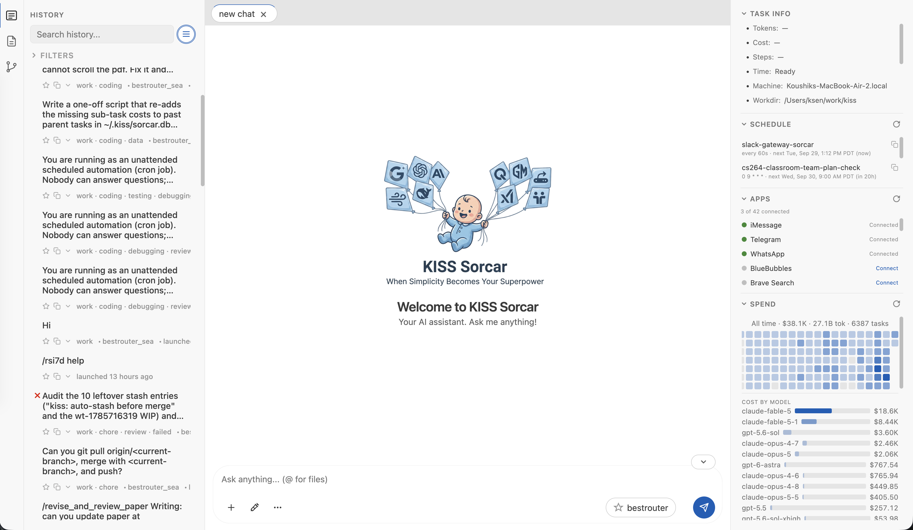
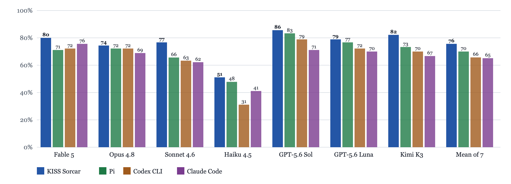

<div align="center">

<picture>
  <source media="(prefers-color-scheme: dark)" srcset="https://raw.githubusercontent.com/ksenxx/kiss_ai/main/assets/KISS-Sorcar-Logo-Dark.png">
  <source media="(prefers-color-scheme: light)" srcset="https://raw.githubusercontent.com/ksenxx/kiss_ai/main/assets/KISS-Sorcar-Logo.png">
  
</picture>

[](https://pypi.org/project/kiss-agent-framework/)
[](LICENSE)
[](https://www.python.org/)
[](https://kisssorcar.github.io/)
[](https://arxiv.org/abs/2604.23822)

*"Everything should be made as simple as possible, but not simpler." — Albert Einstein*

</div>

# KISS Sorcar

### Open-source general-purpose AI agent for long-horizon tasks and AI discovery

**KISS Sorcar is a free, simple, local-first, bring-your-own-key AI agent framework.** It runs as a browser/mobile web app served by a local daemon, and offers a Python client API for scripting tasks. Your prompts and code go directly to the model provider or local endpoint you configure, never through our servers. Multi-model workflows take a paragraph of prompt, not a pipeline: complex AI systems and techniques can be replaced with a paragraph of prompt in KISS Sorcar.

```bash
curl -fsSL https://raw.githubusercontent.com/ksenxx/kiss_ai/main/scripts/install.sh | bash
```

This README is the quick start. The detailed references are:

- [FEATURES.md](FEATURES.md): the complete feature inventory, checked against the source tree.
- [src/kiss/server/README.md](src/kiss/server/README.md): every `sorcar.run()` option, tools, hooks, and the Sorcar Extension Agent authoring guide.
- [src/kiss/agents/third_party_agents/README.md](src/kiss/agents/third_party_agents/README.md): the messaging and service agents, sign-in, and worked examples.
- [MODELS.md](MODELS.md): the full per-provider model list.
- [kisssorcar.github.io/docs](https://kisssorcar.github.io/docs/): installation, CLI, API, and messaging guides.

______________________________________________________________________

<details>
<summary><strong>Table of Contents</strong></summary>

- [Terminal-Bench 2.0](#terminal-bench-20-kiss-sorcar-vs-pi-codex-cli-and-claude-code)
- [What is in the Name](#what-is-in-the-name)
- [Installation](#installation)
- [Using KISS Sorcar](#using-kiss-sorcar)
  - [Web and mobile app](#web-and-mobile-app)
  - [The `kiss-web` daemon](#the-kiss-web-daemon)
  - [Python client API](#python-client-api)
  - [Sorcar Extension Agents (SEAs)](#sorcar-extension-agents-seas)
  - [Skills, MCP servers, and customization](#skills-mcp-servers-and-customization)
- [Messaging & Third-Party Agents](#messaging--third-party-agents)
- [Models Supported](#models-supported)
- [Contributing](#contributing)
- [License](#license)
- [Citation](#citation)

</details>

<div align="center">
  
</div>

## Terminal-Bench 2.0: KISS Sorcar vs Pi, Codex CLI, and Claude Code

The [HarnessTax](https://harnesstax.github.io/) study (Pan, Yang, Arabzadeh, Chiang, Stoica, Zaharia; UC Berkeley and Arena Intelligence) holds the model fixed, swaps the harness between Claude Code, Codex CLI, and Pi, and finds that the harness moves cost far more than it moves what gets solved. We added KISS Sorcar to their Terminal-Bench 2.0 table: the same 30 sampled tasks, the same seven models, three attempts per task, graded by the official Terminal-Bench 2.0 verifier, with the system prompt cut to 727 words of coding rules (`papers/kisssorcar/evidence/tb2_prompt.txt`). Averaged over the seven models, **KISS Sorcar solved 75.6% of attempts; Pi 70.0%, Codex CLI 65.7%, Claude Code 65.1%**, with the best point estimate on every model.

| Model | KISS Sorcar solved | $/att. | Pi solved | $/att. | Codex CLI solved | $/att. | Claude Code solved | $/att. |
|---|---:|---:|---:|---:|---:|---:|---:|---:|
| Claude Fable 5 | **80.0** | 1.50 | 71.1 | 1.08 | 72.2 | 0.98 | 75.6 | 1.55 |
| Claude Opus 4.8 | **74.4** | 1.21 | 72.2 | 0.76 | 72.2 | 0.85 | 68.9 | 0.90 |
| Claude Sonnet 4.6 | **76.7** | 2.23 | 65.6 | 0.61 | 63.3 | 0.55 | 62.2 | 0.67 |
| Claude Haiku 4.5 | **51.1** | 0.39 | 47.8 | 0.25 | 31.1 | 0.21 | 41.1 | 0.26 |
| GPT-5.6 Sol | **85.6** | 0.69 | 83.3 | 0.42 | 78.9 | 0.76 | 71.1 | 1.35 |
| GPT-5.6 Luna | **78.9** | 0.05 | 76.7 | 0.04 | 72.2 | 0.06 | 70.0 | 0.10 |
| Kimi K3 | **82.2** | 1.14 | 73.3 | 0.38 | 70.0 | 0.45 | 66.7 | 0.52 |
| **Mean of 7 models** | **75.6** | 1.03 | 70.0 | 0.51 | 65.7 | 0.55 | 65.1 | 0.77 |

*Terminal-Bench 2.0, the study's 30-task sample, three attempts per task: percentage of attempts solved and cost per attempt in USD. KISS Sorcar: 630 attempts run on 25 September 2026, no turn cap, $50 budget per attempt, providers' default request parameters. The other three columns are the study's published numbers (100-turn cap, high reasoning effort, priced on a 1 September list). Bold marks the best point estimate per row.*

<div align="center">
  
</div>

Thirty tasks is a small sample (the pooled 95% interval, 63.8 to 85.9, contains all three published means), so we reran Pi ourselves, paired, on Claude Fable 5 with no turn cap and the same price table. On the study's 30 tasks KISS Sorcar solved 80.0% of attempts to Pi's 68.9%, a gap of **+11.1 points (95% interval +3.3 to +20.0)** for five cents more per attempt; on the 57 tasks the study did not sample, 82.5% to 71.9%, a gap of **+10.5 points (+2.9 to +18.7)** for 63 cents more. Only Pi was rerun, on one model, and the benchmark exercises the loop, six tools, and the coding rules with the discovery procedures, memory, reviewer, and IDE features switched off. Full write-up: [The Harness Tax, Audited](https://kisssorcar.github.io/blog/harness-tax-terminal-bench-blog.html); method and intervals: [the paper](https://kisssorcar.github.io/assets/kiss_sorcar.pdf), Section 5; per-attempt records: `papers/kisssorcar/evidence/tb2_trials.json`; the runners live in the separate `benchmarkings` package (a sibling checkout, or `KISS_BENCHMARKINGS_DIR`), which the paper scripts under `papers/kisssorcar/` locate.

## What is in the Name

**KISS Agent Framework** is a deliberately small agent runtime organized around the [KISS principle](https://en.wikipedia.org/wiki/KISS_principle) ("Keep it Simple, Stupid").
The name "Sorcar" pays homage to [P. C. Sorcar](https://en.wikipedia.org/wiki/P._C._Sorcar), the legendary Bengali magician, evoking the idea of an agent that performs feats that appear magical yet are grounded in disciplined engineering.
Note: **Sorcar** also means government in Bengali.

## Installation

### Install

```bash
curl -fsSL https://raw.githubusercontent.com/ksenxx/kiss_ai/main/scripts/install.sh | bash
```

The one-liner clones or updates `~/.kiss/kiss_ai` and runs its `install.sh` from the directory you ran the command in, so the daemon serves that directory (unless that directory is inside `~/.kiss` or the brand's home, as when the daemon updates itself from its own clone: then it serves your home directory). From a checkout, the same thing is:

```bash
git clone https://github.com/ksenxx/kiss_ai.git && cd kiss_ai && ./install.sh
```

The installer targets macOS and Linux on `x86_64`, `aarch64`, and `arm64`. `install.sh` copies the runtime into `~/.kiss/kiss`: the Python environment (uv), the library byte-compiled to `.pyc` files, the files a runtime reads as Python scripts (the bundled SEAs under `src/kiss/agents/seas/`, the channel and cron SEAs, `_version.py`, and the modules the database and memory syncs ship to a remote machine as source: `scripts/sync_db.py` with `chat_summary.py`, `history_columns.py` and `scripts/carry_over_tables.py`, and `scripts/merge_memory_pages.py`) kept as source, and the web app frontend (`src/kiss/webapp/media/`). It then installs the `sorcar` CLI (with the `rsorcar` and `sorcar-docker` launchers; `rsorcar user@host` deploys this checkout to a remote Linux machine and merges the two machines' task databases both ways, which need not be on the same release: a history column one side lacks is added with the other's declaration, a column only the target has keeps its default for incoming rows, and the `is_cron` flag is worked out for rows from before it existed. A deploy changes only the remote machine, and a task running on either side does not stop it: the ordinary delta syncs run beside both live web apps and hold back a task still in flight until it has finished, so a later sync brings it over complete; a deleted task is recorded in `deleted_tasks`, and a deleted chat records its tasks there and its own id in `deleted_chats`, so the sync removes them on the other machine instead of bringing them back (a task still running there is left alone). A task counts as running while its newest event is within `SORCAR_LIVE_TASK_WINDOW` seconds (default 300; `0` turns the check off), and while one runs on the remote the final `kiss-web` restart is skipped, so the remote keeps serving the previous release until the next deploy or `systemctl --user restart kiss-web`; the full-copy fallback (a first deploy, or a merge that fails) stops the remote web app for the swap, so it refuses while a task runs there and leaves both databases as they were. `SORCAR_FORCE_RESTART=1` restarts and swaps anyway, killing the task; a remote `history.db` that exists but cannot be read answers `unknown` rather than "no task", which skips the restart with a warning and refuses the full copy too, since a database the probe could not look into may hold a running task, while a missing file or one that is not an SQLite file counts as holding none. The deploy also syncs the agent's memory pages and the autorouter's notes both ways: `~/.kiss/AUTOROUTER.md` and `~/.kiss/MODEL_DECISIONS.md` are merged by `src/kiss/scripts/sync_kiss_notes.py` under the lock the agents take to append a row, so a row written during the sync is never lost, the evidence with the later refreshed date winning and the ledger becoming the union of both machines' rows in time order; a failure of either sync is a warning, not a failed deploy) in `~/.local/bin`, Playwright's Chromium and cloudflared, refreshes `~/.kiss/MODEL_INFO.json`, registers the `kiss-web` daemon as your user service (launchd on macOS, a systemd user unit on Linux) serving the directory it was run from, sets a random remote-access password on the first install (printed in a box of `*` at the end of every run, after the app has opened, and stored in `~/.kiss/config.json`; when the run's terminal has gone away by then, as it does when `install.sh` runs from the web app's own Terminal tab and restarts the daemon hosting it, the install carries on with its output in the log, which says the password is in Settings rather than printing it), and opens the web app at `http://127.0.0.1:8787` as a standalone app: its own window with no address bar or tabs (Chromium's app mode, run by `kiss-app` from the app's venv in Google Chrome, Chromium, Edge or Brave if installed, else in Playwright's Chromium, or in the browser `KISS_APP_BROWSER` names, a path or a command name that is then the only candidate, under its own profile in `~/.kiss/webapp-profile`), plus a launcher in your applications menu (`~/.local/share/applications/kiss-sorcar.desktop` on Linux, `~/Applications/KISS Sorcar.app` on macOS) named and iconed after the brand; the running window carries that icon in the dock or taskbar as well (the Linux entry names the window's X11 class and Wayland app id; the macOS bundle is a clone of the browser's, its binary and frameworks copied rather than symlinked, since Chromium's sandboxed helper processes read only their own bundle's real path, re-signed under the brand's identity and refreshed whenever the browser updates, except that a stale clone a window may still be running from is left for the next launch, and launches that overlap take turns under a lock file beside the bundle, `.<product>.app.lock`, so neither deletes the clone the other just built; clicking that icon while the app is open brings its window to the front rather than opening a browser window; `kiss-app` waits up to `--wait` seconds (default 120) for the daemon's URL file (`~/.kiss/remote-url.json`, written as the daemon starts) but not for the daemon itself: when the daemon is not answering yet, as after a reboot on macOS, where the app is relaunched at login about a minute before the daemon's LaunchAgent, the window opens at once on a packaged waiting page (`src/kiss/webapp/media/appStart.html`, a `file://` page showing the app's name) that asks the daemon every half second and replaces itself with the app at the first answer, rather than staying closed or opening onto Chromium's error page (on macOS the waiting page first moves into the app's named popup window, which then restores its saved bounds and navigates to the app in place), and on macOS the daemon's watchdog quits a browser it finds running under the app's profile with no window for several sweeps in a row, which is what the app leaves behind when its window was closed while the daemon was down, so the next click starts the app afresh rather than opening an empty browser window; on Linux the bundled Chromium runs without its sandbox, since it has no setuid helper for hosts that restrict unprivileged user namespaces; a web link in the chat opens in your default browser rather than inside the app window, which has no address bar to get back from; `kiss-app` asks the daemon directly, ignoring any `http_proxy` in your environment, which could not reach this machine's loopback anyway; and `kiss-app --print-command` prints the browser command it would run, quoted for your platform's shell, without waiting for the daemon). Once the window is up the installer opens the folder holding that launcher in the file manager so you can see where the app is and pin it. Without such a browser it falls back to the default browser; on a remote machine it prints the cloudflared URL to open on your own device instead. A browser on the machine itself needs no password (a page of some other website open in that browser, which the browser lets open a WebSocket to 127.0.0.1 too, is told from the web app by its `Origin` and refused without the password, and the `/api/jobs` routes refuse it by its `Host` and `Origin` the same way); from any other device type that password into the web app (the daemon checks it on every command such a browser sends). The Settings panel shows it in a plain text box you can edit: the new password is in force as soon as it is saved, with no restart (other devices then sign in again with it), and an empty box turns remote access off. Re-running `install.sh` updates the app in place, keeps the password (so the one your devices know stays valid), and restarts the daemon only when no task is running (otherwise the daemon restarts itself once its tasks are done, see below); from a shell, `~/.kiss/kiss/.venv/bin/python -m kiss.core.remote_password --rotate` draws a new random one. On a machine that also has a white-label brand home (a `~/.<brand>` directory with post-install hooks, or the one the running service was started from), the installer repeats itself into that home as well, each home keeping its own app copy (named after the home: `~/.s10s/s10s`), model catalog and password, and starts the brand's daemon rather than the stock one. Whatever fails during a run (a hook, a brand home's install, a daemon that does not come up) is recorded in `.install-problems` under the home of the daemon the run starts (a nested brand home's failures are folded in, prefixed with that home) and shown as a notification in the web app for up to a week, or until a run succeeds. `./install.sh --non-interactive` takes the default answer to every question, `./install.sh --restart-only` installs nothing and only restarts the daemon from the app in `KISS_HOME`, `KISS_SKIP_LAUNCH=1` skips starting the daemon and opening the app, `KISS_HOME` overrides the state directory, and the log is in `~/.kiss/install.log`.

When a new release is available, the update toast in the web app offers **Update** and **Update when idle**; the daemon installs an idle update as soon as no task is running. The Settings panel's header names the installed version and, in parentheses, the short git commit it was installed from: `install.sh` writes the checkout's `git rev-parse --short HEAD` to `src/kiss/core/_commit.txt` in the installed copy, a daemon run straight from a checkout asks git itself, and an install from a tarball shows the version alone. `install.sh` never restarts a daemon that reports tasks in flight: it defers the restart, records it in `.kiss-web.restart-pending` in the daemon's home (the path the busy daemon names as `restartPendingFile` in its active-tasks answer and `scripts/check-kiss-web-active-tasks.py` prints; a JSON record of the installer, the state directory and the work dir to serve), and the daemon finishes it by itself: it looks for the record every 5 s and, once no task is in flight and no installer it launched is still running, raises the run-admission barrier so no new task starts meanwhile and runs the recorded `install.sh --restart-only` (which waits for an install that still holds the update lock, then restarts the daemon onto the app already installed and, apart from retiring a legacy app directory the new one has replaced, does nothing else, keeping the deferred run's `.install-problems` for the restarted daemon to report). The record is taken away as it is claimed, so a broken one is not retried, every restart by `install.sh` that brings the daemon up removes it, and a `--restart-only` run that still finds tasks in flight writes no new one, so the daemon cannot retry in a loop. So a Sorcar task can run `./install.sh`, and the daemon it runs under moves to the new build once the task is done. A daemon from before this behavior cannot finish the restart, and the installer then says to re-run it once the tasks finish. From a checkout, `scripts/reinstall-kiss-web-when-idle.sh` re-runs the whole `./install.sh` once no daemon of yours has a task in flight (it asks the daemon of every home that publishes an endpoint file, `~/.kiss`, a brand's `~/.<brand>` and `$KISS_HOME`, and hands `KISS_HOME` on to the job; the active-tasks probe it uses, `scripts/check-kiss-web-active-tasks.py`, likewise defaults to the state directory of the app its interpreter belongs to, a brand's own included): it starts a detached one-shot job (a launchd plist with `KeepAlive` off on macOS; on Linux a transient `systemd-run --collect` unit, or a `setsid` session where `systemd-run` is missing) and returns at once. If the update fails, run the installation command again. It will not delete your history. A web app page that was open through the install or update reloads itself once the restarted daemon is up: on every reconnect the page asks `GET /api/daemon` for the daemon's per-process token and reloads when the token differs from the one it saw at its first sign-in (after the commands it queued during the outage have been confirmed, so none is lost; a probe that cannot reach the daemon, gets a server error or has no answer after 12 s is aborted and retried with a growing delay, 5 s up to 60 s, while the connection lasts), while a network blip, which reconnects to the same daemon process, keeps the page as it is. The refresh button at the right end of the Chats row reloads the page by hand, which is the browser's reload made reachable from the app window and a phone's home-screen app, neither of which has an address bar. After an install or update the chat panel shows the tips from `src/kiss/TIPS.md` once per version. An update on a machine that still has the retired VS Code extension tries to uninstall it (through the `code`, `code-insiders`, `cursor` and `code-server` CLIs, or the one `KISS_CODE_CLI` names; if a copy remains, the terminal tells you to remove it from the Extensions view) and, for a week, the web app shows a "VS Code extension removed" notice pointing to the app; its **Do not show this again** checkbox silences it for good. All state (history database, settings, memories, TLS material) lives in `~/.kiss`; `KISS_HOME` overrides the directory, and a white-label brand names its own through `home_dir` in `brand.json`. Executable scripts in `~/.kiss/post-install.d/` run in name order at the end of every install; a hook that is an `exec <script>` stub naming a script inside a git checkout with an upstream (as a brand's installer writes it) has that checkout fetched and rebased onto the upstream first (local edits stashed around the rebase; if the rebase cannot complete, the checkout is reset to the upstream, with the local commits kept on a `brand-update-backup-<time>` branch and the edits in a stash entry, both named in the warning), and a failing hook is reported and the install still completes. A brand that wants you signed in to a service of its own ships an executable `signin` hook in its home: while the hook reports you signed out, the web app shows a sign-in window with one button per provider the hook lists (Google and Apple, say), and a pasted redirect URL or code completes a sign-in started from another device; a missing or broken hook shows nothing, so a brand's sign-in can never lock you out of your own daemon, and a helper the hook leaves running with its stdout (a browser opener, say) cannot hold up the result, since the daemon reads what the hook printed as soon as the hook itself has exited. Branding (`src/kiss/webapp/media/brand.json` and a git-ignored `.brand/` overlay for white-label builds) and the installer's steps are described in [FEATURES.md](FEATURES.md#20-installation-deployment-docker-and-release).

### Docker

```bash
./sorcar-docker [PORT] [--rebuild]
```

This builds a plain Debian image (`Dockerfile`) and starts a container whose entrypoint (`scripts/docker-startup.sh`) clones the repository (the private `kiss.git` when `GH_TOKEN` is set, else the public `kiss_ai.git`), runs `install.sh`, sets the web app password (`KISS_WEB_PASSWORD`, or a generated one printed in `docker logs`) and serves the web app on port 8787 (host port `PORT`, 8787 by default); the API keys in your environment are forwarded. State persists in the `kiss-sorcar-web-home` volume. Open `https://localhost:PORT`; the certificate is self-signed, so accept it once or install `/ca.crt`. Inside a container the Settings panel hides the LAN and tunnel URL bars, since the container's daemon is reached only through the published port.

### Python package install

If you only want the Python package (the `kiss-web` daemon, the Python client API, and the messaging-agent entry points):

```bash
pipx install kiss-agent-framework
# or
uv tool install kiss-agent-framework
```

KISS Sorcar requires **Python 3.13+**.

### Configure model access

Provide at least one model backend. You can use environment variables such as:

```bash
export ANTHROPIC_API_KEY=...
export OPENAI_API_KEY=...
export ZAI_API_KEY=...
export MOONSHOT_API_KEY=...
export TOGETHER_API_KEY=...
export OPENROUTER_API_KEY=...
export GEMINI_API_KEY=...
```

The default and fast models follow the first provider with a credential, in the order Anthropic (`claude-opus-5-5` / `claude-sonnet-5-5`) → OpenAI (`gpt-6.1-sol-medium` / `gpt-6-luna`) → Gemini (`gemini-3.8-flash` / `gemini-3.5-flash-lite`) → OpenRouter (`openrouter/anthropic/claude-opus-5.5` / `openrouter/anthropic/claude-sonnet-5.5`) → Together (`moonshotai/Kimi-K3` / `deepseek-ai/DeepSeek-V4.1-Flash`) → Z.AI (`glm-4.7` / `glm-4.5-air`) → Moonshot (`kimi-k3` / `kimi-k2.5`) → Bedrock (the cheapest registered `bedrock/` id of that Anthropic model, else the dearest or cheapest registered `bedrock/` model by output price; see below) → Claude Code CLI (`cc/opus` / `cc/haiku`) → Codex CLI (`codex/default`), so an install whose only key is for one provider never starts with "No model".

Claude models can also run through Amazon Bedrock: the catalog lists the Claude ids Bedrock serves as `bedrock/<Bedrock model or inference-profile id>` (for example `bedrock/global.anthropic.claude-opus-5-5` or `bedrock/us.anthropic.claude-opus-4-6-v1`, with the usual `-high`/`-max` effort suffixes), and any other id the region serves can be used by name. Set either a Bedrock API key or an AWS access key pair, plus the region:

```bash
export AWS_BEARER_TOKEN_BEDROCK=...   # Bedrock API key (bearer token), or:
export AWS_ACCESS_KEY_ID=...
export AWS_SECRET_ACCESS_KEY=...
export AWS_SESSION_TOKEN=...          # temporary credentials only
export AWS_REGION=us-east-1           # default when unset
```

Without either, the request is signed with whatever boto3's default credential chain finds on the machine, and the picker lists the Bedrock models as soon as such a source is configured: a web-identity token file (EKS with IRSA), ECS container credentials, or a profile in the shared `~/.aws` files (`AWS_PROFILE` or `default`; static keys, or an assume-role, SSO or `credential_process` profile judged by its configuration alone), all read from the files and environment without a network call; only EC2 instance-metadata credentials go undetected, since probing them is a network round-trip.

Bedrock models are priced as their `claude-*` catalog entry, which holds the `global.` profile rate; an id of a Claude 4.5-or-later model under any other cross-region prefix (`us.`, `eu.`, `apac.`, `jp.`, `au.`, `ca.`, `us-gov.`, ...) or the in-region `anthropic.` form is billed 10% above it, as on AWS's price list. An inference-profile ARN (`bedrock/arn:aws:bedrock:us-east-1:123456789012:inference-profile/us.anthropic.claude-opus-4-6-v1`) is sent to Bedrock as it is and priced as the profile its last path segment names; a Claude model the direct catalog no longer lists is priced by its OpenRouter twin (Opus 4.1), and one the catalog holds only as a `bedrock/` entry (Sonnet 4, Claude 3 Haiku) by that entry's base rate with the premium of the profile actually used applied once. The bundled `bedrock/*` entries are the ids the model updater (`uv run python -m kiss.scripts.update_models`, or the **Update Models** button in Settings) found in its own AWS region: Bedrock lists the cross-region inference profiles and on-demand model ids per region, so running the updater on a machine in another region relists what that region serves, and each entry copies its `claude-*` twin's context length, capabilities and effort suffixes with the prices scaled as above. With Bedrock as the only configured provider, the default and fast models are the `global.` profiles of the Anthropic default and fast models. An id the catalog does not list can still be typed as a model name or added under **Settings → Custom Models** (name only, no endpoint), which puts it in the model picker from the next daemon start.

You can also set API keys, a custom model endpoint, and custom HTTP headers in the Settings panel of the web app. A key saved there lives in `~/.kiss/api_keys.env` (one `export KEY=value` line per credential, mode 0600), which the daemon loads at startup and your bash or zsh RC sources through a hook line the save appends once; the `export KEY=…` (fish: `set -gx KEY …`) that an earlier release or you wrote into the RC is removed on save and on delete so a stale line cannot shadow the store, and only that assignment goes when it shares its line with other commands (`export OPENAI_API_KEY=old; export ANTHROPIC_API_KEY=keep` keeps the second; the line is read as the shell reads it, quotes, `$(…)` and redirections included, a command emptied beside `&&`, `||`, `|` or `&` or after `if`/`then` becomes the `true` no-op so the line stays valid, and an export inside `$(…)` or `(…)`, which never reaches the sourcing shell, is left alone; a key assigned inside a command that spans lines (a here-document, a quote left open at the line's end), or set on one line in a form the edit does not remove (`typeset -x KEY=…`, `read KEY`, `printf -v KEY`, an `eval` that names it), is not edited at all: the save is refused with `Could not save the settings: <rc>: line N may set KEY where it cannot be edited safely; remove it there by hand`, and nothing is written). A key the store lacks is imported from the shell RC files at daemon start (a key already in the store is never touched), your login shell's RC read first so a key left behind in another shell's RC never beats the current one, not even when the current one is a value the text cannot import; every command of a line is read, and a key whose last assignment the shell may not run (a branch of `&&`/`||`, a pipeline member, a background command) or whose value only the shell can resolve is taken by sourcing the RC (once per store) rather than from its text. The same store holds `ANTHROPIC_WORKSPACE_ID`, which an identity-linked Anthropic key must send with every request (the API Keys section has a box for it; the environment variable works too). The **Custom Models** section of the Settings panel registers your own models (a local vLLM/Ollama endpoint, or a provider model not in the bundled catalog); entries are stored in `~/.kiss/MY_MODELS.json` and appear in the model picker alongside the bundled catalog; an entry named after a catalog model (exactly, under a provider prefix such as `openai/<model>`, as a `bedrock/<id>` profile, or as an `-xhigh` alias the catalog does not list, which carries no `thinking` level) starts from that model's context length, `thinking` level, capability flags, Responses-API transport flag, fallback, thinking overrides and prices, its `prompt_tiers` included, so it is billed at the catalog rate, keeps its transport and capabilities, and keeps asking for the catalog's reasoning effort after a restart; when the daemon (or the registered machine shown) refuses an Add or Save, the page brings the submitted draft back (a refused Add puts its name back into a still-empty name box, a refused Save reopens that model's edit with the submitted values) unless Settings has moved to another machine; while another edit is open or you have typed into the boxes since, the draft waits and is placed when that edit's Save or Cancel, or the next Add, frees the boxes; drafts are placed oldest first, and of several refused together only the first is sure to land, since a later refused Add finds the name box already filled by the earlier one and is dropped, and a later refused Save reopens its own edit over the earlier draft. A hand-edited entry whose context length or price is missing, or is not a finite, non-negative number (a negative price, `NaN`, `1e309`, a quoted number), is skipped with a warning when the catalog loads rather than billing a negative or `NaN` cost. An entry with its own endpoint runs against that endpoint whether a task starts on it or `set_model` switches to it mid-run (the endpoint, key and headers are the entry's own, so a different model never inherits them), its `thinking` level comes from the loaded catalog when the name is already there and from the file as it is now otherwise (so an entry added while the daemon runs gets its default effort before a restart, and a switch away drops a `reasoning_effort` equal to that default while one that differs from it is kept), and an entry whose own name ends in `-xhigh` (a router that reads the effort off the name) is sent to its endpoint under that full name, while an entry named after a generated effort alias such as `gpt-5.6-sol-xhigh` stays an alias of its base, and an entry that overrides a base model carries its context length, capability flags, Responses-API flag and prices over to that base's bundled `-low`/…/`-xhigh` aliases (unless the file names the alias itself), so picking an alias budgets compaction on and bills at the overridden values. An entry with its own endpoint whose name no vendor routes (`my-router/qwen`, say) is sent over the Responses API when its own `use_responses_api` flag says so; a vendor-routed name pointed at a foreign endpoint stays on Chat Completions, since that endpoint's Responses support is unverified. The **Bedrock** section after it holds the Bedrock API key, AWS access key pair, session token and region. The **Claude Code** section after that is for the `cc/*` models, which run the `claude` CLI: it shows whether that CLI is logged in and how it will bill (`claude auth status`), holds the switch **Bill my Claude subscription for cc/ models** (on by default: the CLI is run without `ANTHROPIC_API_KEY` / `ANTHROPIC_AUTH_TOKEN`, so a `claude login` on a Pro or Max plan pays for the turn instead of API tokens; off, the CLI inherits the daemon's environment and an API key bills per token) and an optional subscription token from `claude setup-token` (`CLAUDE_CODE_OAUTH_TOKEN`) for a machine where nobody ran `claude login`. The **Codex** section after that does the same for the `codex/*` models, which run the `codex` CLI: it shows whether that CLI is logged in and how it will bill (`codex login status`), holds the switch **Bill my ChatGPT subscription for codex/ models** (on by default: the CLI is run without `OPENAI_API_KEY` / `CODEX_API_KEY`, so it bills the ChatGPT plan it is logged in to, and a turn is refused when the CLI's saved login is an API key from `codex login --with-api-key`, which would bill per token anyway; off, `OPENAI_API_KEY` bills per token), a **Sign in with ChatGPT** button that starts `codex login --device-auth` on the daemon's machine and shows the link and one-time code to enter in any browser (the way to log a headless machine in to a Plus/Pro plan), and a box for a Codex access token (`CODEX_ACCESS_TOKEN`, ChatGPT Business/Enterprise) for a machine where nobody ran `codex login`. Both CLIs are driven as plain models: their own tools, MCP servers, hooks and project instructions are switched off and they work with Sorcar's system prompt and tools, like every other model (Codex is handed Sorcar's tools, every one but `finish` and `set_model`, as a `kiss` MCP server, so one `codex/*` step can make several tool calls, each executed by Sorcar; the bridge listens on a loopback port any local user could reach, so every request must carry a per-launch secret that Codex forwards to the bridge's proxy through its environment (`KISS_MCP_BRIDGE_TOKEN`, never on a command line), an unauthenticated request is refused, a tool name the bridge does not list is answered with an error, and a connection that has not delivered its one-line request within 5 s, or has 64 MiB of it buffered without a newline before the next read (the cap is checked before each 64 KiB read, so a line that completes inside the chunk crossing it still goes through), is closed rather than waited on; `finish` and `set_model` are called through the text-based tool protocol, the first because it ends the step, the second because it must not replace the model under a running turn). A `cc/*` model gets every tool through that text-based protocol (the `claude` CLI runs with its own tools off), and a Claude model that falls back to its native `<invoke name="…">` syntax despite the JSON instructions is understood all the same: the first `<invoke>` block that opens a line is the call, the text after it (the model imagining the result) is dropped from the stream, and each argument the tool does not declare as a string is decoded from its JSON text, while a string parameter keeps its text as typed; only the first block counts, because the CLI then writes invoke after invoke with no results between them. A `cc/*` turn that ends on a tool call is read on past the call for the message's final usage (the CLI sends it after the call's text) and cut at the first new content, so the call's real output tokens are billed rather than a placeholder. Both CLIs stream their thinking into the Thinking panel: `claude` is run with `--thinking-display summarized` (its `--print` mode otherwise asks the API to omit the text) and, when the model has an effort level, with `--effort <level>`: `model_config`'s `reasoning_effort` if set, else its native `output_config.effort`, else the catalog entry's `thinking` level (the same order the direct Anthropic adapter resolves `output_config.effort` in), so a `cc/claude-opus-5-5-xhigh` alias runs `--model claude-opus-5-5 --effort xhigh` (the `-xhigh` suffix is stripped from `--model`), a base `cc/claude-opus-5-5` runs at the level the catalog lists for it, and the CLI's own short names `cc/opus`, `cc/sonnet` and `cc/haiku` carry no level and send no flag, keeping the CLI's default; a turn that sends the flag runs without `CLAUDE_CODE_EFFORT_LEVEL` in the CLI's environment, which would otherwise outrank it. `codex` runs with `model_reasoning_summary="detailed"` (its `--ignore-user-config` drops the user's setting, and without one the CLI emits no reasoning items), and a Codex summary line that is nothing but a bold Markdown title is shown as plain text. The API Keys, Custom Models, Bedrock, Claude Code and Codex sections start collapsed every time Settings opens. Settings opens for the machine the chat header's machine drop-down names: for a registered machine the form shows and saves that machine's keys, settings and custom models (the daemon forwards the commands over the registered link), and hides what only concerns this daemon (its URLs and the Update, Reset Server and Update Models buttons); the form's text fields and custom-model list are blanked while it switches machines, so one machine's password and keys never show under another's name. A save that cannot write `config.json` (a full disk, the file locked by another process) answers "Could not save the settings: ..." and sends the stored settings back instead of applying the change; an API key is stored only under a name that is a valid environment-variable name and with a value free of line breaks and NULs, any other entry is dropped with a warning in the log.

The picker also lists six bundled router agents under the `Router` group: **`autorouter`** runs its routing session on `claude-opus-5-5-medium` (pre-run classification off, web tools and memory on), splits a task into units that have a mechanical acceptance check and dispatches those to the cheapest model tier that passes the check (the tiers are ordered candidate lists in which each direct model is followed by its `openrouter/...` twin: small opens with `zai-org/GLM-5.3-Flash`, `openrouter/z-ai/glm-5.3-flash`, `gpt-6-luna-xhigh`, medium with `openrouter/meta/muse-wonder`, `gemini-4-argon`, `openrouter/google/gemini-4-argon`, frontier with `gpt-6-astra`, `openrouter/openai/gpt-6-astra`, `claude-fable-5-2-max`, its twin, `claude-opus-5-5-max`; the first candidate the installation can run wins), escalating on failure, keeps guarded and uncheckable work and the final acceptance of the whole on the frontier tier, and switches its own model only at phase boundaries; **`bestrouter`** starts every task on `claude-opus-5-5-medium`, which answers simple questions and queries itself, switches to `claude-fable-5-2-max` for everything else, software development, analysis and writing included (a task that mostly dispatches sub-agents may dispatch, wait and log on the first model, but its judgement steps, the triage of a failed test run, acting on a sub-agent's failure, the final summary, run on the second), and has `gpt-6-astra-xhigh` review the result read-only through a non-blocking `run_agent` on at most 75% of the budget; **`orautorouter`** and **`orbestrouter`** are the same two routers restricted to the OpenRouter vendor, so a single OpenRouter key runs them: `orautorouter` routes on `openrouter/anthropic/claude-opus-5.5-medium` and its tiers hold only `openrouter/...` models (the OpenRouter twins of the autorouter's candidates, in the same order) and `orbestrouter` starts on `openrouter/anthropic/claude-opus-5.5-medium`, works on `openrouter/anthropic/claude-fable-5.2-max` and has `openrouter/openai/gpt-6-astra-xhigh` reviewing; **`ccxbestrouter`** is the `bestrouter` on the Claude Code and Codex CLIs, so a Claude subscription and a ChatGPT subscription run it without API tokens: it starts on `cc/claude-opus-5-5-medium`, works on `cc/claude-fable-5-2-max` and has `codex/gpt-6-astra-xhigh` reviewing (`codex/gpt-6-astra` at `xhigh` reasoning effort; the same protocol with the bestrouter's "(not codex)" warning dropped, since the reviewer is the Codex model on purpose); **`brbestrouter`** is the `bestrouter` on Amazon Bedrock's global cross-region inference profiles, so one set of AWS credentials runs it: it starts on `bedrock/global.anthropic.claude-opus-5-5-medium`, works on `bedrock/global.anthropic.claude-opus-5-5-max` and has `bedrock/global.anthropic.claude-fable-5-1-max` reviewing (the "(not codex)" warning dropped here too, since it means nothing to a Claude reviewer). They are Sorcar Extension Agents (see below), not models.

## Using KISS Sorcar

KISS Sorcar has two client interfaces, both served by one local daemon: the **web/mobile app** and the **Python client API**. A third interface, the **`sorcar` terminal command**, runs a SorcarAgent directly in the current directory without the daemon: `sorcar -t "Summarize README.md"` runs an inline task, `sorcar -f task.txt` runs the file's content as the task (exactly one of `-t`/`-f` is required; see `sorcar --help` for the model, budget, and work-dir flags).

### Web and mobile app

Open the web app in a browser and type or speak your task. The chat interface provides:

- `@` file/folder mentions with ranked completion from a persistent index of your working directory and home directory. The index skips dot-directories, `node_modules`, `__pycache__`, `venv`, `site-packages` and the non-glob entries of every `.gitignore` met on the way down (nested repositories included): a bare name is skipped at any depth below that `.gitignore`, a name with a trailing `/` only when it is a directory, and an entry with a slash elsewhere only at that place relative to its `.gitignore` (again directories only with a trailing `/`); negations and entries with `*` or `?` are not read. The home index leaves out the operating system's application-state tree (`~/Library` on macOS, the hidden `AppData` on Windows; a working directory inside it is indexed as a root of its own), and a folder the operating system refuses to let the daemon read (macOS privacy protection, say) is listed as a bare folder entry and skipped for the rest of the daemon's life rather than stalling every scan, so the picker opens even when the home scan is blocked (a folder whose `.gitignore` read has not returned within 5 seconds counts as refused the same way, since a protected folder's `open` never returns while the permission prompt is pending); after a daemon restart the first `@` answers at once from the listings saved by the previous run while a fresh scan runs behind it. In a chat bound to a registered machine the picker lists that machine's files: the daemon sends the request to the machine with the chat's working directory there, keeps asking for up to a minute while the machine is still indexing the folder, and answers in the background, in order per tab and machine, so a slow scan holds up neither a message you send meanwhile nor another tab's list; a mention picked there is counted on that machine, so its ranking learns it.
- **Git worktree isolation** that the agent manages itself, with no setting to toggle: inside a git checkout, the agent calls its `create_worktree` tool before its first change to a tracked file, which moves the task onto a private `kiss/wt-*` branch checked out under `<repo>/.kiss-worktrees/` (an edit to a tracked file of the checkout outside a worktree is refused), and `commit_and_merge` once the work is verified, which commits the branch with a generated message and squash-merges it into the branch the task started from (the bundled `/merge` agent resolves conflicts). A worktree a task leaves unmerged is offered to you with a Merge / Discard bar when anything in it differs from the branch it started from (files its branch's commits changed, edits on disk, edits only staged in its index, or untracked files); a verified clean one is discarded on its own. In a git checkout a top-level task also has **`checkpoint(name)`** and **`rollback(name)`**: the first snapshots every tracked file (one an ignore pattern matches included) and every untracked file git does not ignore as a git tree object written through a private index, so HEAD, the branch, the real index and the stash are untouched and nothing is committed; the second rewrites the files changed or deleted since and removes the ones created since, leaves untracked ignored files (build output, `tmp/`) alone, and saves the state it replaces as `before-rollback` so it can be undone. Snapshots live for the task; a sub-agent gets neither tool, since it edits its caller's tree in place and a rollback would undo the caller's and its siblings' work too, and a run inside a Docker image has neither (the `coding` SEA's container-side `checkpoint`/`rollback`, which archive the container's work dir, are the pair's origin).
- A **coding gate** on `finish`, the finish discipline of the coding SEA applied to every run that has the edit tools. Once the run has changed a code file (or written the verifier `tmp/<task-id>/verify.sh` the system prompt asks for), a `finish(success=True)` runs that verifier and is refused while it fails (the agent's own run of it is reused instead when it passed, its exit status was the command's, it was the last command of its call and nothing changed since); a run whose `model_config` sets `coding_gate: false`, as `/sync` does, is never such a coding run, whatever it edits, and a run that is no coding run is not gated at all. Nothing in the `finish` call itself is refused: the gate reads every shell result's exit code (host or container, `bash_job` and `run_commands_parallel` included, from the digest a long parallel report is reduced to as well) and shows the reviewer each command named in finish's `evidence` argument with the exit code of its last run (`not run` for one that never ran), and the wording of the summary is the reviewer's to judge. A reviewer model reads the diff (files edited in another repository's worktree included) once per run, in a review whose first attempt is one call at the provider's default effort, with 240 s per attempt (an attempt that comes back empty, cut by the output cap, refused or past the deadline is retried once, at low reasoning effort when the model's catalog entry has a thinking level and unchanged otherwise; config key `coding_gate_reviewer`: a model name, used as given; empty picks the strongest configured model of another family than the run's, and no review runs when every configured model is of the run's own family; `off` for none; a read-only reviewer the agent dispatched itself after its last change counts instead once it finished successfully, and a sub-task on this machine that is no review is a change the diff is read for when the work differs after it, while one sent to another machine is neither a change nor a review here; a review that comes back without a verdict, or still errors or misses the deadline after that retry, refuses nothing, and after two such failures none is asked for again; each stage recorded as a `gate_stage` event with its duration and outcome), whose numbered findings must each be answered at the next finish by a change or quoted evidence (judged by the decisions model; without it the findings are unjudged and refuse nothing). A refusal lists every failed check at once; the first refusal buys one round whatever refused it, a later round is refused only while the verifier fails (three refused rounds at most), and otherwise the work is delivered with the open findings appended as caveats, so a reviewer's finding holds a run for one round and the gate never holds one forever. A `finish(success=False)` whose verifier passes is questioned once. When the agent first writes its interpretation ledger `tmp/<task-id>/ledger.md`, the reviewer model reads the task and the ledger once and the `Write`'s result ends with the sentences of the task it would read differently or finds unsettled, for the agent to settle in the ledger before its first edit (no refusal: an interactive run can ask the user). `commit_and_merge` of a run that changed code runs the verifier and the review first, while the worktree is still there to fix; the worktree's git-ignored files, the verifier and `tmp/PROGRESS.md` among them, are removed with it and not copied to the checkout, so the finish after the merge has no verifier to run and is gated on rounds of its own: a completed merge resets the round count and moves the findings its review left open from the gate's ledger to the merge's caveats, and the run's one review, when it ran at the merge, does not run again; a merge is refused under the same round rule, every refusal saying that a merge asked for again goes through unless the verifier fails, and the merge let through carries its open findings in its result and into the finish summary as caveats unless the summary answers them with quoted evidence, so no run ends with its work on a branch nobody merges. Sub-agents get the same gate without the reviewer: the caller's gate reviews the whole diff.
- A pre-run **task classifier** that marks a task involving neither software development nor Internet search as simple, so it runs with a lite system prompt. A run that cannot edit files anyway (a `review` or `shell` tool profile, or a script-only SEA such as a channel agent) gets the lite prompt whatever the verdict; a library `run()` with such a profile skips the classifier's model call, while the daemon's task runner, which also runs `run_agent` sub-tasks, still classifies a submitted task before the run. The classifier and the agent's `decide` tool use the `~typesafe/jev-latest` decisions model through OpenRouter when the `classify_with_decisions` key in `~/.kiss/config.json` is on (the default; it has no Settings toggle) and an OpenRouter key is configured.
- A model picker (the picker of the machine the chat header's drop-down shows: it lists that machine's models and default model, a pick becomes the tab's model and that machine's default and leaves this daemon's alone, the page keeps each machine's last list so a switch back repaints at once while the list is asked afresh, and a model switch made by a running agent shows only while the chat is on the machine its task runs on), per-task budget caps, chat history with tags (at most three per task, always including `secret` for a trajectory that carries a credential) and per-chat summaries (double-click a chat's title, or click its pencil button, to retype it; your text replaces the generated summary on every device until you clear it, the page showing what you typed for about ten seconds (`HISTORY_TITLE_OVERLAY_MS`) before the daemon's copy of the title takes over, which also puts the old title back when the daemon could not save the edit, and a collapsed chat shows when its latest task finished), ordered with running tasks first and then by when each task finished, newest first (a task with no completion time yet, because it is still running or predates that column, counts from its launch instead; a chat ranks by the newest such time among its tasks, and the same time drives a row's "3 hours ago" label and the date filter), filterable by state, date, SEA, machine, working directory and tag, with a **Cron** chip, off by default, that brings in the tasks the scheduler launched (they are hidden otherwise) (each task row's details show, where known, its working directory, model and parallel mode, then the machine it ran on with its budget cap and the agent it ran as, then its chat, task and parent ids), a **Task Info** view (tokens, cost, steps, time, working directory, budget, model, and the ids of the chat, the task and its parent), a `machine: directory` header above the chat with two drop-downs (both stay on screen at phone widths, the directory wrapping onto a second line when the machine name needs the room): the **machine** the chat's next task runs on (this one or any registered machine that answered the daemon's last ping, each shown by the name you gave it or, when you registered it by its address, by its own host name; a remote pick is green, red once the machine is reported down; a sub-agent tab of a task running on a registered machine shows that machine, as its parent's tab does; the pick is sent with each task and kept across reloads, and changing it while a task runs leaves that task where it is and routes the next one) and the **working directory** (one daemon-wide directory, persisted in `~/.kiss/config.json`, that every task from every surface runs in unless the `run()` call or the task's SEA names another, as the channel agents' `~/.kiss/channel_work` does; the drop-down lists the current directory, then every directory picked before that still exists, newest first, and a **Choose ...** entry that opens a folder picker; a pick there or the Explorer's "Set as Working Directory" check mark changes it for all connected clients at once; while the machine drop-down names a registered machine, the directory drop-down lists that machine's own working directory and the directories picked there before, a pick there changes that machine's working directory and leaves this one's alone, **Choose ...** browses that machine's folders, and the Explorer and Source Control views show that machine's working directory and repository, with files opened from them read and saved there), and inline rendering of tool-generated images, including pictures the agent names by file path (`` in a result, answer or Markdown panel, resolved against the task's working directory; in a previewed `.html` or `.md` file, against that file's own directory): the page's origin serves no files, so each one is fetched over the authenticated connection, from the machine the chat is bound to (a relative path in a tab bound to a registered machine is resolved against that machine's working directory, not this daemon's, and so is a file link clicked there), and shown as a `data:` URI; in a result, answer or Markdown panel, one the daemon cannot serve shows its alt text (the path, when the tag gives none) in a dashed box whose tooltip says so, while in a file preview it keeps its original `src`.
- **Image and PDF attachments** via the picker, paste, or drag-and-drop (files the native picker delivers belong to the chat that opened it: switching tabs while it is open parks them on that chat, and closing that chat discards them); files attached to a message sent while a task is running go with it (to the live agent for a steering message, with each queued task for a `<task>` follow-up). An image or PDF a tool returns during the run (a screenshot, a `Read` of a chart) reaches a model that cannot see (DeepSeek, Kimi, a text Qwen, a local model, or a `cc/*` or `codex/*` model, whose CLI transport carries text only) as a description written by the first configured vision model (`claude-sonnet-5-5`, `gpt-6-luna`, `gemini-3.5-flash-lite`, then the OpenRouter twins of the Claude and Gemini ones) instead of raw base64, billed against the task's budget and filed in the Spend panel under the vision model that wrote it.
- A finished task, or a chat, can be deleted from the Chats panel: task deletion removes the task and its sub-tasks, chat deletion removes the chat's records from this daemon's `history.db`. The daemon refuses while any record it would remove is still running. Tasks stored on registered machines are untouched, so a remote task row, or a chat whose tasks all ran remotely, offers no delete button here.
- **Persistent agent memory** (on by default): Markdown pages under `~/.kiss/memories` with a vector index, plus a per-repository memory for tasks run inside a git checkout. A task with memory on starts with a search keyed by its own text (a task over 4,000 characters searches by its first and last 2,000), and up to five matching pages (name, date, title, summary) are appended to its first message; a search that fails leaves the message as it was. Toggle it in Settings or with `KISS_USE_MEMORY=0`.
- **Context compaction** (on by default): before a model call, once an agent's context has grown past 100k tokens (then every further 100k of growth) or past 30% of its model's window, and at least ten steps after the previous one, old, large tool outputs and arguments in its conversation are replaced with short stubs, applied only when the drop is worth the prompt-cache miss and logged as a `compaction` event with the tokens it removed. Each stub carries an id (`compacted tool output #7: …`, `compacted argument #8: …`, in square brackets) under which the run keeps the original: a tool call whose argument is such a stub (a `Write` of a compacted file's content, say) runs on the original text, with a note appended to its result saying which argument was restored, while a stub the run does not know, a stub followed by text that is not its own preview, or a stub buried inside a longer text is refused before anything is written, run or matched (only a whole stub head line counts: text that merely quotes a stub's opening words, a grep for them or a source line of the compaction module, is ordinary content). A DeepSeek model (direct, through Together or through OpenRouter), whose API wants every earlier turn's reasoning passed back whenever tools are present, cannot take a stub inside a turn, so its compaction removes whole turns instead: every model turn but the newest ten goes, reasoning, calls and results together, and a single user note in their place says how many turns are gone (the `compaction` event then reports `turns`). A Claude model on the Anthropic API (not Bedrock, which keeps the thresholds above) is compacted by a rule of its own, because its requests read the conversation from the prompt cache and an edit of an earlier message makes the provider write everything after it again: the agent leaves the stored conversation alone until the context passes 250k tokens, and then stubs the inputs and results of every tool call but the last twenty in one edit, and only when that, with the old reasoning that goes with them, removes at least 50k tokens, so the prompt-cache rewrite it costs is rare and pays for itself (the `context_edit_trigger_tokens`, `context_edit_keep_tool_uses` and `context_edit_clear_at_least` fields of the framework `Config`, read from the `KISS_CONTEXT_EDIT_TRIGGER_TOKENS`, `KISS_CONTEXT_EDIT_KEEP_TOOL_USES` and `KISS_CONTEXT_EDIT_CLEAR_AT_LEAST` environment variables when the process starts, not keys of `~/.kiss/config.json`; a trigger of 0 puts the model under the thresholds above, a keep count of 0 keeps no tool call, and a minimum of 0 sets no minimum, the clearings then being ten steps apart). The two numbers hold for a model whose cache write costs fifty cache reads (Claude Fable 5.2 and 5.1); for another model both are multiplied by the square root of its own ratio over fifty (177k and 35k for Opus and Sonnet 5.5 at 25, 125k and 25k for the other Claude models at 12.5), and the trigger is at most 80% of the context size at which the session hands off, so a model with a small window is cleared before it hands off. Between two clearings a request is the one before it with new messages at its end, so the cached prefix is re-written only at a clearing. The agent does this itself rather than ask for Anthropic's server-side `clear_tool_uses` edit, which it used until 2026-11-11: the server chose the cleared results afresh on every request, its choice moved by a result or two between requests, and each move re-wrote the cache without freeing anything (312 times that day). A clearing also removes the old thinking blocks of the conversation in the same edit (the `reasoning_blocks` of the `compaction` event), since kept they are read again on every later call: Claude 5.1 and later bind every thinking block to the messages before it (sent back after an earlier message changed, the block is dropped by the API or, on Claude Fable 5.2, the request is refused with a 400), so on those models every block goes and the model reasons afresh on its next turn, while an earlier model keeps the blocks of its newest reply, which the API requires ahead of the pending tool results. One edit can still go out with the requests (the `context-management-2025-06-27` beta), and what the server cleared under it is logged as a `context_edits` event with the tokens it removed: an off-by-default edit that keeps the model's reasoning for only the last N turns (`reasoning_keep_turns`, `KISS_REASONING_KEEP_TURNS`; 0 keeps every turn, as the providers do): Anthropic's `clear_thinking` edit on a Claude request whose thinking is on (a `thinking` in `model_config` that turns it off leaves the reasoning alone), and `reasoning.context: current_turn` on OpenAI's GPT-5.6 and later through the Responses API (unless `model_config` sets `reasoning.context` itself). A message holding only tool results continues the provider's turn, so with it on the agent appends a short harness note as a user message every `reasoning_turn_steps` steps (`KISS_REASONING_TURN_STEPS`, default 5; 0 never does) to start a new one. It stays off because every clearing rewrites the cached prefix: in the 2026-11-07 Terminal-Bench A/B (2 turns kept, a turn every 5 steps) 92% of the calls after a turn note missed the prompt cache and the spend per attempt nearly doubled. The Settings checkbox **Compaction** (the `compaction` key of `~/.kiss/config.json`, seeded by `KISS_TOOL_OUTPUT_COMPACTION`) is the global switch, read by every agent at each step, so turning it off stops the running tasks compacting too; with it on, a single run opts out with `compaction: false`, which is a `sorcar.run()` keyword, a SEA setting and a `run_agent` / `run_parallel` option (a sub-agent inherits its caller's value unless its call passes one), and a headless `run_sea` applies the saved setting as the daemon does.
- Wake-word voice chat ("Hey Sorcar, …") via the mic button, including steering a running agent by voice. The wake phrase is checked three times before anything runs. In the page, two local recognizers must both hear it within 2.5 s of each other: one whose grammar knows only the phrase, spelled with the dictionary words the speech model hears for the name ("hey sore car", "hey sir car", "hey sar car"), and whose every word must be heard confidently, because that grammar alone force-fits any loud enough speech onto the phrase; and a grammar-free one with the full English vocabulary, which cannot spell the name and so confirms when its result contains the word "hey" on its own or ends in one to four words whose letters are within three edits of "heysorcar" ("he's order", "who's or car"). On the daemon, the transcript of the capture, which begins with the wake phrase's own audio, is scanned for the name starting at each of its first eight words (a two-word spelling that starts at the eighth reaches into the ninth): a word, or two adjacent words, spelled "sorcar", "sorkar", "sarkar", "sarcar", "soccer", "sir car", "sore car" or "sar car" counts, as does any other single word within one edit of "sorcar" (never a word pair); everything up to and including that word is cut and only the rest runs, while a transcript with no such word, such as "hey, so the car", is rejected as a false wake rather than run; only speech the transcriber reports as non-English, whose translation may drop the English wake word, is accepted on the page's two agreeing recognizers alone (`wakeAgreed`). The speech engine and model load in the page: a load that has not settled in 30 s is reported as failed and the next click of the mic retries it (a model download still under way is reused rather than started again, and one that timed out twice is cancelled so the next click downloads afresh); a microphone request the browser never answers (a permission prompt nobody acts on) is given up after the same 30 s instead of leaving the button wedged; a recognizer that reports an error once loaded (it could not be built, or could not decode a chunk) turns the mic off with the reason on its button, and the next click retries on the loaded model; and each transcription goes to the conversation that was on screen when you spoke, dropped rather than typed into another chat if you switched tabs meanwhile. Every nonempty capture the daemon can decode is saved before transcription, as it was received (the wake word's own audio included, so a false trigger can be replayed), as a WAV plus a JSON note holding the wake flags and then the transcript, its language and whether it was accepted, under `~/.kiss/voice-debug/`; only the newest 200 recordings are kept, and a disk error there never stops the transcription.
- Live steering: inject a message into a running agent or switch its model mid-run; wrap the message in `<task>…</task>` to queue it as the next task instead. A message that reaches the daemon after the task has ended is refused rather than dropped (an `error` with `code: "prompt_refused"`, addressed to the tab), and the page puts the text back in the composer while that is still empty (a draft typed since, or an attachment parked there, is kept instead), so a Send that raced the task's end is not lost unless you have already typed the next one.
- When an agent asks you a question, every surface brings its tab forward and the composer becomes the answer box; a tab that is not in front shows a `?` badge ("Waiting for your answer") until the question is answered on any device, the task ends, or the tab closes. Each question carries an id of its own and an answer names it, so an answer sent from a second device after the first one's was taken is dropped rather than taken as the answer to the agent's next question, even one with the same text. A tab still in answer mode for a question that was answered on another device while this one was away leaves it once its replayed transcript shows that last question answered, keeping the draft typed meanwhile; a question still open is re-announced by the daemon after the replay.
- A **victory sound** when a task finishes: the page plays `media/victory.mp3` (a half-second brass-like flourish up a C-major arpeggio, synthesized rather than recorded so it carries no licence: `uv run --with lameenc python -m kiss.scripts.make_victory_sound` renders it deterministically as a 64 kbps mono MP3, and editing the script's `NOTES` or `tone` and re-running it gives another jingle) on the `task_done` of a task of this page, whether the task ran on this daemon or on a registered machine (a bound tab gets the remote daemon's frames as they are). Sub-agents are silent: the task runner marks their end events `subagent`, and the page also skips a tab it knows as a sub-agent's. The Settings checkbox **Play a victory sound when a task finishes (on this machine or on a registered one)**, on by default, mutes it per browser profile (localStorage, so other same-origin pages follow the change at once). A browser whose autoplay policy refuses the jingle because the page has had no click or keypress yet keeps the refused finishes and sounds them, one after the other, at the next gesture; a clip whose download the browser cut short (Chromium drops every request in flight when an interface of the machine appears or goes away, as when a container starts beside the daemon) is fetched once more before the finish goes unsounded; a clip the browser pauses midway (the tab sent to the background, audio focus lost) counts as played, so the finishes queued behind it are not held up for ever.
- Tab mirroring: every connected browser shows the same chat tabs (the daemon owns the one canonical tab list and binds each chat to at most one tab), and a sub-agent opens a nested tab of its own on every client that closes when it finishes (a reload, or a surface connecting later, is told such a finished tab as closed history, so it is not reopened; a finished sub-agent's tab you reopen yourself from its parent's fan-out panel is announced as reopened to every surface and stays open there until a client closes it). A chat or task you open (a history row, a sub-agent tab, a switch back to a parked chat) lands at the end of its transcript while its task is running and, once the task has finished, with that task's panel at the top of the view so the result fills the rest; a replay you did not ask for, such as a reconnect's, keeps your reading position. A replay into a chat tab first tells the tab whether the daemon still runs its task, so a tab that missed its task's end while the page was offline drops its spinner and Stop button, and one whose task started during the outage picks them up. A chat opened from a registered machine says "Loading the chat from <machine>…" under the task panel until the machine's chat arrives. A surface that connects gets the transcript of the tab it is looking at; every other open tab, one bound to a registered machine included, is told only whether its task is running and fetches its transcript when you open it, so a reconnect does not carry every tab's chat; a chat's sub-agent tabs are handled the same way on every replay of the chat, announced with an offer each and fetched one at a time as you open them, so a history click on a chat with ninety sub-agents sends one transcript, not ninety. There is no row of chat tabs: the chat on screen is the one you pick in the Chats panel or open with **+**, and a group strip under it lists that chat's sub-agent tabs; on the mobile web app's file screen the strip also lists the file, browser and terminal tabs the task opened (its chat screen lists just the chat and its sub-agents); the strip is hidden for a single conversation. On a phone, swiping left or right across the middle of the screen moves between the chat history, the chat, the open files and the task info; a sticky hint says so until its **Do not show this again** box is ticked. A phone screen is too small for the transcript and the composer at once, so while a task runs the composer folds away under its handle and comes back when nothing is running; a new chat on screen keeps it, and **+** opens the new chat with the composer unfolded and focused (the phone raises its keyboard) whatever folded it, a running task elsewhere or your own pull on the handle, which otherwise holds until **+** is pressed. The desktop web app splits the window instead: the chat on the left keeps the strip, and the content tabs get a row of their own on the right; closing the content tab on screen moves the pane to the nearest remaining content tab, and a tab you closed before the daemon had answered its open request stays closed when that answer lands.
- A **Browser tab** that streams a real browser running next to the daemon to every surface: the machine's default browser when it is Chromium-based, else the first installed Chromium-family browser, else Playwright's bundled Chromium (`KISS_BROWSER` names an executable to use instead, a path checked as given or a bare name looked up on `PATH` the way `Popen` runs it); the tab's badge names the browser and, when a fallback was taken, why — a browser that is installed but cannot start (a Chrome left half-updated, say) is replaced by the bundled Chromium, the badge naming it and quoting the few lines of the failure that matter (the headline, the browser's first error line, how it exited) rather than Playwright's whole call log. The stream is paced per viewer: a frame (JPEG, up to 15 a second while the page repaints) goes out only while at most two of that viewer's frames await its acknowledgement, a frame produced meanwhile is held back and the newest one goes out when the acknowledgement arrives, so a slow link shows the latest picture at its own pace instead of a backlog that would delay the connection's keepalive and drop the Browser tab from every surface (a viewer that never acknowledges, such as an older surface, has a frame counted as delivered after 5 s); a page of a registered machine's browser is relayed the same way, the daemon acknowledging each frame to the machine and holding the newest back for a surface that is behind. An agent's `show_browser()` moves the page it is browsing into that tab when a login, CAPTCHA, or live demo needs you (out of a Chrome it attached to, only the page's URL comes along, never that profile's cookies or `localStorage`). When the chat on screen is bound to a registered machine, the Browser button opens a page of that machine's browser instead, and the tab is labelled with the machine. What you type in the tab's address bar is read as a browser does: input containing `://`, or beginning with `about:`, `chrome:`, `data:` or `file:`, loads as it is; an IP address or `localhost` (with an optional port and path) gets `http://`, a dotted host name gets `https://`, and anything else (a `mailto:` address included) is searched on Google; an empty address opens the tab's home page (`KISS_BROWSER_HOME`, or Google); Enter or Escape pressed while an input method is still composing text commits or cancels the composition, not the address. Besides navigating, clicking and typing, the agent has DevTools-grade tools on that browser: `evaluate_script` runs a JavaScript function or expression in the page and returns its result as JSON, `list_console_messages` and `list_network_requests` return the console output (uncaught errors included) and the requests (with status, filterable by URL substring) recorded since the page loaded or since their last `clear`, and `wait_for` blocks until a text appears on, or disappears from, the page. It can also drive **your own Chrome** rather than the daemon's: `attach_to_chrome` connects over the DevTools protocol to a Chrome or Chromium you started with `--remote-debugging-port` (default `http://localhost:9222`, a separate profile is needed since Chrome ignores that flag on the default one), and `use_my_chrome` works through the **KISS Sorcar Bridge** extension in your everyday Chrome (list, open, navigate and snapshot tabs, click or type into numbered elements, run a script), which talks to a loopback WebSocket the bridge serves (a mutual challenge-response handshake against a token the bridge writes, with its port, into `bridge-config.json` in the extension folder; the token never crosses the wire). The bridge copies the extension's files into `~/.kiss/chrome_extension` when it starts, and you load that folder once from `chrome://extensions` (Developer mode, Load unpacked). The first `use_my_chrome` call starts the bridge and may wait a few seconds for the extension to find it; tick **Drive my Chrome** in Settings (the `chrome_bridge` key of `~/.kiss/config.json`, off by default) and the daemon serves the socket from start-up instead.
- Scheduled automations: ask in plain language ("every weekday at 9am, summarize my unread Slack messages") and the built-in cron agent (`kiss-cron` from the shell) creates, lists, pauses, resumes, or removes the schedule; the Schedule panel does the same with buttons. Schedules are kept in Pacific time, and a job can deliver its result to a messaging channel. A job's prompt may be a slash command (`/recommendations now`), which runs that SEA directly, and an `in_chat` job submits its prompt as a message typed into a new chat. Every installation is seeded once with two such jobs, a 6-hourly `/recommendations now` and an 8:00 `in_chat` `/good_morning now`; edit or remove them as you like, they are not re-created. Like cron, the scheduler does not catch up on occurrences missed while the daemon was down: a repeating job found more than ten minutes overdue is rescheduled from now without running (a one-shot job still runs, late). A job that fails the same way twice in a row (same first non-blank line of the result, whitespace-trimmed: an expired sign-in, a dead host) is not delivered again, and its next run is pushed to at least an hour from now, that minimum doubling with every further repeat up to a day (a run already scheduled later than that stays put); a failure whose previous result never reached a target (a delivery note starting with `error`) is no repeat, so it is delivered again and nothing is postponed. A prompt job that is not `in_chat` gets a **run context** block ahead of its prompt: the time now (in Pacific time and UTC), the schedule, the start of the window this run covers (the last run that succeeded and ended silent — `[SILENT]`, `NO_REPLY` or an empty result — or whose result every delivery target received, or the job's creation while none has; a failed attempt, however quiet its result (one that failed with a silent or empty summary is recorded and delivered as the error "Task failed"), or a result a target did not get, covers nothing, so the window keeps growing until one succeeds), the previous attempt with its status and the tail of its result, so the run neither asks the clock nor reads its own log. Before such a job is dispatched, each Composio-backed Google connector its prompt names (Gmail, Google Calendar, Docs, Drive, Sheets, Chat) has its connection status checked, and a connector that is not active fails the run with a fixed message instead of spending the run's steps on it (an `in_chat` job, a prompt that asks to authenticate or reconnect, and a status the check could not determine are let through). Each home keeps its own store (`$KISS_HOME/cron/jobs.json`) and only the running daemon's store ticks, so a daemon that starts from a different home than the last one did (a brand's `~/.<brand>` after the stock `~/.kiss`, or the other way round; the last daemon's home is recorded in `~/.kiss-web-home`) adopts the previous home's jobs once at start-up, before seeding the defaults: every job whose name this store lacks (paused ones included; a job already here under the same name, or a default's former name, stands as it is) is copied in with a clean failure streak, a repeating job gets a fresh next run, a one-shot keeps its deadline and a finished job stays finished; a store that cannot be read or written is left alone and the marker still moves on.

The web app is also served over a cloudflared tunnel: copy the URL and password from the Settings panel and open it on any device; the browser tab is titled `KISS Sorcar: <machine name>` so several servers are easy to tell apart. The daemon also posts each new tunnel URL, followed by the machine name in parentheses, to a private per-machine ntfy.sh topic linked from the same panel, so a phone subscribed to the topics of several machines can tell their URLs apart after a restart. Its desktop mode adds a **Task Info sidebar** with live token, cost, and step metrics and a **Task update** for the running task (the `/ask` agent's short answer to what the task has done so far, first requested a minute after the task starts, refreshed every ten minutes or on demand with the refresh button, and charged to the task; for a task running on a registered machine, that machine's daemon answers), plus **Schedule** (every cron job, with a **+** in the header that creates one in place and, per job, edit-in-place, run-now, enable/disable, copy and delete buttons), **Machines** (this machine and every registered one, labelled as in the chat header's drop-down, with its address and reachability; the tooltip shows the resolved IP and the daemon port; the report is cached for a minute, or for ten seconds while any machine is unreachable, and the next request after that re-pings the machines (the page asks for the panels every thirty seconds while it is visible, and the panel's refresh button asks at once), so a row turns green soon after a laptop wakes, and a machine that failed to answer is not dialled again for five seconds, doubling with every failure in a row up to thirty (a rejected password waits the full thirty from the first failure, so the remote daemon's lockout after a few wrong passwords is not tripped); when the daemon finds the host has slept for thirty seconds or more, which it tells from the wall clock running ahead of the monotonic clock, it abandons its cached sockets and ssh forwards to every registered machine and clears the back-offs, so the first request after a wake dials afresh rather than hanging on a dead socket; the header's **+** registers a new one, and a machine registered any way, there, by `/machine add` or by the CLI, brings the subpanel on screen), **Apps** (channel sign-in state; click one to connect it), **Spend** (a per-day heatmap of what your tasks cost and a cost-by-model bar chart; a task's total, sub-agents included, is split among the models its own calls and its sub-agents actually ran on, so a `set_model` switch or a sub-agent on another model is filed under that model, as are the calls made for the task outside its agent loop (the pre-run classifier's `decide` call, a vision model's descriptions, the finish gate's review), and `anthropic/claude-...` and `claude-...` count as one model), and **Recommendations** (ten suggested next tasks drawn by the `/recommendations` SEA, which a default cron job runs every six hours, from your tasks of the last 24 hours plus enough older ones to review at least 20 completed tasks, with at least three of the ten combining the third-party apps you are signed in to, or ten starter tasks for a new project when there are no recent tasks; clicking one opens a new chat with the task in the composer, unsent) panels. The Schedule, Machines, Apps, Spend and Recommendations panels, like the model picker and the Settings sheet, show the machine the chat header's drop-down has picked: for a registered machine the daemon forwards their requests over the link, so they list (and Schedule and Machines edit) that machine's jobs, registered machines, sign-ins, spend and suggestions; the drop-down itself keeps listing this daemon's registry. A Settings sheet left open while the drop-down's machine changes saves the edits made so far to the machine they were made for, then loads the new machine's settings, and a task sent to a registered machine carries no **Use web tools** override from this page, so the machine applies its own setting. The activity bar holds an **Explorer** (workspace file tree with Ctrl/Cmd-click, Shift-click, and Ctrl/Cmd+A multi-select; **Add Folder to Explorer...** opens a folder picker whose "Recently opened" list offers the working directories picked so far that the Explorer does not already show; a rename that changes only the case of a name, `a.txt` to `A.txt`, works on a case-insensitive file system too, through a temporary name in the same folder, with the old name put back if the second step fails; a rename onto a name that exists asks before replacing, and a confirmed replacement puts the old entry aside and publishes the new name without clobbering, so an entry another program created under that name meanwhile is kept along with the source, and the rename fails with `rename failed: Replacement failed; retained entry at <backup>: …` naming the `.<name>.replaced-…` file where the old entry stays) and a **Source Control** view (the header's badge counts the uncommitted files of the worktree the chat's task is working in, or of the checkout itself when there is none, never those of other tasks' worktrees; changes grouped per worktree, with foldable sections, and a commit graph; every file row opens a side-by-side diff, as in VS Code: a graph file against the commit's parent, a file of the Changes list or of the graph's "Uncommitted changes" row as the working tree against HEAD (a deleted file too, its working-tree side empty), in a read-only tab titled `<file> (Working Tree)` for the working tree and `<file> (parent7 ↔ sha7)` for a commit (`<file> (sha7)` for a root commit); the row's context menu offers **Open Changes** first, then **Open File**). When the chat on screen is bound to a registered remote machine, both views browse that machine's working directory and repository instead of the local daemon's folders (the Explorer then shows only that one directory and hides **Add Folder to Explorer...**), and a file opened from it saves and reloads back to that machine. On the first load after an install or update only Recommendations is expanded (the browser remembers the version, so later loads keep your own folds); when a task starts, the sidebar shows Task Info and Task update expanded and every other section collapsed; afterwards the sidebar is an accordion: clicking a collapsed section's header opens it and folds the others. File links open in **content tabs** with a Monaco editor, Markdown/HTML preview, and a PDF viewer (a page the viewer cannot draw, a decoder error say, shows `Cannot display page N: …` in its place rather than a blank; a file link in the transcript of a chat bound to a remote machine resolves and opens on that machine; a prompt that is nothing but the path of an existing file, sent from a chat with no task running, opens that file in such a tab instead of starting a task, on the machine the chat is bound to, where the tab then saves and reloads it); a tab showing a file or folder on disk has a **Reload from disk** button at its top right (at the right end of the Save bar when the tab has one, floating over the view otherwise) that re-reads it, replacing any unsaved edits (edits typed while the reload is in flight are kept, and another reload must be asked for), while a virtual tab such as a commit's patch or a search result has none. An editable file carries the SHA-256 of the bytes it opened, and a save is refused when the file changed on disk meanwhile, offering **Overwrite** or a reload. The "..." menu holds the appearance switches (**Dark mode** / **Light mode**, an **Auto mode** that is dark from 7 pm to 7 am by the device's clock, and **High contrast** / **Low contrast**, low being the default; each choice is remembered by the browser); its **Git Commit** item stages every change in the repository that holds the chat's working directory (`git add -A`), has the model write a commit message from the staged diff and commits (a clean tree is "Nothing to commit."; when the chat header names a registered machine, the commit runs in that machine's folder and its outcome comes back as the toast here; the item reads "Committing…" meanwhile and re-arms on its own after two minutes if no outcome has arrived, while a remote commit may take longer), and its **Terminal** item opens a shell on the daemon's machine in a tab, or on the machine the chat on screen is bound to, labelled with that machine (xterm.js; bash and zsh start with your own dotfiles plus a hook that writes each command to the history file as it is entered, so Up/Down in a new terminal tab recall the commands of every earlier one; keystrokes typed before the daemon has attached the shell to the page's connection, or while that connection is down, wait until it has attached the shell to the current connection and are then sent in order, or are dropped, with a note in the terminal, when a reconnect finds the shell ended meanwhile and a new one in its place; a shell that has exited, or that the daemon could not start, says so in the tab, and Enter starts a new one in the same tab, discarding whatever was typed for the ended one while the connection was down; a shell hung up by the daemon after the grace period takes its foreground job with it, so a command left running in it does not live on unreachable). Its **iPhone Home Screen** item, just above Settings, fetches `/webclip.mobileconfig`, a configuration profile signed with a certificate issued by the daemon's local CA that puts a full-screen icon for the web app on an iPhone or iPad Home Screen (Apple's Web Clip payload, so it needs no web app manifest): open the menu in Safari on the phone, allow the download, then install it under Settings > Profile Downloaded. The profile opens the tunnel URL when one is up, else the first LAN URL, never the local one; while the daemon publishes neither, the item lands on a 404 page that says to set a remote password first. A phone that has installed `/ca.crt` shows the profile as Verified; any other installs it as Not Verified all the same, and deleting the profile under Settings > General > VPN & Device Management removes the icon again. Sections 15 to 19 of [FEATURES.md](FEATURES.md) describe each of these in full.

### The `kiss-web` daemon

The `kiss-web` daemon hosts the agents, chat sessions, and the web app, and services every client command over a WebSocket on one port (8787 by default; plain on the machine's own loopback, TLS for everyone else). Browsers sign in with the password from Settings; same-machine clients (the Python client, cron jobs, and channel agents) present a per-start token the daemon writes to `~/.kiss/sorcar-local.json` (`KISS_SORCAR_LOCAL` overrides the path). `install.sh` registers it as your user service; you can also manage it yourself:

```bash
# Start the daemon (serves the web app).
kiss-web

# Pin the daemon's working directory.
kiss-web --workdir "$HOME/projects/my-repo"

# Print the active remote (cloudflared) URL and exit.
kiss-web --url

# Trust the daemon's TLS certificate in this user's browsers and exit.
kiss-web --trust-ca
```

The Local URL (`http://127.0.0.1:PORT`) is plain HTTP: loopback traffic never leaves the machine. The same port speaks TLS to everyone else: the LAN URLs use a certificate issued by a machine-local certificate authority kept in `~/.kiss/tls/`; `kiss-web --trust-ca` installs it in the browsers on the daemon's machine, and a phone or tablet on the same network installs it from `https://<lan-ip>:PORT/ca.crt` (compare the SHA-256 fingerprint the command prints). Plain HTTP from any other machine is refused. The `/trajectories` page, which shows every job's saved trajectories, fetches them from `/api/jobs` and `/api/jobs/<job>/trajectories`, and those two routes authenticate the requester the way the WebSocket sign-in does: a browser or program on the machine itself and a registered machine's link enrolled with the CA are served as they are, while anyone else (a visitor through the tunnel arrives as a loopback peer, so the no-password lockdown alone would let them in) must send the remote password as an HTTP Basic credential, which the browser asks for on a 401 challenge; nobody else is served while no password is set (403), and a wrong password counts toward the per-IP lockout the sign-in uses (429 while it holds). The CA key never leaves `~/.kiss/tls/`, and the server certificate is re-issued automatically when it expires or the LAN address changes. The same CA issues the RSA-2048 certificate (`profile-signer.pem` / `profile-signer-key.pem` beside it, re-issued when it is missing, mismatched, not issued by the current CA or within 30 days of expiry) that signs the iPhone Web Clip profile the "..." menu serves at `/webclip.mobileconfig`; `python -m kiss.scripts.webclip` writes such a profile for any HTTP(S) URL (`--url` defaults to the tunnel URL, else the first LAN URL, in `~/.kiss/remote-url.json`; `--label`, `--icon` and `--icon-background` replace the brand's name and icon, a PNG, JPEG or GIF being centre-cropped and flattened onto that background colour as an opaque 400x400 PNG, `--organization` the profile's organization, `--out` the output file, by default the label as a lower-case file-name-safe slug plus `.mobileconfig`, `--tls-dir` the signing CA directory, `~/.kiss/tls` by default, and `--unsigned` writes the plain XML), and since the profile's identifiers derive from the URL, re-generating it for the same URL replaces the installed profile instead of adding a second icon.

The WebSocket is built for slow links. A frame above 64 KiB (a replayed transcript) goes to the web app, to another daemon's machine link and to the Python client as separate `part` frames that the receiver joins, each one a sign of life for the page's stale-socket check, which drops a socket silent for 45 s and would otherwise take one big frame's minutes of transfer for a dead connection; a link between two daemons negotiates permessage-deflate on top. A replayed transcript leaves its pictures out: every screenshot or plot in a tool result travels as a handle, and the page fetches the picture (from the machine the chat is bound to, for a remote chat) once it scrolls to within 400 px of the view (at once in a browser without `IntersectionObserver`). A Chats row carries its task text once, cut to 2,000 characters, and the composer's ArrowUp history is refreshed with the texts used since the list the page holds rather than the whole list at every task start or finish (the whole list again after a task or chat deletion), and leaves out any text longer than 4,000 characters (a pasted document, a generated continuation prompt), which stays stored (a task prompt in its Chats row, a steering message in the daemon's `steer_inputs` table) but is not recalled by the arrow keys. The sidebar panels' replies (`history`, `machines`, `cronJobs`, `appsStatus`, `spendReport`, `recommendations`: asked for by you and waited for on screen, and sent whole whatever their size, a fifty-row Chats page running past one part) go ahead of whatever is queued for the connection, and a transcript under way lets them through between two of its parts; a later part of a big frame is not written until the peer has taken the earlier ones down to about one part, so an urgent reply waits behind about two parts whatever the link (a client on the machine's own loopback is not held). A page's `ready` queues the transcript of the tab on screen only after the Chats page the page asked for just before it has been answered (3 s at most, then the transcript goes anyway; a page with no Chats request pending, a phone with its drawer closed, does not wait), so the rows are on the wire first; the Chats rows of registered machines are waited for 2 s, a machine slower than that contributes the unfiltered page it last answered with (nothing for a search or tag filter, or for a machine that has not answered since it was registered at its current address) and, when the rows it then brings differ, every page is nudged to refresh its rows. Over such a link the Chats panel does not sit on its placeholder meanwhile: the page paints the plain (unfiltered) page one the previous visit left in the browser's storage before its first request goes out, and the first reply replaces it. A peer whose socket takes nothing of a frame for 30 s (the bytes it has not taken yet, looked at once a second: the daemon's own write buffer plus, on Linux and macOS, the kernel's send queue; the write buffer alone on Windows) is dropped, however slow its link; a peer that keeps reading, however slowly, is kept. The daemon's own keepalive ping is judged the same way: it queues behind the frames already in flight, and both the ping and its pong are waited for as no-progress deadlines, so a peer still taking a long transcript is not dropped for a pong that cannot arrive before it has read what sits ahead of it. A browser signed in with the password is checked on every frame against the password in force; the one that changed the password in Settings keeps its session until its first frame with the new one, every other browser is sent nothing more from the moment `config.json` holds another password (whoever wrote it, a save in Settings or `install.sh`) and within a second is told `Wrong password.` and sent back to the sign-in page rather than left looking connected until its next command, and a second change by someone else ends that allowance too.

Every HTTP answer the daemon's request handler builds (a HEAD health check is answered before that handler and skips this) passes through `speed_up_response` (`src/kiss/server/http_speed.py`, the `process_response` hook of its listeners): a `200` text body (HTML, JavaScript, CSS, JSON, SVG, WebAssembly) of 1 KiB or more goes out gzip-compressed to a client whose `Accept-Encoding` admits gzip (with `Vary: Accept-Encoding` either way), compressed once per distinct body since the results are kept in memory keyed by the sha256 of the bytes (64 MiB at most), which cuts the web app's assets to about 40% of their size on the way through a tunnel or a brand's hub relay; and a `/media/<file>?v=<hash>` asset, whose URL changes whenever its bytes do, is marked `Cache-Control: public, max-age=31536000, immutable` so the browser keeps it for a year, while the page and every other such answer stay `no-store`. A brand that needs a helper running for exactly as long as the daemon (Seamless Loop's hub relay, which lets a browser reach this daemon through the brand's hub from any device without a tunnel) drops an executable into `~/.kiss/services.d/`: the daemon starts every executable file there (dot files skipped) once it has written its local endpoint file, each in its own process group with `KISS_HOME` set and the home as its working directory, appends its output to `~/.kiss/logs/services/<name>.log`, restarts one that exits after 1 s, doubling up to 60 s while it keeps failing (a run of a minute or more resets the delay), and at shutdown sends each process group `SIGTERM`, then `SIGKILL` after 5 s when ignored (`src/kiss/server/services.py`).

### Python client API

Any Python process can run a task on the daemon with `kiss.server.sorcar.run` and block until it finishes (up to `timeout`, one hour by default). The task shows up as a tab in the web app while it runs; closing that tab there hides the task but does not end it, and the Python caller still gets its result. A connection the daemon drops mid-run is re-established for up to five minutes (the daemon replays what the client missed, naming the run by its task id or, before it has one, by a token the client minted) while `timeout` keeps running; a session handoff (`finish(success=False, is_continue=True)`) is not the end of the run, the caller keeps waiting for the next session:

```python
from kiss.server import sorcar

result = sorcar.run("Summarize README.md", work_dir="/path/to/repo")
print(result.text, result.success, result.cost, result.tokens, result.steps)

# Continue the same chat (the agent sees the prior task as context):
follow_up = sorcar.run("Now fix the typos you found", chat_id=result.chat_id)
```

`run()` accepts keyword options mirroring the chat interface (`model`, `work_dir`, `chat_id`, `max_budget`, `model_config`, `use_web_tools`, `use_memory`, `compaction`, `auto_classify`, `tool_profile`, `docker_image`, `timeout`, and more) plus options that customize the agent itself: `system_prompt`, `add_to_system_prompt`, `add_to_prompt`, and `sea_path` (run a Sorcar Extension Agent — a Python file whose `settings()` configures the run and whose `tools()` supplies extra tool functions, imported and run in the daemon process). Every option is documented in [src/kiss/server/README.md](src/kiss/server/README.md).

### Sorcar Extension Agents (SEAs)

A **Sorcar Extension Agent (SEA)** is a Python file, `<name>/<name>_sea.py`, that defines one class deriving from one of the three base classes in `kiss.agents.seas.base.base_sea`; you pass the file's path as `sea_path` to `sorcar.run()` (or as the `agent` of the `run_agent` tool). The daemon executes it on every run, instantiates the class and calls the methods it defines; every method on `BaseSea` passes its input through (its one rule of its own is the `summary` cadence: a run that has the `summary` tool must call it at every tenth step of the `Steps:` footer count, and until it does every other tool call but `finish` runs with a note appended to its result asking for `summary(description=...)` as the next call, `base_sea.SUMMARY_DUE_NOTE`). What a SEA *is* is its base class: `BaseSea` is an ordinary Sorcar session with the caller's or the user's settings; `WorkerSea` is a focused tool-bound run on the caller's tree (it lays `WORKER_DEFAULTS` under the subclass's settings: no classifier, no browser, no memory; and its `tools()` drops `create_worktree` and `commit_and_merge`, so a worker edits the caller's tree in place); `ChannelSea` is a worker that serves an external service from `$KISS_HOME/channel_work` (unless its own `work_dir` says otherwise, as `/cron`'s `cron/work` does), holds its channel workspace, gets the channel preamble, never inherits from a calling task and has `work_dir` and the worker keys locked (every behaviour is listed in `sea_settings.CHANNEL_BEHAVIOURS`). `settings(self, settings)` receives the dict the base classes built and returns the dict to use (`settings | {...}`): any of `run()`'s per-run parameters (`model`, `max_budget`, `tool_profile`, `work_dir`, `chat_id`, `use_web_tools`, `use_memory`, `compaction`, `auto_classify`, `model_config`, `docker_image`), plus `timeout` (seconds a `run_agent` call waits for the script before handing back a job id; 3600 by default), `locked` (keys an explicit `run_agent` argument may not change) and `hidden` (`True` keeps the SEA out of the command list, so it is no `/command` and no `run_agent` agent name; it is still loadable by path and as a base class, and the hidden `sorcar` SEA is what an empty `agent` means). The former `kind`, `preset`, `channel`, `allow_fan_out`, `is_parallel`, `inherit`, `extends`, `append_basic_tools`, `use_worktree`, `auto_commit` and `append_to_*`/`add_to_*` prompt keys are refused with a message explaining what took their place (`sea_settings.REMOVED_SETTINGS`). A relative `work_dir`, in a SEA or a call's option, is a path under the calling task's directory. A subclass's keys override its base's defaults; an explicit `run_agent` argument or option overrides the SEA's value unless the SEA lists the key in `locked`, and parameters the SEA leaves out keep the caller's values (the daemon's defaults for a channel, which inherits nothing from the calling task, or when the call passes `inherit: false`). `settings()` is data; text and code come from the other methods: `prompt(self, task)` receives the task text and returns the prompt body (`{task_id}` in it becomes the calling task's id), `system_prompt(self, system_prompt)` receives the assembled system prompt and returns the one to use (return your own text to replace it, `system_prompt + "\n\n" + more` to append), `tools(self, tools)` receives the run's toolset and returns the run's (`tools + [mine]` adds tool callables to the built-in toolset; `"tool_profile": "none"` drops the built-in toolset so the returned callables plus `finish` are the agent's entire tool set). A SEA builds on another by Python inheritance (`class MySea(ShSea)`, or `sea_class("sh")` from `kiss.agents.sorcar.sea_commands`); the launcher applies the base class's methods first, so methods never call `super()`; when the model picker checks which SEAs register as models (`register_as_model()`), a base imported the ordinary way (`from parent_sea import Parent`) is re-executed from its file once the file has changed and the SEA deriving from it is loaded again, so an edited base changes the verdict without a restart. Every command SEA also defines `description()`, one sentence that `/<name> help` prints; `/<name> check` loads the class and prints its inheritance chain, effective settings, model, tools, defined methods and the sample prompt a run would use, or the first error. From the shell, `sea lint [paths] [--fix] [--registered]` checks SEA files against the same contract (every bundled SEA by default; `--registered` adds the ones your `SEAS.md` lists; `--fix` rewrites renamed and removed keys, old base classes and verdicts, replacing each file atomically; a rewrite that would no longer parse is reported as `not fixed <path>: <why>` and the file is left as it was), and `sea docs [--check] [pages...]` regenerates the settings, base-class, channel, precedence, option and command tables between the `<!-- sea-docs: … -->` markers of the docs (by default the bundled pages that exist; `--check` only reports stale blocks, and a page named on the command line that does not exist is reported as `missing: <path>`). Three hook methods run in the task's executor sessions (internal helper sessions are not hooked; a `run_agent`/`run_parallel` child gets the hooks of its own layers, not the parent's): `llm_call_hook(self, new_messages)` before each model call, `llm_response_hook(self, reply)` after each model reply and before any of the reply's pending tool calls run (a tool a CLI-backed model such as Codex ran natively during its turn has run already; `reply` is an `LLMReply`: the text, the tool calls, the call's usage with its `stop_reason`, the step, and the run's cost and token totals so far), and `tool_call_hook(self, name, args)` before each tool call. The last two return a `Verdict`: `ALLOW` lets the reply or call proceed, `refuse(text)` (tool hook only) suppresses the call and hands *text* to the model, `allow_with_note(text)` (tool hook only) lets the call run and appends *text* to its result (`finish` carries no note), and `end_run(result, success=True)` ends the run with *result* without running the call or any other still-pending call of that reply; all come from `base_sea`. One file is a complete custom agent:

```python
# weather/weather_sea.py — a minimal SEA
from typing import Any

import requests

from kiss.agents.seas.base.base_sea import WorkerSea


def get_weather(city: str) -> str:
    """Return current weather for a city from wttr.in.

    Args:
        city: City name to look up.
    """
    resp = requests.get(f"https://wttr.in/{city}?format=3", timeout=10)
    resp.raise_for_status()
    return resp.text.strip()


class WeatherSea(WorkerSea):
    def description(self) -> str:
        return "Reports the current weather in San Francisco from wttr.in."

    def settings(self, settings: dict[str, Any]) -> dict[str, Any]:
        """A worker run whose only tools are get_weather and finish."""
        return settings | {
            "max_budget": 0.50,
            "tool_profile": "none",
        }

    def prompt(self, task: str) -> str:
        return f"Look up the current weather in {task or 'San Francisco'} and report it."

    def system_prompt(self, system_prompt: str) -> str:
        return ("You are a weather assistant. Use the get_weather tool "
                "to look up weather, then call finish with the result.")

    def tools(self, tools: list[Any]) -> list[Any]:
        """With tool_profile "none" above, get_weather and finish are the whole tool set."""
        return tools + [get_weather]
```

```python
from kiss.server import sorcar

result = sorcar.run("placeholder", sea_path="weather/weather_sea.py")
```

**Slash commands.** Every SEA folder in a scanned folder whose settings do not mark it `hidden` is also a chat command: `/xxx some text` runs `xxx/xxx_sea.py` directly in the tab with "some text" as the task, the SEA's settings, system prompt, and tools applied to that very run (no relay turn by the chat agent and no nested sub-agent tab); `/xxx help` prints the SEA's `description()` without a model call. A task you type that names a command elsewhere in its text, or whose earlier tasks in the chat do (`... You must use /discover ...`, then `continue`), gets each named command's `description()` after the task under `# Slash commands the user named`, so the agent knows what the command does before it calls it with `run_agent`. Typing `/` at the start of any word in the composer opens a completion popup (a `/` inside a path such as `src/` or `@docs/` does not) listing the three commands you ran most recently, then the ones run at least twice, most-run first, then the rest, as every surface sees them, since the ranking comes from the task history; the accepted command replaces the text from that `/` to the cursor and keeps what is before and after it. The same SEA runs as a sub-task of any task through `run_agent(agent="xxx", task=...)`. The channel agents are registered this way (`/slack`, `/gmail`, ...), and so are 30 of the 32 bundled SEAs in `src/kiss/agents/seas/` (the `base` folder holds the base classes, not a command): `/ask` (answer a question about the current task from its persisted events), `/sh` (run a shell command), `/sync` (commit the checkout's uncommitted changes on the current branch, fetch `origin/main`, merge it into that branch and push; with machines registered, first do the same on every machine one at a time, as a `run_agent(agent="sync", machine=<name>)` sub-task on that machine's checkout of the same repository, found by its remote URL, wherever the machine keeps it, then here, then on every machine once more, so each checkout ends up with what the others pushed; `/sync` alone is enough, since the SEA supplies its own task text, `/sync <remote>/<branch>` merges another remote branch, and `/sync this machine only` skips the machines, which is what the sub-task sent to a machine says so it does not fan out again), `/sync_history_and_memory` (bring `history.db` and `memories/` of this machine and of every registered ssh machine together in one run, through one `sync_history_and_memory` tool call with no other tools and a $1 budget: every machine is reached over one multiplexed ssh connection and worked on concurrently, first finding the Sorcar home of the daemon the machine was registered with (a stock install's `~/.kiss` or a branded install's own home directory, so branded and stock installs sync with each other), then pulling what each machine has into this one and then pushing the union back to each, so one run converges every machine that completes all three waves (a machine that fails in one wave is left out of the later ones and reported as skipped or half-synced); history rows travel through `scripts/sync_db.py` as a union of tasks by id and events by `(task_id, seq)` with deletions carried over, unless the row is younger than the deletion, since a reused id is a new task, and a key deleted again after living again travels with its newer deletion time (a task row leaving its home database is stamped with that machine's short host name in its `machine` column, a row from a third machine keeps the name it already carries, and a row coming back to the machine it ran on has the stamp cleared, so the Chats panel on every machine can list a synced task under the registered machine that ran it; a row from a host no machine is registered for stays listed as local), memory pages travel only when their content hash differs (the merge on each side holds the locks an agent takes to write or delete a page, so a page written while the sync runs lands before or after the merge and is never lost), the newer `updated` stamp winning and two writes no further apart than the measured spread of the machines' clocks reported as a conflict and kept on both sides; a task whose row is about to travel while it is still running, the later of its start and newest event younger than 300 s on its own machine (24 h for a row still carrying the web app's start placeholder), is held back and travels once it has finished, so running the sync while tasks run loses nothing; a machine registered by URL rather than ssh is reported as skipped; `/sync_history_and_memory` alone syncs every machine, `/sync_history_and_memory <machine>` one of them, `/sync_history_and_memory dry run` reports what would travel), `/install` (run `./install.sh --non-interactive` in the private kiss checkout, the clone of `https://github.com/ksenxx/kiss.git` in the login's home, of every machine registered over ssh, concurrently, through one `install_on_machines` tool call with a $1 budget; each machine is reported ok or failed with the last lines of its output, the remote-access password redacted; `/install <machine>[,<machine>]` installs only those), `/good_morning` and `/recommendations` (the morning greeting and the stored next-task suggestions the web app shows), `/machine` (register, forget, or list remote Sorcar machines, `/machine add user@host`, an SSH login used once to enroll this daemon's certificate on that machine and from then on reached through a persistent `ssh -N -L` port-forward to its daemon port with that certificate (the daemon counts the forward as up only once ssh itself reports the local port bound, and moves to a fresh local port when ssh could not bind the one it picked), so only the ssh port needs to be open and revoking the machine means removing its ssh access, or `/machine add <name> <https://host:port> <password>`; the Chats panel then lists that machine's tasks next to the local ones (every registered machine's chats are merged into one list, running tasks first and then newest first, and a machine that does not answer keeps showing the default, unfiltered page it last returned instead of dropping out; with a search or tag filter on, or when the machine has never answered, or when its registration changed since, it contributes nothing until it answers again), the chat header's machine drop-down can send a chat's tasks to it, and `run_agent(machine=<name>, ...)` runs a sub-task there with that machine's tools, files and models, its tab nested under the caller's on every surface), `/rsi7d` (seven-day recursive self-improvement of the bundled SEAs from their logged runs: each SEA is handed to `/discover`, which edits the SEA's script in place in a detached worktree of the checkout under `tmp/rsi7d/discover/<name>`, one replay of a past run per evaluated point, and the script it leaves there is taken into the checkout only when the child reports success, changed nothing but the script and its test file, and the script compiles, loads and passes `sea lint`; the worktree is removed afterwards and the evaluated commits stay under `refs/discover/<child task id>/`), `/merge` (resolve a conflicted git merge), `/task_update` (progress report on a task), `/autorouter`, `/bestrouter`, `/orautorouter` and `/orbestrouter` (the model routers above), `/ccxbestrouter` (the `/bestrouter` protocol on Claude Code and Codex models), `/brbestrouter` (the `/bestrouter` protocol on Amazon Bedrock's Claude models), `/skillopt` (optimize a skill or prompt constant against an evaluation set), `/write_paper`, `/review_paper`, and `/revise_and_review_paper` (write, review, and iterate on a research paper), `/write_patent` and `/review_patent` (draft a utility patent application in the 37 CFR 1.77 layout with proofreader gates and a DOCX/PDF build, and review a draft or a published patent like an examiner: prior-art search, eligibility, novelty, obviousness and definiteness claim by claim), `/git_extract_knowledge` (build and maintain a repository's durable memory), `/write` (prose for a general audience), `/devtools` (drive a web app like a developer in DevTools: every click verified with `evaluate_script`, `list_console_messages`, `list_network_requests` and `wait_for` rather than by re-reading the accessibility tree, the browser tools switched on and your own Chrome reachable through `attach_to_chrome` or `use_my_chrome`; `/devtools <page or app, what to do or what is broken>`), `/discover` (the AI discovery loop, run in a git repository so that every evaluated idea is a commit held by a ref `refs/discover/<task id>/<id>` that outlives resets and squash merges: fix a dev / held-out split with its evaluation command and noise floor (the held-out part is off limits from then on, read by nothing but the held-out check), profile the baseline, search the state of the art, write and pairwise-judge ideas, implement the winner on its parent point's commit, evaluate and commit it, and keep a Pareto frontier of the winners against the user's metrics, each point a commit with a parent; an evaluated idea is logged KEPT, TIE or FAILED (TIE and FAILED are never retried, evicted points DOMINATED), and one random number drawn from a Bash call picks the next operator, a variant of a frontier point reasoned from its observations, a composition of two frontier points of different aspects (when no pair qualifies, a fork of the oldest frontier point that is an ancestor of another, so the two can compose later), or fresh ideas from a web search, `gpt-6-astra` or `gemini-4-argon`; a frontier or TIE point that meets the goal on the dev metrics is checked once on the held-out split, which ends the loop when the held-out metrics meet the goal too and are no worse than the baseline's on the task's first-priority metric, and evicts the point as OVERFIT when they do not (the baseline goes back on the frontier if that empties it); the loop also stops at the budget or the round limit, 100 rounds unless the task says otherwise, then held-out checks the frontier and TIE points in the task's metric priority, takes the first that is no worse than the baseline there on the first-priority metric and not dominated or equalled by it (else the baseline), resets the working tree to its commit and reports it with its dev and held-out metrics; a task that asks only for research, ideas or a ranking still gets the loop, ranked by measured dev metrics, and one that forbids changing its repository gets it in a lab, a copy of the artifact's current files in `<scratch dir>/lab` with its own `git init` and `create_worktree`, the best point handed back as `<scratch dir>/best.patch` from `git diff --binary` for the user to apply; the loop's instructions live in the SEA, appended to its system prompt, not in `SYSTEM.md`), `/gepa` (GEPA, the reflective text optimizer, run by the agent from pseudocode written from the official implementation `gepa-ai/gepa` and appended to the SEA's system prompt: the seed texts of a system (prompts, instructions, code, configuration) are scored on the validation set, then each iteration draws a candidate from the per-example Pareto front, runs it on a minibatch of 3 training examples, hands the outputs and the feedback whole to the `reflect` tool the SEA adds, one fresh call of the reflection model (the run's model unless the task names another) on the official reflection prompt with no tools and no memory of the run, which rewrites one component, and keeps the rewrite only when the minibatch total improves, in which case it is scored on the whole validation set; the agent never writes or edits a candidate text itself; the official merge of two frontier candidates runs when the task asks for it; the bookkeeping (the fronts, the seeded draws, the budget) is `gepa.py`, a script the agent writes once from the pseudocode and that alone runs the evaluation command, so the metric-call count is the official engine's, the state is `state.json`, `log.jsonl`, `candidates/` and `records/` in `<scratch dir>/gepa`, from which a continued run resumes, and the run stops at the task's metric-call budget, 10 validation passes without one; `/gepa <the texts to optimize, the train and validation data, the evaluation command or metric with its feedback, and the budget>`), and `/remember` and `/forget` (add or remove a standing instruction in `~/.kiss/AGENTS.md`). `/write`, `/review_paper`, `/revise_and_review_paper`, `/review_patent`, `/discover` and `/gepa` pin the `bestrouter` model in their settings, so they run on the router whatever the tab's model picker says. The other two are hidden (`"hidden": True` in `settings()`, so no slash command): `sorcar`, the plain sub-agent `run_agent` runs when `agent` is empty, and `coding`, the unattended benchmark harness whose generated per-trial SEAs are loaded by path. List your own SEA folders, one per line, in `~/.kiss/SEAS.md`; they are picked up within two seconds. The `settings()` contract, type checking, hooks, and dispatch flow are in [src/kiss/server/README.md](src/kiss/server/README.md) and [docs/sea-commands.md](https://kisssorcar.github.io/docs/sea-commands.md).

### Skills, MCP servers, and customization

- Agent Skills loaded from `~/.kiss/skills`, `<project>/.kiss/skills`, Claude skill directories, `.agents/skills`, and the git-ignored `src/kiss/agents/claude_skills/` folder of the checkout, where Claude Code plugins can be dropped (`<plugin>/skills/<name>/SKILL.md`, loaded as `<plugin>:<name>`); a `SKILL.md` whose YAML frontmatter does not parse still loads, with no metadata and its first paragraph as the description; no skill ships with the repository itself.
- MCP server discovery from `~/.kiss/mcp.json`, `<project>/.kiss/mcp.json`, and `<project>/.mcp.json`. Remote servers that follow the MCP authorization spec (Notion, Linear, Asana, or any URL) are signed into from the chat with the `connect_mcp_server` tool (`zoom` is known too but needs a pre-registered app named by `KISS_MCP_ZOOM_CLIENT_ID`); tokens are stored under `~/.kiss/mcp_auth/`, one file per server name and URL, so a same-named server at another URL is never handed another's token. Every edit of those config files (a sign-in saving its server, a removal) holds one lock, `~/.kiss/mcp.lock`, instead of leaving a `.lock` beside a checked-in `.mcp.json`, and refuses to write over a file that is not valid `{"mcpServers": {...}}` JSON, so a hand-edited file with a syntax error keeps its other servers; a server's tool list is read page by page (`tools/list` cursors), and a tool call the user stops is cancelled at once on the session's loop instead of being waited out. Each MCP tool's input schema is declared to the model reduced to what every provider accepts (`type`, `description`, a string `enum`, `properties` with `required`, `items`; an `anyOf` or `oneOf` union, or a list-valued `type`, becomes `anyOf`, the one union keyword Gemini's declaration schema knows; a local `$ref` (`#/$defs/Name`, the form pydantic and so FastMCP emit for a nested model) is replaced by its target and an `allOf` by its members, the keywords beside them winning over theirs while `properties` and `required` are joined across all of them, a target that is itself a reference (an alias) followed in turn, and a reference already being resolved (a self-referencing model, a cycle of aliases), or one met once the declaration has grown to 5,000 nodes, stopping at the target's type, while a remote or dangling `$ref`, `additionalProperties`, `format`, bounds and the like are left out, and a node without a type is declared an object when it has properties, an array when it has items, else a string). Every configured server's tool definitions are part of every model request; servers can be deferred (off by default: `"alwaysLoad": false` in a server's entry, or an `mcp_upfront_tool_chars` budget in `config.json`), and their tools are then reached through `mcp_tool_search` and `mcp_tool_call`, which saves tokens, costs some accuracy and, in the evaluation made for it, did not improve reasoning ([connectors/](connectors/README.md#deferring-large-servers-opt-in)). A curated catalog of privacy-first MCP connectors ships in [connectors/](connectors/README.md).
- "Tricks" (inject-instruction snippets) come from your `~/.kiss/MY_INJECTION.md` and the bundled `src/kiss/INJECTIONS.md`; the Inject panel in the chat lists, inserts, edits, and deletes them; a promptlet you add or edit there must not be empty and may not contain a line that is a bare `##` or starts with `## ` (the delimiter the file's sections are split at; `###` headings are fine).

## Messaging & Third-Party Agents

KISS Sorcar includes 44 third-party agents that act on messaging services, mailboxes, devices, and web services on your behalf. 32 are messaging-channel agents:

BlueBubbles · DingTalk · Discord · Email (IMAP/SMTP) · Feishu · Gmail · Google Chat · Home Assistant · iMessage · IRC · LINE · Matrix · Mattermost · Microsoft Teams · Nextcloud Talk · Nostr · ntfy · Phone Control · QQ · Signal · SimpleX · Slack · SMS · Synology Chat · Telegram · Tlon · Twitch · Webhook · WeCom · WeiXin · WhatsApp · Zalo

Ten more are service agents that give Sorcar authenticated API tools for productivity and data services:

Brave Search (`kiss-brave`) · Firecrawl (`kiss-firecrawl`) · GitHub (`kiss-github`) · Google Calendar (`kiss-gcal`) · Google Docs (`kiss-gdocs`) · Google Drive (`kiss-gdrive`) · Google Sheets (`kiss-gsheets`) · Notion (`kiss-notion`) · Overleaf (`kiss-overleaf`) · PostgreSQL (`kiss-postgres`)

In a chat task, just say what you want ("send 'running late' to Alice on WhatsApp", "list my open GitHub PRs") and Sorcar dispatches the matching agent through its `run_agent` tool (`run_agent(agent="whatsapp", task=...)`): the channel SEA (a class deriving from `ChannelSea`) runs in `$KISS_HOME/channel_work`, inheriting nothing from the calling task, with the channel's authenticated tools and its own system-prompt preamble. Each agent also has its own CLI entry point (`kiss-slack`, `kiss-gmail`, `kiss-whatsapp`, ...). Gateway-capable channels also work **inbound**: a recurring poll tick (ask for "an always-on Telegram gateway" in chat) runs each new message as a Sorcar task, with thread continuity, sender allow-lists, and an optional pairing handshake. Two infrastructure agents round out the set: an **A2A agent** (`kiss-a2a`) exposing Sorcar over the agent-to-agent protocol and an **OpenAI-compatible server** (`kiss-oai`).

**Sign-in.** Every service agent carries `check_<service>_auth` / `authenticate_<service>` tools, so a task can connect a service on the spot, and the Apps panel of the web app starts such a task when you click a service that is not connected. The six Google Workspace agents go through Composio (Google only lets verified OAuth apps request Workspace scopes, so no Google token is stored locally); GitHub, Microsoft Teams, Slack, and Discord use public OAuth apps with device-code or PKCE flows and no client secret. Every sign-in ends on a page only you may complete, shown in the Browser tab under the daemon; the agent never asks for your password or a 2FA code. On Linux, credentials for the 18 Muse-covered connectors are isolated by default behind a local auth daemon that swaps opaque surrogate tokens for the real ones at the network edge and applies an allow/deny/ask policy with an audit log (`python -m kiss.agents.third_party_agents.muse_auth`; opt out with `KISS_MUSE_AUTH=0`).

The complete catalog, credentials, and 26 worked examples are in [src/kiss/agents/third_party_agents/README.md](src/kiss/agents/third_party_agents/README.md).

## Models Supported

KISS Sorcar ships a catalog of **1092 models** across **10 provider categories**, with built-in prices (for an image-generation model also the rate of its generated image tokens, `image_output_price_per_1M`, which the Gemini image models bill well above their text output; a model without one bills image tokens at its text output rate), context lengths, and capability flags (`fc` function calling, `gen` generation, `emb` embedding, `dec` typed decisions via OpenRouter's `/api/alpha/decisions`). The source of truth is [src/kiss/core/models/MODEL_INFO.json](src/kiss/core/models/MODEL_INFO.json); the per-provider counts and the full model list are in [MODELS.md](MODELS.md). Models are grouped by the provider that routes them, so the `cc/*` and `codex/*` namespaces (Claude Code CLI and Codex CLI) are categories of their own, and the open-weight `openai/gpt-oss-*` and `google/gemma-*` models count under Together AI, which serves them. A model whose reasoning effort the updater could set is listed once per level as well, under the vendor's own ladder (`-low`/`-medium`/`-high`/`-xhigh` for the OpenAI family, up to `-max` for Claude and Moonshot/Kimi models, `-low`/`-medium`/`-high` for Gemini, every level up to the highest the probe accepted; a `cc/claude-*` entry is never probed, since the `claude` CLI runs an unsupported level at the highest one below it instead of rejecting it, and mirrors the level and aliases of its direct `claude-*` twin instead, while `cc/opus`, `cc/sonnet` and `cc/haiku` name no fixed model and carry none): each alias is an `alias_of` its base with the same prices and context length and a pinned `thinking` level, and the suffix is stripped before the provider is called. Re-testing the entries already in the catalog (`--test-existing`) keeps a stored verdict when a probe could not run: a missing or rejected credential, a rate limit, a timeout, a dropped connection or a vendor 5xx is trouble with the endpoint or the key rather than a verdict on the model. When the generation probe (or, for a decisions-only entry, the decisions probe) is inconclusive, the entry is skipped whole, its function-calling, thinking, Responses-API and decisions flags as they were, and the run prints `probe inconclusive, stored capabilities kept`; when a later probe is inconclusive, only that flag keeps its stored value and the probes that did conclude still update theirs. A flag changes only on a conclusive verdict, a definitive rejection (an unknown model, an unsupported parameter) or an empty answer included. An OpenAI-compatible endpoint whose capabilities are not registered is sent `tools` together with `reasoning_effort` optimistically: a 400 that names `reasoning_effort` is retried without it, and the endpoint-and-model pair is remembered as refusing the combination, unless the 400 refuses the level itself (`Invalid value: 'xhigh'`), which drops that request's level only and leaves the pair's other levels in use. The direct `gemini-*` models are probed on Gemini's `low`/`medium`/`high` scale too, so the Gemini flash and `gemini-4-argon` families carry such aliases: a Gemini model sends the level as `thinking_config.thinking_level` (an `xhigh` or `max` asked for through `reasoning_effort` becomes `high`; with neither a level nor a budget in `model_config`, the catalog's `thinking` level of the entry is sent, so `gemini-4-argon-high` runs at high), keeps `include_thoughts` on unless `model_config` sets it to false so the thinking shows in the UI, and the low-effort retry of a reply the output cap cut short is skipped when the configured level is already low.

Cost and budget tracking use the catalog prices, except for `openrouter/*` models, where the cost OpenRouter reports for each response is billed instead, since the same model id is priced differently per upstream route. The catalog holds each provider's standard rates and, for long prompts, two kinds of tier. An `openrouter/*` entry can carry `prompt_tiers`, OpenRouter's own long-prompt prices (104 entries: the Claude Sonnet 4.5 and Haiku 5.5 twins with `~anthropic/claude-haiku-latest`, Gemini 2.5 and 3.1 Pro, GPT-5.4 through GPT-6.1 with their `~openai/*-latest` aliases, Grok 4.x and `grok-build` with `~x-ai/grok-latest`, Qwen Plus, Flash and Coder Flash, Seed 2.0 Lite and Mini, Sakana Fugu Ultra): each tier is a `min_prompt_tokens` threshold with the per-million prices that replace the entry's own once a single request's prompt (input, cache-read, cache-write and audio-input tokens together) is strictly longer than it, a later tier winning per price when several apply (Qwen 3.7 Flash steps at 32K and again at 256K) and an omitted price keeping the base value; the model updater (`uv run python -m kiss.scripts.update_models`) imports them from each OpenRouter listing's `pricing.overrides`, skips an override with any condition other than `min_prompt_tokens` (a time-of-day window, say) so the base price applies to it, and drops a tier list OpenRouter no longer publishes. An entry without tiers falls back to the name-based rule in `src/kiss/core/models/model_info.py` (`_long_context_uplift`; not applied to a decisions-only entry such as `openrouter/openai/gpt-6-luna-decisions`, whose flat listed price is not the generation model's tiered one), which bills the whole request at the family's multiples of the short-context rates: Claude Sonnet 4.5 under its direct and Bedrock names bills a prompt over 200K tokens at twice the input and cache rates and 1.5 times the output rate (the OpenRouter twin's tier holds the same figures, $6/$22.50 and $0.60 cache read), Haiku 5.5 over 100K at five times every rate, GPT-5.4 through GPT-6.1 (not the 5.4 mini and nano) over 272K and Gemini 2.5 and 3.1 Pro over 200K at 2x input and cache and 1.5x output, while Sonnet 4.6 and the other 1M-context Claude models stay at their standard rates. Neither rule is applied to a summed multi-request count, since a sum cannot tell one long request from many short ones; when the response says a differently priced tier served the call, the estimate is scaled by that tier's factor: OpenAI's `service_tier` (Flex at half the standard rate, Fast at the model's published ratio, Ultrafast at six times; a Fast request downgraded to `default` bills standard) and Anthropic's `usage.speed` (fast mode at twice the rate) and `usage.inference_geo` (US-only inference at 1.1x on Claude 4.6 and later, which a workspace default can select without the request asking for it; the two stack, and Bedrock, whose regional premium the catalog prices already carry, bills at the catalog rate). A `cc/*` or `codex/*` turn costs $0 while the subscription switch bills the CLI's plan; with the switch off and an API key paying, the turn is priced at the catalog rate of the model the CLI resolved (`cc/opus` as `claude-opus-5-5`, a dated snapshot as its undated entry; a Claude Code turn of several requests bills its summed usage at the short-context rates and adds the long-context premium of each request that crossed the threshold on its own, since the tier is a per-request rule and the CLI reports every request's usage, while the fast-mode and US-inference factors the CLI's stream reports scale the whole turn; an unknown Claude model, or a turn that used more than one model, falls back to the CLI's own numeric `total_cost_usd`, and an unpriced Codex name such as `codex/default` stays at $0 with one warning per model instance). Billing is decided once per CLI launch, so flipping the switch mid-turn does not reprice that turn. A Codex turn whose CLI exits non-zero after reporting the turn's usage, or that Stop interrupts after the turn has completed, still bills that turn, once. OpenAI's prompt-cache writes, free before the GPT-5.6 family and unpriced on the `-pro` variants, bill at 1.25x the input rate for the default 30-minute cache and at 2.5x for the 12-hour one a `prompt_cache_options.ttl` of `12h` in `model_config` asks for (Sorcar does not ask for it by itself). Anthropic's cache writes bill at 1.25x the input rate for the five-minute cache Sorcar requests and at 2x for the one-hour one; a streamed response whose aggregate cache-write count outgrows the per-lifetime split of its `message_start` has the excess billed at the five-minute rate when the split shows only five-minute writes, and at the one-hour rate otherwise, so an unknown lifetime is never under-billed. Prompt caching is on for Claude through OpenRouter as well (`openrouter/anthropic/...` and the `openrouter/~anthropic/...` aliases get a top-level ephemeral `cache_control`, unless `model_config` sets `enable_cache` to false), so a long conversation re-reads its prefix at the cache rate; on Bedrock, whose API rejects the top-level marker, the adapter instead puts an explicit `cache_control` on the last non-thinking block of each request's final message (unless caching is off, that message already carries a marker, or the request is at the API's limit of four), moving it forward turn by turn, so the conversation is cached there too, not only the tools and system prompt. A response the adapters reject after the provider has billed it, the usage the provider has already reported for a streamed response that Stop interrupts, or a non-streamed OpenAI-compatible reply that arrives after Stop (the request runs on a worker thread while the task's stop event is watched; Stop shuts the pending socket, one still connecting, in its TLS handshake or going through a proxy mount included, and drops the client so the SDK does not re-send it; the same teardown cuts a non-streamed request that has outrun its whole-request deadline, its read timeout (`model_config` `timeout`, 1800 s by default) over the SDK's two attempts plus the backoff between them, since the read timeout alone bounds only the silence between two bytes and a peer sending one byte at a time could hold the call for good, and an Anthropic, Gemini or OpenAI-compatible stream whose response headers never complete is cut at a header deadline of the same kind, each reported as a retryable stall rather than left hanging; an OpenAI-compatible embeddings call, a Gemini embedding call and an OpenRouter decisions call are bounded the same way), still count towards the task's cost and budget, and the task total shown in the UI includes the task classifier's spend, every earlier session of a task continued after a crash, the whole spend of the sub-tasks the task dispatches with `run_agent` and `run_parallel`, the spend of the `/ask` answers and Task update runs on its tab, including answers given while the task was still setting up, the descriptions a vision model writes of the images and PDFs a model that cannot see is handed (billed before every budget check, so the cap covers them), and the finish gate's review, charged to the run that asked for it even when it finishes after a Stop ended that run, as are the model calls made for the task outside its agent loop (the gate's `decide` call on the review's findings, the commit message, a `talk` synthesis, a `decide` call, `/gepa`'s `reflect` calls and `/skillopt`'s analyst calls), each filed in the Spend panel under the model it ran on rather than the task's own and counted as no agent step, as are the classifier's spend (under the decisions model, or under the run's model for the LLM fallback) and each vision model's descriptions; such a charge is recorded once by key, so a filing a Stop cuts short is retried without double-counting. A sub-task run on another machine with `run_agent(machine=...)` keeps its row there, and what that row spends after the dispatch returned (an `/ask` answer, a Task update) is fetched from the machine when the Chats or Spend panel refreshes and charged to the calling task once, whether it arrives while the caller runs or is found at the caller's final save; a task whose process died mid-run has its totals and its Spend split by model recovered from its logged events rather than filed whole under its launch model, and its cost raised to at least what its own model calls and charges plus its sub-agents' spend record (a terminal `sorcar -t` run that printed no usage event, or local sub-agents that died with the process, would otherwise stay at $0), deepest row first and never lowered. The `Budget:` figure in the usage line the model sees after every tool result counts the same way, earlier sessions and sub-agents included, so the agent's own view of its spend matches the budget check that stops it.

## Contributing

Contributions in the form of issues are welcome. KISS Sorcar should be able to help implement and review them.  If you want to send a pull request (PR), please make sure that `uv run check --full` passes (ruff, mypy, pyright, and the web app's lint when `npm` is installed and `src/kiss/webapp/node_modules` exists; `--fix` runs `ruff check --fix` first and prints only the residual errors, a repeat run on an unchanged tree printing the previous verdict, and `--read-only` changes neither the tree nor the environment, with no cleaning, no `uv sync`, no generated docs and every `uv run` stage run with `uv run --no-sync`, so it can run beside the tests) and that all Python (`uv run pytest`) and JavaScript (`npm test` in `src/kiss/webapp`) tests pass on macOS and Linux. Inside a task's git worktree (a checkout under `.kiss-worktrees/`) the check runs in the main checkout's `.venv` (or the `UV_PROJECT_ENVIRONMENT` the caller set) with the worktree's `src/` and `projects/` first on `PYTHONPATH`, syncs the dependencies only (`uv sync --inexact --no-install-project`) and runs its stages with `uv run --no-sync`, so the shared editable install is never re-pointed at a directory the merge removes; the agent's `Bash` refuses `uv sync`/`uv add`/`uv remove` there and names the command to run instead (`PYTHONPATH=<worktree>/src:<worktree>/projects <main checkout>/.venv/bin/check --full --fix`), and rewrites a plain `uv run <program>` (or `uv run -m <module>`) to that environment's binary with the same `PYTHONPATH`, noting the rewritten command after the result; the worktree's own `.venv`, and that of every nested folder holding a tracked `pyproject.toml`, is a file saying where the environment is, so a `uv` run the tool cannot see (a script, a Makefile, `bash -c`) fails in uv itself rather than building a second environment on whatever Python uv finds newest, while a main checkout without a `.venv` leaves uv alone to build the worktree's own. While you work, `uv run impacted-tests` lists the test files within two import hops (`--depth`; 0 for no bound) of the Python files you changed under `src/` (uncommitted and untracked files, or the paths you pass; other files are ignored), `--owned <paths>` lists instead only the given test files and the tests named for the given modules (`test_<module>.py`, `test_<module>_*.py`; no import hops, a module with no test named for it is noted on stderr), which is what a sub-agent fixing a few files in a tree it shares with siblings should run, and `--splits N` prints instead a JSON list of at most N `uv run pytest` commands for `run_commands_parallel`, each carrying a per-test `--timeout` (600 s by default, `--timeout 0` for none; a plain `uv run pytest` keeps `pyproject.toml`'s `timeout = 0`) and balanced by the seconds earlier runs took per test file (the test suite's `conftest.py` records every session's per-file durations into `tmp/test-durations.json` of the main checkout, shared with its worktrees, or the file `$KISS_TEST_DURATIONS` names; a file with no record weighs its size at the median seconds per byte of the recorded ones), so you need not run the whole suite after every edit. `uv run findings-report <files> -o report.html` builds the findings table of a final report from the files fixers and reviewers append to, one JSON object per finding on one line (`file`, `line`, `kind`, `status`, `summary`, `test`): the counts by status and kind and one row per finding, open ones first, as an HTML fragment (standard output without `-o`); a malformed line is named with its file and line number and the run exits 1 without writing a report.

## License

Apache-2.0. See [LICENSE](LICENSE).

## Citation

If you use KISS Sorcar in your research, please cite:

```bibtex
@misc{sen2026kisssorcar,
  title         = {KISS Sorcar: A Stupidly-Simple General-Purpose and Software Engineering AI Assistant},
  author        = {Sen, Koushik},
  year          = {2026},
  eprint        = {2604.23822},
  archivePrefix = {arXiv},
  primaryClass  = {cs.SE},
  url           = {https://arxiv.org/abs/2604.23822}
}
```
