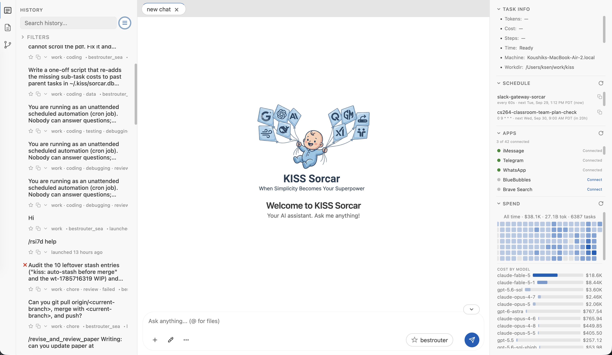
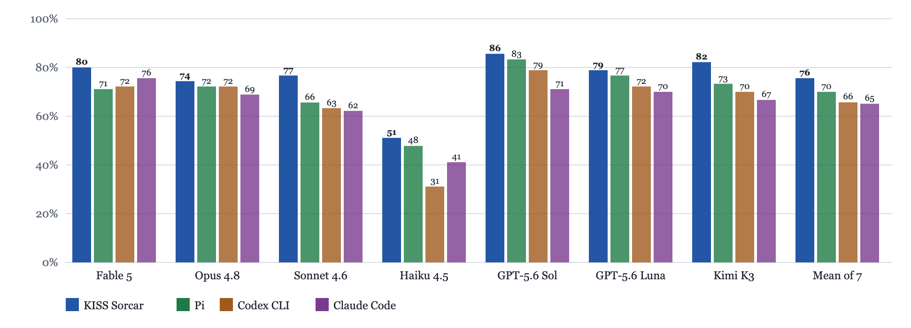

<div align="center">

<picture>
  <source media="(prefers-color-scheme: dark)" srcset="https://raw.githubusercontent.com/ksenxx/kiss_ai/main/assets/KISS-Sorcar-Logo-Dark.png">
  <source media="(prefers-color-scheme: light)" srcset="https://raw.githubusercontent.com/ksenxx/kiss_ai/main/assets/KISS-Sorcar-Logo.png">
  
</picture>

[](https://pypi.org/project/kiss-agent-framework/)
[](LICENSE)
[](https://www.python.org/)
[](https://kisssorcar.github.io/)
[](https://arxiv.org/abs/2604.23822)

*"Everything should be made as simple as possible, but not simpler." — Albert Einstein*

</div>

# KISS Sorcar

### Open-source general-purpose recursively self evolving AI agent for long-horizon tasks and AI discovery and optimization

**KISS Sorcar is a free, simple, local-first, bring-your-own-key AI agent framework.** It runs as a browser/mobile web app served by a local daemon, and offers a Python client API for scripting tasks. Your prompts and code go directly to the model provider or local endpoint you configure, never through our servers. Multi-model workflows take a paragraph of prompt, not a pipeline: complex AI systems and techniques can be replaced with a paragraph of prompt in KISS Sorcar.

```bash
curl -fsSL https://raw.githubusercontent.com/ksenxx/kiss_ai/main/scripts/install.sh | bash
```

This README is the quick start. The detailed references are:

- [FEATURES.md](FEATURES.md): the complete feature inventory, checked against the source tree.
- [src/kiss/server/README.md](src/kiss/server/README.md): every `sorcar.run()` option, tools, hooks, and the Sorcar Extension Agent authoring guide.
- [src/kiss/agents/third_party_agents/README.md](src/kiss/agents/third_party_agents/README.md): the messaging and service agents, sign-in, and worked examples.
- [MODELS.md](MODELS.md): the full per-provider model list.
- [kisssorcar.github.io/docs](https://kisssorcar.github.io/docs/): installation, CLI, API, and messaging guides.

______________________________________________________________________

<details>
<summary><strong>Table of Contents</strong></summary>

- [Terminal-Bench 2.0](#terminal-bench-20-kiss-sorcar-vs-pi-codex-cli-and-claude-code)
- [What is in the Name](#what-is-in-the-name)
- [Installation](#installation)
  - [Install](#install)
  - [Docker](#docker)
  - [Python package install](#python-package-install)
  - [Configure model access](#configure-model-access)
- [Using KISS Sorcar](#using-kiss-sorcar)
  - [Web and mobile app](#web-and-mobile-app)
  - [The `kiss-web` daemon](#the-kiss-web-daemon)
  - [Python client API](#python-client-api)
  - [Sorcar Extension Agents (SEAs)](#sorcar-extension-agents-seas)
  - [Skills, MCP servers, and customization](#skills-mcp-servers-and-customization)
- [Messaging & Third-Party Agents](#messaging--third-party-agents)
- [Models Supported](#models-supported)
- [Contributing](#contributing)
- [License](#license)
- [Citation](#citation)

</details>

<div align="center">
  
</div>

## Terminal-Bench 2.0: KISS Sorcar vs Pi, Codex CLI, and Claude Code

The [HarnessTax](https://harnesstax.github.io/) study (Pan, Yang, Arabzadeh, Chiang, Stoica, Zaharia; UC Berkeley and Arena Intelligence) holds the model fixed, swaps the harness between Claude Code, Codex CLI, and Pi, and finds that the harness moves cost far more than it moves what gets solved. We added KISS Sorcar to their Terminal-Bench 2.0 table under the same evaluation setup:

- **Tasks and attempts**: The same 30 sampled tasks across the same seven models, with three attempts per task, graded by the official Terminal-Bench 2.0 verifier.
- **System prompt**: Cut to 727 words of coding rules (`papers/kisssorcar/evidence/tb2_prompt.txt`).
- **Overall solve rate**: Averaged over the seven models, KISS Sorcar solved 75.6% of attempts, compared to Pi at 70.0%, Codex CLI at 65.7%, and Claude Code at 65.1%, with the best point estimate on every model.

| Model | KISS Sorcar solved | $/att. | Pi solved | $/att. | Codex CLI solved | $/att. | Claude Code solved | $/att. |
|---|---:|---:|---:|---:|---:|---:|---:|---:|
| Claude Fable 5 | **80.0** | 1.50 | 71.1 | 1.08 | 72.2 | 0.98 | 75.6 | 1.55 |
| Claude Opus 4.8 | **74.4** | 1.21 | 72.2 | 0.76 | 72.2 | 0.85 | 68.9 | 0.90 |
| Claude Sonnet 4.6 | **76.7** | 2.23 | 65.6 | 0.61 | 63.3 | 0.55 | 62.2 | 0.67 |
| Claude Haiku 4.5 | **51.1** | 0.39 | 47.8 | 0.25 | 31.1 | 0.21 | 41.1 | 0.26 |
| GPT-5.6 Sol | **85.6** | 0.69 | 83.3 | 0.42 | 78.9 | 0.76 | 71.1 | 1.35 |
| GPT-5.6 Luna | **78.9** | 0.05 | 76.7 | 0.04 | 72.2 | 0.06 | 70.0 | 0.10 |
| Kimi K3 | **82.2** | 1.14 | 73.3 | 0.38 | 70.0 | 0.45 | 66.7 | 0.52 |
| **Mean of 7 models** | **75.6** | 1.03 | 70.0 | 0.51 | 65.7 | 0.55 | 65.1 | 0.77 |

- **Metrics**: Percentage of attempts solved and cost per attempt in USD on the study's 30-task Terminal-Bench 2.0 sample (three attempts per task). Bold marks the best point estimate per row.
- **KISS Sorcar configuration**: 630 attempts run on 25 September 2026, no turn cap, $50 budget per attempt, and providers' default request parameters.
- **Baseline columns**: Published numbers from the HarnessTax study (100-turn cap, high reasoning effort, priced on a 1 September list).

<div align="center">
  
</div>

### Paired Rerun Against Pi

Thirty tasks is a small sample (the pooled 95% interval, 63.8 to 85.9, contains all three published means), so we reran Pi ourselves in a paired comparison on Claude Fable 5 with no turn cap and the same price table:

- **Study's 30 sampled tasks**: KISS Sorcar solved 80.0% of attempts vs. Pi's 68.9%, a gap of +11.1 points (95% interval +3.3 to +20.0) for five cents more per attempt.
- **57 unsampled tasks**: KISS Sorcar solved 82.5% of attempts vs. Pi's 71.9%, a gap of +10.5 points (95% interval +2.9 to +18.7) for 63 cents more per attempt.
- **Scope**: Only Pi was rerun, on one model. The benchmark exercises the loop, six tools, and the coding rules, with discovery procedures, memory, reviewer, and IDE features switched off.
- **References and artifacts**:
  - **Full write-up**: [The Harness Tax, Audited](https://kisssorcar.github.io/blog/harness-tax-terminal-bench-blog.html).
  - **Method and intervals**: [the paper](https://kisssorcar.github.io/assets/kiss_sorcar.pdf), Section 5.
  - **Per-attempt records**: `papers/kisssorcar/evidence/tb2_trials.json`.
  - **Benchmark runners**: Stored in the separate `benchmarkings` package (a sibling checkout or `KISS_BENCHMARKINGS_DIR`), located by the paper scripts under `papers/kisssorcar/`.

### Harbor Bridge

The repository includes its own Harbor bridge in `src/kiss/benchmarks/terminal_bench/`:

- **Agent implementations**:
  - `harbor_agent.py`: Runs the hidden `coding` SEA, which is the one place that still gates `finish` on verifiers and a reviewer.
  - `vanilla_agent.py` (`VanillaSorcarAgent`): Runs the plain Sorcar agent with the task instruction passed unchanged:
    - Enables shell, edit, sub-agent, and control tools only (no browser, web search, memory, MCP, `decide`, or classification).
    - Uses Harbor's per-task timeout as the clock and `--ak budget_usd=` (default $50) as the budget cap.
- **How to run**:
  1. Start the private benchmark daemon with `uv run python -m kiss.benchmarks.terminal_bench.daemon` (uses home `~/.kiss-tb` unless `--home` specifies otherwise; pass the same folder to the agent via `--ak home=`).
  2. Run Harbor, for example: `uv run harbor run -d terminal-bench@2.0 -a kiss.benchmarks.terminal_bench.vanilla_agent:VanillaSorcarAgent -m claude-fable-5-high --ak budget_usd=50`.
- **Model pinning**: The daemon pins every task to the model it was given:
  - `set_model` is refused.
  - Sub-agents keep the trial's model.
  - Refusals and provider errors are never handed to a fallback model.
- **Full-benchmark result**: On the full 89-task set (three attempts each), the vanilla agent on claude-fable-5-high passed 190 of 267 trials (71.2%) after two disqualified passes were removed. The write-up is in `reports/terminal-bench-2-vanilla-fable-5-high.html` in the development repository.

## What is in the Name

- **KISS Agent Framework**: A deliberately small agent runtime organized around the [KISS principle](https://en.wikipedia.org/wiki/KISS_principle) ("Keep it Simple, Stupid").
- **Sorcar**: Pays homage to [P. C. Sorcar](https://en.wikipedia.org/wiki/P._C._Sorcar), the legendary Bengali magician, evoking the idea of an agent that performs feats that appear magical yet are grounded in disciplined engineering. Sorcar also means government in Bengali.

## Installation

### Install

```bash
curl -fsSL https://raw.githubusercontent.com/ksenxx/kiss_ai/main/scripts/install.sh | bash
```

- **One-liner workflow**:
  1. Clones or updates `~/.kiss/kiss_ai`.
  2. Runs `install.sh` from the directory where you invoked the command so the daemon serves that directory.
  3. Serves your home directory instead if the command was run inside `~/.kiss` or a brand's home (such as when the daemon updates itself from its own clone).

From a local checkout, run the equivalent command:

```bash
git clone https://github.com/ksenxx/kiss_ai.git && cd kiss_ai && ./install.sh
```

#### What the Installer Sets Up

The installer targets macOS and Linux on `x86_64`, `aarch64`, and `arm64`, performing these steps in sequence:

1. **Installs the runtime into `~/.kiss/kiss`**:
   - The Python environment (uv).
   - The library byte-compiled to `.pyc` files.
   - Files read as Python scripts at runtime, kept as source:
     - Bundled SEAs under `src/kiss/agents/seas/`.
     - Channel and cron SEAs.
     - `_version.py`.
     - Modules shipped to remote machines as source for database and memory syncs: `scripts/sync_db.py` (with `chat_summary.py`, `history_columns.py`, and `scripts/carry_over_tables.py`) and `scripts/merge_memory_pages.py`.
   - The web app frontend (`src/kiss/webapp/media/`).
2. **Installs CLIs and browser/tunnel binaries**:
   - Installs the `sorcar` CLI along with the `rsorcar` and `sorcar-docker` launchers in `~/.local/bin`.
   - Installs Playwright's Chromium and cloudflared.
3. **Updates the model catalog**: Refreshes `~/.kiss/MODEL_INFO.json`.
4. **Registers the background daemon**: Configures `kiss-web` as a user service (launchd on macOS, or a systemd user unit on Linux) serving the directory from which `install.sh` was run.
5. **Sets a remote-access password**:
   - Generates a random password on first install and stores it in `~/.kiss/config.json`.
   - Prints the password inside a box of `*` at the end of every run, after the app opens.
   - If the terminal goes away before the run finishes (for example, when `install.sh` runs inside the web app's own Terminal tab and restarts the hosting daemon), the installer continues writing output to the log and notes that the password is in Settings rather than printing it.
6. **Opens the web app**:
   - Launches `http://127.0.0.1:8787` as a standalone app window and, once the window is up, opens the folder containing the application launcher in your file manager so you can see where the app is and pin it.
   - Falls back to your default browser if no app-mode browser is available.
   - Prints the cloudflared URL to open on your own device when run on a remote machine.

#### Standalone App Window

On local machines, `kiss-app` (run from the app's venv) opens the web app in Chromium's app mode as a dedicated window with no address bar or tabs, using a dedicated profile in `~/.kiss/webapp-profile`:

- **Browser selection order**:
  1. The browser specified by `KISS_APP_BROWSER` (a path or command name), which becomes the sole candidate when set.
  2. Installed desktop browsers: Google Chrome, Chromium, Edge, or Brave.
  3. Playwright's Chromium (on Linux, the bundled Chromium runs without its sandbox because it has no setuid helper for hosts restricting unprivileged user namespaces).
  4. The system default browser if none of the above are available.
- **Application menu launcher and window icon**:
  - Creates a launcher named and iconed after the brand (`~/.local/share/applications/kiss-sorcar.desktop` on Linux, `~/Applications/KISS Sorcar.app` on macOS), and applies that icon to the running window in the dock or taskbar.
  - Clicking the launcher icon while the app is open brings its window to the front instead of opening a new browser window.
  - **Linux**: Sets the window's X11 class and Wayland app id in the desktop entry.
  - **macOS**: Clones the browser's bundle with its binary and frameworks copied rather than symlinked (Chromium's sandboxed helper processes read only their own bundle's real path), re-signs it under the brand's identity, and refreshes it whenever the browser updates:
    - Leaves any stale clone from which an open window may still be running until the next launch.
    - Serializes overlapping launches using a lock file beside the bundle (`.<product>.app.lock`) so neither deletes the clone the other just built.
- **Startup behavior and waiting page**:
  - `kiss-app` waits up to `--wait` seconds (default 120) for the daemon's URL file (`~/.kiss/remote-url.json`, written as the daemon starts), without waiting for the daemon itself to answer HTTP requests.
  - When the daemon is not answering yet (such as after a macOS reboot, where the app relaunches at login about a minute before the daemon's LaunchAgent), the window opens immediately on a packaged waiting page (`src/kiss/webapp/media/appStart.html`, a `file://` page showing the app's name) instead of staying closed or showing Chromium's error page.
  - The waiting page polls the daemon every half second and replaces itself with the app on the first answer (on macOS, the waiting page first moves into the app's named popup window, which restores its saved bounds and navigates to the app in place).
  - On macOS, closing the app window while the daemon is down leaves a windowless browser process running under the app's profile; the daemon's watchdog quits any such process found with no window across several consecutive sweeps so the next click starts the app fresh rather than opening an empty browser window.
- **Links, proxies, and CLI inspection**:
  - Clicking a web link in the chat opens your default browser instead of navigating inside the address-bar-free app window.
  - `kiss-app` queries the local daemon directly, ignoring any `http_proxy` in your environment (which could not reach local loopback).
  - `kiss-app --print-command` prints the shell-quoted browser command for your platform without waiting for the daemon.

#### Remote Access and Password Management

- **Local browser access**: Requires no password on the machine itself.
  - Pages from other websites open in the same local browser (which the browser also permits to open a WebSocket to 127.0.0.1) are distinguished from the web app by their `Origin` and refused without the password.
  - The `/api/jobs` routes enforce the same check using `Host` and `Origin`.
- **Remote device access**: Enter the password in the web app; the daemon verifies it on every command sent by a remote browser.
- **Editing, disabling, and rotating**:
  - **Settings panel**: Shows the password in an editable plain-text box. Saving a new value puts it into effect immediately without a restart (requiring other devices to sign in again), and saving an empty box turns remote access off.
  - **Re-running `install.sh`**: Preserves the existing password so signed-in devices stay valid.
  - **Command-line rotation**: Run `~/.kiss/kiss/.venv/bin/python -m kiss.core.remote_password --rotate` to generate a new random password.

#### Remote Deployment and Sync

Running `rsorcar user@host` deploys the local checkout to a remote Linux machine (changing only the remote machine) and merges task databases, agent memory pages, and autorouter notes in both directions:

- **Cross-version database merge**: The local and remote machines do not need to run the same release:
  - A history column missing on one side is added using the other side's declaration.
  - A column present only on the target keeps its default value for incoming rows.
  - The `is_cron` flag is computed for rows created before that column existed.
- **Live delta sync and deletions**:
  - A task running on either machine does not block deployment: ordinary delta syncs run alongside both live web apps and hold back any in-flight task until it finishes, transferring it complete on a later sync.
  - Deleting a task records it in `deleted_tasks`, and deleting a chat records its tasks in `deleted_tasks` plus its own ID in `deleted_chats`, so sync removes them on the other machine rather than bringing them back (any task still running on the other machine is left alone).
- **Running-task checks and restarts**:
  - A task counts as running while its newest event is within `SORCAR_LIVE_TASK_WINDOW` seconds (default 300; `0` turns the check off).
  - **Remote task active**: Skips the final `kiss-web` restart so the remote machine continues serving the previous release until the next deploy or `systemctl --user restart kiss-web`.
  - **Full-copy fallback** (first deploy or failed merge): Must stop the remote web app for the database swap, so it refuses while a remote task is running and leaves both databases unchanged.
  - **Unreadable `history.db`**: A remote `history.db` that exists but cannot be read reports `unknown` rather than "no task" (since an unreadable database might hold a running task), skipping the restart with a warning and refusing the full copy; a missing file or non-SQLite file counts as holding no running tasks.
  - **Force restart**: Setting `SORCAR_FORCE_RESTART=1` restarts the service and swaps the database anyway, killing any running task.
- **Memory and autorouter note sync**:
  - Syncs agent memory pages in both directions.
  - Merges `~/.kiss/AUTOROUTER.md` and `~/.kiss/MODEL_DECISIONS.md` both ways via `src/kiss/scripts/sync_kiss_notes.py` under the lock that agents take when appending a row, ensuring rows written during sync are never lost: evidence with the later refreshed date wins, and the ledger becomes the time-ordered union of both machines' rows.
  - Any failure in memory or note sync produces a warning rather than failing the deploy.

#### Updates, Reinstalls, and Deferred Restarts

Re-running `install.sh` updates the app in place without deleting your history. If an update fails, run the installation command again.

- **In-app update toast**: When a new release is available, the web app toast offers these actions:
  - **Update**: Installs the update immediately.
  - **Update when idle**: Installs the update automatically as soon as no task is running.
  - **Remind me later**: Hides the toast in every window for 24 hours.
- **Version and commit display**: The Settings panel header displays the installed version and, in parentheses, the short git commit it was installed from:
  - `install.sh` writes the checkout's `git rev-parse --short HEAD` to `src/kiss/core/_commit.txt` in the installed copy.
  - A daemon started directly from a checkout queries git itself.
  - An installation from a tarball shows only the version.
- **Deferred restart when tasks are in flight**: `install.sh` never restarts a busy daemon, allowing a running Sorcar task to run `./install.sh` itself and transition the daemon to the new build once finished:
  1. `install.sh` defers the restart and writes `.kiss-web.restart-pending` in the daemon's home (the path named as `restartPendingFile` in the busy daemon's active-tasks response and printed by `scripts/check-kiss-web-active-tasks.py`), storing a JSON record of the installer, state directory, and work dir to serve.
  2. The daemon polls for `.kiss-web.restart-pending` every 5 s.
  3. Once no task is in flight and no installer launched by the daemon is still running, the daemon raises the run-admission barrier so no new task can start, claims and removes the record (preventing retries of a broken record), and runs the recorded `install.sh --restart-only`.
  4. `install.sh --restart-only` waits for any install still holding the update lock, then restarts the daemon onto the already-installed app and, once the daemon serves that app, retires any legacy app directory the new one has replaced; it does nothing else, and keeps the deferred run's `.install-problems` for the restarted daemon to report.
  5. Every `install.sh` restart that brings the daemon up removes `.kiss-web.restart-pending`, and a `--restart-only` run that still finds tasks in flight writes no new record, preventing retry loops.
  6. A daemon from an older release without this support cannot finish the deferred restart, so the installer prompts you to re-run it after tasks finish.
- **Idle full reinstall from a checkout**: `scripts/reinstall-kiss-web-when-idle.sh` re-runs the full `./install.sh` once none of your daemons have a task in flight:
  - Queries the daemon of every home publishing an endpoint file (`~/.kiss`, any brand's `~/.<brand>`, and `$KISS_HOME`) and passes `KISS_HOME` to the job; its active-tasks probe (`scripts/check-kiss-web-active-tasks.py`) defaults to the state directory of the app owning its interpreter (including a brand's own).
  - Starts a detached one-shot job and returns immediately: a launchd plist with `KeepAlive` off on macOS, or a transient `systemd-run --collect` unit on Linux (falling back to a `setsid` session when `systemd-run` is missing).
- **Page reload behavior**:
  - Open web app pages reload automatically once a restarted daemon comes up: on every reconnect, the page queries `GET /api/daemon` for the daemon's per-process token and reloads if it differs from the token seen at initial sign-in (waiting first until commands queued during the outage are confirmed so none are lost).
  - If the `GET /api/daemon` probe cannot reach the daemon, receives a server error, or gets no answer after 12 s, it aborts and retries with a growing delay from 5 s up to 60 s while the connection lasts; a brief network blip that reconnects to the same daemon process leaves the page unchanged.
  - A manual refresh button at the right end of the Chats row reloads the page on demand, making browser reload accessible in the app window and phone home-screen apps where there is no address bar.
- **Post-install notices, tips, and legacy cleanup**:
  - **Release tips**: After an install or update, the chat panel shows tips from `src/kiss/TIPS.md` once per version.
  - **Failure notifications**: Any failure during an install run (a failing hook, a brand home install error, or a daemon that fails to come up) is recorded in `.install-problems` in the started daemon's home (with nested brand-home failures folded in and prefixed by that home) and shown as a web app notification for up to a week, or until a run succeeds.
  - **Retired VS Code extension removal**: Updating a machine that still has the retired VS Code extension attempts to uninstall it via the `code`, `code-insiders`, `cursor`, and `code-server` CLIs (or the CLI named by `KISS_CODE_CLI`; if a copy remains, the terminal instructs you to remove it from the Extensions view) and for a week, the web app shows a "VS Code extension removed" notice pointing to the app, with a "Do not show this again" checkbox to silence it permanently.

#### State Directory, Hooks, and White-Label Brands

- **State storage**: All persistent state (history database, settings, memories, and TLS material) lives in `~/.kiss`. Override it with `KISS_HOME`, or set `home_dir` in `brand.json` for a white-label brand.
- **Post-install hooks**: Executable scripts in `~/.kiss/post-install.d/` run in alphabetical name order at the end of every install; a failing hook is reported without failing the install.
  - If a hook is an `exec <script>` stub pointing to a script inside a git checkout with an upstream (as written by a brand's installer), the installer updates that checkout before running the hook:
    1. Fetches the upstream, then rebases onto it with local edits stashed around the rebase (`git rebase --autostash`); when the fetch fails, the hook runs the checkout's current code.
    2. If the rebase cannot complete, resets the checkout to the upstream while saving local commits on a `brand-update-backup-<time>` branch and local edits in a stash entry, naming both in a warning.
- **White-label brand homes**:
  - On a machine with a white-label brand home (a `~/.<brand>` directory with post-install hooks, or the home from which the running service was started), `install.sh` repeats itself into that home as well.
  - Each home keeps its own app copy named after the home (for example, `~/.s10s/s10s`), model catalog, and password, and the installer starts the brand's daemon instead of the stock one.
  - Branding (`src/kiss/webapp/media/brand.json` and a git-ignored `.brand/` overlay for white-label builds) and the installer steps are documented in [FEATURES.md](FEATURES.md#20-installation-deployment-docker-and-release).
- **Brand `signin` hook**: A brand that requires signing in to its own service includes an executable `signin` hook in its home:
  - While the hook reports you signed out, the web app displays a sign-in window with one button per provider listed by the hook (such as Google and Apple), and accepts a pasted redirect URL or code to finish a sign-in started on another device.
  - A missing or broken hook shows nothing, ensuring a brand's sign-in can never lock you out of your own daemon.
  - The daemon reads the hook's output as soon as the hook process exits, so background helpers inheriting stdout (such as a browser opener) cannot hold up the result.

#### Installer Flags, Environment Variables, and Logs

- `./install.sh --non-interactive`: Accepts the default answer to every prompt.
- `./install.sh --restart-only`: Installs nothing and only restarts the daemon from the app in `KISS_HOME`.
- `KISS_SKIP_LAUNCH=1`: Skips starting the daemon and opening the app.
- `KISS_HOME`: Overrides the `~/.kiss` state directory.
- `~/.kiss/install.log`: Stores the installer log.

### Docker

```bash
./sorcar-docker [PORT] [--rebuild]
```

This script builds a plain Debian image (`Dockerfile`) and runs KISS Sorcar inside a container:

1. **Container startup sequence**: The entrypoint (`scripts/docker-startup.sh`) performs the following steps:
   1. Clones the repository: the private `kiss.git` when `GH_TOKEN` is set, or the public `kiss_ai.git` otherwise.
   2. Runs `install.sh`.
   3. Configures the web app password from `KISS_WEB_PASSWORD`, or generates one and prints it in `docker logs`.
   4. Serves the web app on container port 8787, mapped to host port `PORT` (8787 by default).
2. **Environment and persistence**:
   - Forwards API keys from your host environment into the container.
   - Persists state in the `kiss-sorcar-web-home` volume.
3. **Browser access**:
   - Open `https://localhost:PORT` and accept the self-signed certificate once, or install `/ca.crt`.
   - Inside a container, the Settings panel hides the LAN and tunnel URL bars because the container's daemon is reachable only through the published port.

### Python package install

Install only the Python package if you just need these components:

- The `kiss-web` daemon
- The Python client API
- The messaging-agent entry points

```bash
pipx install kiss-agent-framework
# or
uv tool install kiss-agent-framework
```

- **Python version**: KISS Sorcar requires Python 3.13+.

### Configure model access

Provide at least one model backend. You can set provider credentials with environment variables such as:

```bash
export ANTHROPIC_API_KEY=...
export OPENAI_API_KEY=...
export GEMINI_API_KEY=...
export OPENROUTER_API_KEY=...
```

#### Default and fast model order

The default and fast models follow the first provider with a configured credential, in the priority order below, so an installation with a key for a single provider never starts with "No model":

1. **Anthropic**: `claude-opus-5-5` (default) and `claude-sonnet-5-5` (fast).
2. **OpenAI**: `gpt-6.1-sol-medium` (default) and `gpt-6-luna` (fast).
3. **Gemini**: `gemini-3.8-flash` (default) and `gemini-3.5-flash-lite` (fast).
4. **OpenRouter**: `openrouter/anthropic/claude-opus-5.5` (default) and `openrouter/anthropic/claude-sonnet-5.5` (fast).
5. **Bedrock**: The cheapest registered `bedrock/` ID of that Anthropic model, or else the dearest (default) or cheapest (fast) registered `bedrock/` model by output price (see Amazon Bedrock below).
6. **Claude Code CLI**: `cc/opus` (default) and `cc/haiku` (fast).
7. **Codex CLI**: `codex/default`.

#### Amazon Bedrock

Claude models can also run through Amazon Bedrock:

- **Model IDs**:
  - The catalog lists Bedrock-served Claude IDs as `bedrock/<Bedrock model or inference-profile id>` (for example, `bedrock/global.anthropic.claude-opus-5-5` or `bedrock/us.anthropic.claude-opus-4-6-v1`), including the standard `-high` and `-max` effort suffixes.
  - Any other ID served by the configured region can be used directly by name.
  - An ID not listed in the catalog can be typed as a model name or added under Settings -> Custom Models (name only, no endpoint), which places it in the model picker starting at the next daemon start.
  - When Bedrock is the only configured provider, the default and fast models are the `global.` profiles of the Anthropic default and fast models.
- **Explicit credentials**: Set either a Bedrock API key or an AWS access key pair, plus the AWS region:

```bash
export AWS_BEARER_TOKEN_BEDROCK=...   # Bedrock API key (bearer token), or:
export AWS_ACCESS_KEY_ID=...
export AWS_SECRET_ACCESS_KEY=...
export AWS_SESSION_TOKEN=...          # temporary credentials only
export AWS_REGION=us-east-1           # default when unset
```

- **Default credential chain**:
  - Without explicit environment keys, requests are signed with whatever boto3's default credential chain finds on the machine.
  - The model picker lists Bedrock models as soon as one of the following sources is configured (all read from local files and the environment without a network call):
    - A web-identity token file (EKS with IRSA).
    - ECS container credentials.
    - A profile in the shared `~/.aws` files (`AWS_PROFILE` or `default`), including static keys or an assume-role, SSO, or `credential_process` profile evaluated from its configuration alone.
  - Only EC2 instance-metadata credentials go undetected by the picker, because probing them requires a network round-trip.
- **Pricing**:
  - Bedrock models are priced at their `claude-*` catalog entry rate, which holds the `global.` profile rate.
  - Any Claude 4.5-or-later model ID under another cross-region prefix (`us.`, `eu.`, `apac.`, `jp.`, `au.`, `ca.`, `us-gov.`, and others) or the in-region `anthropic.` prefix is billed 10% above that base rate, matching AWS's price list.
  - An inference-profile ARN (such as `bedrock/arn:aws:bedrock:us-east-1:123456789012:inference-profile/us.anthropic.claude-opus-4-6-v1`) is sent to Bedrock unchanged and priced according to the profile named in its last path segment.
  - A Claude model no longer listed in the direct catalog is priced using its OpenRouter twin (such as Opus 4.1).
  - A Claude model held in the catalog only as a `bedrock/` entry (such as Sonnet 4 or Claude 3 Haiku) is priced by that entry's base rate, with the premium of the profile actually used applied once.
- **Bundled catalog updates**:
  - The bundled `bedrock/*` entries are the IDs discovered by the model updater (`uv run python -m kiss.scripts.update_models`, or the Update Models button in Settings) in its own AWS region.
  - Bedrock lists cross-region inference profiles and on-demand model IDs per region, so running the updater on a machine in another region relists what that region serves.
  - Each generated entry copies its `claude-*` twin's context length, capabilities, and effort suffixes, with prices scaled according to the rules above.

#### Settings: API keys

You can configure API keys, a custom model endpoint, and custom HTTP headers in the Settings panel of the web app:

- **Key store and shell RC hook**:
  - Keys saved in Settings are stored in `~/.kiss/api_keys.env` (one `export KEY=value` line per credential, mode 0600).
  - The daemon loads `~/.kiss/api_keys.env` at startup, and saving appends a hook line once to your bash or zsh RC file so interactive shells source it.
  - The same store holds `ANTHROPIC_WORKSPACE_ID`, which an identity-linked Anthropic key must send with every request (configurable via the dedicated box in the API Keys section or via the environment variable).
  - An API key is stored only under a valid environment-variable name and with a value free of line breaks and NULs; any other entry is dropped with a warning in the log.
- **Removing stale RC assignments on save and delete**:
  - Any `export KEY=…` line (or `set -gx KEY …` in fish) written into the RC file by you or an earlier release is removed on save and on delete so a stale line cannot shadow the store.
  - When that assignment shares a line with other commands, only that assignment is removed (for example, `export OPENAI_API_KEY=old; export ANTHROPIC_API_KEY=keep` keeps the second command).
  - Each line is parsed the way the shell reads it, including quotes, `$(…)`, and redirections.
  - A command left empty next to `&&`, `||`, `|`, or `&`, or after `if` or `then`, is replaced with the `true` no-op so the line stays valid.
  - An export inside `$(…)` or `(…)`, which never reaches the sourcing shell, is left untouched.
  - Unsafe assignments are never edited: if a key is assigned inside a command spanning multiple lines (such as a here-document or an unclosed quote at the end of a line) or set on one line in a form the editor does not remove (`typeset -x KEY=…`, `read KEY`, `printf -v KEY`, or an `eval` naming the key), the save is refused with `Could not save the settings: <rc>: line N may set KEY where it cannot be edited safely; remove it there by hand`, and nothing is written.
- **Importing missing keys at startup**:
  - At daemon start, any key missing from `~/.kiss/api_keys.env` is imported from shell RC files; keys already in the store are never modified.
  - Your login shell's RC file is read first so a key left behind in another shell's RC file never overrides the current one, even when the current key's value cannot be imported from static text.
  - Every command on a line is inspected.
  - A key whose last assignment might not execute (such as a branch of `&&` or `||`, a pipeline member, or a background command) or whose value only the shell can resolve is imported by sourcing the RC file (once per store) rather than reading its text.

#### Settings: Custom Models

The Custom Models section of the Settings panel registers your own models (such as a local vLLM or Ollama endpoint, or a provider model absent from the bundled catalog):

- **Storage and validation**:
  - Entries are stored in `~/.kiss/MY_MODELS.json` and appear in the model picker alongside the bundled catalog.
  - A hand-edited entry whose context length or price is missing, or is not a finite, non-negative number (such as a negative price, `NaN`, `1e309`, or a quoted number), is skipped with a warning when the catalog loads rather than billing a negative or `NaN` cost.
- **Catalog inheritance and base-model overrides**:
  - An entry named after a catalog model starts from that model's context length, `thinking` level, capability flags, Responses-API transport flag, fallback, thinking overrides, and prices (including `prompt_tiers`). This applies when the entry is named:
    - Exactly after a catalog model.
    - Under a provider prefix such as `openai/<model>`.
    - As a `bedrock/<id>` profile.
    - As an `-xhigh` alias not listed in the catalog (which carries no `thinking` level).
  - Because of this inheritance, the custom entry is billed at the catalog rate, retains its transport and capabilities, and continues requesting the catalog's reasoning effort after a restart.
  - An entry that overrides a base model propagates its context length, capability flags, Responses-API flag, and prices to that base model's bundled `-low`/…/`-xhigh` aliases (unless `~/.kiss/MY_MODELS.json` names the alias itself), so selecting an alias budgets compaction and bills at the overridden values.
- **Custom endpoints, effort levels, and transport**:
  - An entry with its own endpoint runs against that endpoint whether a task starts on it or `set_model` switches to it mid-run; the endpoint, API key, and HTTP headers belong exclusively to that entry and are never inherited by another model.
  - The entry's `thinking` level comes from the loaded catalog when the name is already present there, and from the `~/.kiss/MY_MODELS.json` file as it currently stands otherwise. Consequently, an entry added while the daemon is running receives its default effort before a restart, and switching away drops a `reasoning_effort` equal to that default while keeping one that differs from it.
  - An entry whose own name ends in `-xhigh` (for example, a router that reads the effort level from the model name) is sent to its endpoint under that full name, whereas an entry named after a generated effort alias such as `gpt-5.6-sol-xhigh` remains an alias of its base model.
  - An entry with its own endpoint whose name no known vendor routes (such as `my-router/qwen`) uses the Responses API when its own `use_responses_api` flag is enabled; a vendor-routed name pointed at a foreign endpoint stays on Chat Completions because that endpoint's Responses API support is unverified.
- **Draft recovery on refused Add or Save**:
  - When the daemon (or the currently displayed registered machine) refuses an Add or Save, the page restores the submitted draft unless Settings has switched to another machine:
    - A refused Add restores its model name into the name box if that box is still empty.
    - A refused Save reopens that model's edit view with the submitted values.
  - While another edit is open or if you have typed into the input boxes since submitting, the draft waits and is placed once that edit's Save or Cancel, or the next Add, frees the boxes.
  - Queued drafts are placed oldest first; if several submissions are refused together, only the first is guaranteed to land, because a later refused Add finds the name box already filled by the earlier draft and is dropped, and a later refused Save reopens its own edit over the earlier draft.

#### Settings: Bedrock, Claude Code, and Codex

- **Bedrock section**: Appears after Custom Models and holds the Bedrock API key, AWS access key pair, session token, and region.
- **Claude Code section (`cc/*` models)**: Configures models that run the `claude` CLI:
  - **Auth status**: Shows whether the `claude` CLI is logged in and how it will bill (`claude auth status`).
  - **Bill my Claude subscription for cc/ models**: Enabled by default.
    - When on, the CLI runs without `ANTHROPIC_API_KEY` or `ANTHROPIC_AUTH_TOKEN`, so a `claude login` session on a Pro or Max plan pays for the turn instead of API tokens.
    - When off, the CLI inherits the daemon's environment and an API key bills per token.
  - **Subscription token**: Accepts an optional token from `claude setup-token` (`CLAUDE_CODE_OAUTH_TOKEN`) for machines where nobody ran `claude login`.
- **Codex section (`codex/*` models)**: Configures models that run the `codex` CLI:
  - **Login status**: Shows whether the `codex` CLI is logged in and how it will bill (`codex login status`).
  - **Bill my ChatGPT subscription for codex/ models**: Enabled by default.
    - When on, the CLI runs without `OPENAI_API_KEY` or `CODEX_API_KEY` so it bills the logged-in ChatGPT plan; turns are refused if the CLI's saved login is an API key from `codex login --with-api-key`, which would bill per token anyway.
    - When off, `OPENAI_API_KEY` bills per token.
  - **Sign in with ChatGPT**: Starts `codex login --device-auth` on the daemon's machine and displays the URL and one-time code to enter in any browser (used to sign a headless machine in to a Plus or Pro plan).
  - **Codex access token**: Accepts `CODEX_ACCESS_TOKEN` (ChatGPT Business or Enterprise) for machines where nobody ran `codex login`.

#### How CLI models run (`cc/*` and `codex/*`)

Both CLIs are driven as plain models with their built-in tools, MCP servers, hooks, and project instructions turned off, operating with Sorcar's system prompt and tools like every other model:

- **Codex MCP tool bridge (`codex/*`)**:
  - Sorcar exposes every tool except `finish` and `set_model` to Codex as a `kiss` MCP server, allowing a single `codex/*` step to make multiple tool calls executed by Sorcar.
  - `finish` and `set_model` use the text-based tool protocol instead: `finish` because it ends the step, and `set_model` because it must not replace the active model during a running turn.
  - Codex is told that the `kiss` server is required (`required=true`) and is given 24 hours for server startup and per-tool execution (`startup_timeout_sec` and `tool_timeout_sec`):
    - Requiring the server prevents Codex from calling the model before the bridge proxy is ready (an optional server receives only 1 second before the model is queried without tools and answers that they are unavailable).
    - Allowing 24 hours for startup ensures a proxy slower than Codex's own 30 s limit (such as on a machine starting hundreds of Python interpreters simultaneously) does not permanently fail the turn.
    - Silence remains bounded: if the CLI is silent for longer than `model_config`'s `timeout` (300 s by default for a CLI model) with no bridged tool calls in flight, the CLI is terminated and the turn is retried; silence during an active bridged tool call re-arms the deadline instead.
    - Allowing 24 hours per tool prevents long `Bash` or `run_parallel` calls from being cut off at Codex's default 60 s limit.
  - Loopback bridge authentication and limits:
    - Because the bridge listens on a local loopback port reachable by any local user, every request must carry a per-launch secret forwarded by Codex to the bridge proxy via its environment (`KISS_MCP_BRIDGE_TOKEN`, never passed on a command line).
    - Unauthenticated requests are refused, and tool names not listed by the bridge receive an error response.
    - Any connection that does not deliver its single-line request within 5 s, or buffers 64 MiB without a newline before the next read, is closed rather than waited on (the 64 MiB cap is checked before each 64 KiB read, so a line completed within the chunk crossing the cap still succeeds).
- **Claude Code tool parsing and token usage (`cc/*`)**:
  - Every tool is delivered through the text-based protocol (the `claude` CLI runs with its own tools disabled).
  - If a Claude model falls back to its native `<invoke name="…">` syntax despite JSON instructions, Sorcar still parses the call:
    - Only the first `<invoke>` block that opens a line counts as the tool call, because the CLI otherwise writes repeated invoke blocks without results between them.
    - All text after that first block (where the model imagines the tool result) is dropped from the stream.
    - Each argument not declared as a string by the tool schema is decoded from JSON text, while string parameters retain their literal text as typed.
  - When a `cc/*` turn ends on a tool call, Sorcar reads past the call to capture the message's final token usage (sent by the CLI after the call text) and cuts the stream at the first new content, billing actual output tokens instead of a placeholder.
- **Thinking panel and reasoning effort**:
  - Both CLIs stream their reasoning into the Thinking panel.
  - `claude` CLI flags and effort resolution:
    - Runs with `--thinking-display summarized` (because `--print` mode otherwise asks the API to omit thinking text).
    - When the model has an effort level, runs with `--effort <level>`, resolved in the same priority order the direct Anthropic adapter uses for `output_config.effort`:
      1. `model_config`'s `reasoning_effort`, if set.
      2. `model_config`'s native `output_config.effort`, if set.
      3. The catalog entry's `thinking` level.
    - Under this rule, a `cc/claude-opus-5-5-xhigh` alias strips the `-xhigh` suffix from `--model` and runs `--model claude-opus-5-5 --effort xhigh`, a base `cc/claude-opus-5-5` runs at its catalog effort level, and the CLI's short names (`cc/opus`, `cc/sonnet`, and `cc/haiku`) carry no effort level and send no flag, keeping the CLI's default.
    - Any turn that sends `--effort <level>` omits `CLAUDE_CODE_EFFORT_LEVEL` from the CLI's environment so the environment variable cannot outrank the flag.
  - `codex` CLI reasoning summaries:
    - Runs with `model_reasoning_summary="concise"` (because `--ignore-user-config` drops the user's setting, omitting a summary setting produces no reasoning items, and API-key-billed turns rarely receive `"detailed"` summaries from the backend).
    - A Codex summary line consisting solely of a bold Markdown title is displayed as plain text.

#### Settings panel state and remote machines

- **Collapsed sections**: The API Keys, Custom Models, Bedrock, Claude Code, and Codex sections start collapsed every time Settings opens.
- **Machine selection**: Settings opens for the machine selected in the chat header's machine drop-down:
  - For a registered remote machine, the form displays and saves that machine's keys, settings, and custom models (forwarding commands over the registered link) and hides controls specific to the local daemon (its URLs and the Update, Reset Server, and Update Models buttons).
  - Form text fields and the custom-model list are blanked while switching machines so one machine's password and keys never appear under another machine's name.
- **Write errors**: If a save cannot write `config.json` (for example, due to a full disk or a file locked by another process), the daemon answers `"Could not save the settings: ..."` and returns the stored settings instead of applying the change.

#### Router agents

The model picker lists six bundled router agents under the `Router` group. These are Sorcar Extension Agents (see below), not standalone models:

- **`autorouter`**:
  - Runs its routing session on `claude-opus-5-5-medium` (with pre-run classification off, and web tools and memory on).
  - Splits a task into units with a mechanical acceptance check and dispatches them to the cheapest model tier that passes the check, escalating on failure.
  - Resolves each tier as an ordered candidate list where each direct model is followed by its `openrouter/...` twin, selecting the first candidate the installation can run:
    1. **Small tier**: Opens with `openrouter/z-ai/glm-5.3-flash`, `gpt-6-luna-xhigh`, `openrouter/openai/gpt-6-luna-xhigh`.
    2. **Medium tier**: Opens with `openrouter/meta/muse-wonder`, `gemini-4-argon`, `openrouter/google/gemini-4-argon`.
    3. **Frontier tier**: Opens with `gpt-6-astra`, `openrouter/openai/gpt-6-astra`, `claude-fable-5-2-max`, its OpenRouter twin, `claude-opus-5-5-max`.
  - Keeps guarded work, uncheckable work, and final acceptance of the whole task on the frontier tier.
  - Switches its own model only at phase boundaries.
- **`bestrouter`**:
  - Starts every task on `claude-opus-5-5-medium`, which answers simple questions and queries directly.
  - Switches to `openrouter/google/gemini-4-carbon` to write human-facing documents, papers, reports, and results (including the final summary).
  - Switches to `claude-fable-5-2-max` for all other work, including software development and analysis; a task that mainly dispatches sub-agents may dispatch, wait, and log on `claude-opus-5-5-medium`, while judgment steps (such as triaging a failed test run or acting on a sub-agent's failure) run on `claude-fable-5-2-max`.
  - Runs `gpt-6-astra-xhigh` to review the work of both models read-only through a non-blocking `run_agent` call on at most 75% of the budget.
- **`orautorouter`**:
  - Restricts `autorouter` to the OpenRouter vendor so a single OpenRouter key runs it.
  - Routes on `openrouter/anthropic/claude-opus-5.5-medium` and populates its tiers only with `openrouter/...` models (the OpenRouter twins of `autorouter`'s candidates, in the same order).
- **`orbestrouter`**:
  - Restricts `bestrouter` to the OpenRouter vendor so a single OpenRouter key runs it.
  - Starts on `openrouter/anthropic/claude-opus-5.5-medium`, works on `openrouter/anthropic/claude-fable-5.2-max`, writes on `openrouter/google/gemini-4-carbon`, and reviews with `openrouter/openai/gpt-6-astra-xhigh`.
- **`ccxbestrouter`**:
  - Runs `bestrouter` on the Claude Code and Codex CLIs so a Claude subscription and a ChatGPT subscription run it without API tokens.
  - Starts on `cc/claude-opus-5-5-medium`, works on `cc/claude-fable-5-2-max`, writes on `cc/claude-opus-5-5-max`, and reviews with `codex/gpt-6-astra-xhigh` (`codex/gpt-6-astra` at `xhigh` reasoning effort).
- **`brbestrouter`**:
  - Runs `bestrouter` on Amazon Bedrock's global cross-region inference profiles so one set of AWS credentials runs it.
  - Starts on `bedrock/global.anthropic.claude-opus-5-5-medium`, works and writes on `bedrock/global.anthropic.claude-opus-5-5-max`, and reviews with `bedrock/global.anthropic.claude-fable-5-1-max`.

## Using KISS Sorcar

KISS Sorcar provides three client interfaces:

- **Daemon-served interfaces** (both served by one local daemon):
  - **Web/mobile app**
  - **Python client API**
- **`sorcar` terminal command**: Runs a SorcarAgent directly in the current directory without the daemon:
  - `sorcar -t "Summarize README.md"` runs an inline task.
  - `sorcar -f task.txt` runs the file's content as the task.
  - Exactly one of `-t` or `-f` is required.
  - Run `sorcar --help` for the model, budget, and work-dir flags.

### Web and mobile app

Open the web app in a browser and type or speak your task. The chat interface provides:

- **`@` file and folder mentions**: Provides ranked completion from a persistent index of your working directory and home directory.
  - Always skips dot-directories, `node_modules`, `__pycache__`, `venv`, and `site-packages`.
  - Skips non-glob entries from every `.gitignore` encountered during traversal, including nested repositories:
    - A bare name is skipped at any depth below that `.gitignore`.
    - A name with a trailing `/` is skipped only when it is a directory.
    - An entry with a slash elsewhere is skipped only at that relative location under its `.gitignore` (and only when it is a directory if it ends with `/`).
    - Negations and entries containing `*` or `?` are not read.
  - Home directory exclusions and OS access blocks:
    - Excludes the operating system's application-state tree (`~/Library` on macOS and the hidden `AppData` on Windows), though a working directory inside that tree is indexed as its own root.
    - Lists any folder the operating system refuses to let the daemon read (such as under macOS privacy protection) as a bare folder entry and skips it for the rest of the daemon's life instead of stalling every scan, so the picker still opens when the home scan is blocked.
    - Treats a folder whose `.gitignore` read does not return within 5 seconds as refused in the same way, because `open` on a protected folder never returns while the permission prompt is pending.
  - Restart behavior: After a daemon restart, the first `@` query answers immediately from the listings saved by the previous run while a fresh scan runs in the background.
  - Registered machines: In a chat bound to a registered machine, the picker lists that machine's files:
    1. The daemon sends the request to that machine with the chat's working directory there.
    2. While the machine is still indexing the folder, the daemon keeps polling for up to a minute.
    3. The daemon answers in the background, in order per tab and machine, so a slow scan blocks neither a message sent in the meantime nor another tab's list.
    4. Selecting a mention increments the count on that machine so its ranking learns from the pick.
- **Git worktree isolation**: Managed automatically by the agent inside a git checkout, with no setting to toggle.
  - Workflow for tracked files:
    1. Before its first change to a tracked file, the agent calls `create_worktree`, moving the task onto a private `kiss/wt-*` branch checked out under `<repo>/.kiss-worktrees/`.
    2. The agent edits files inside the worktree (any edit to a tracked file in the main checkout outside a worktree is refused).
    3. Once the work is verified, the agent calls `commit_and_merge`, which commits the branch with a generated message and squash-merges it into the starting branch (using the bundled `/merge` agent to resolve conflicts).
  - Unmerged worktrees:
    - Shows a Merge / Discard bar when a task leaves an unmerged worktree that differs from its starting branch (including files changed by branch commits, edits on disk, edits staged only in its index, or untracked files).
    - Automatically discards a verified clean unmerged worktree.
- **Checkpoints and rollbacks**: Top-level tasks in a git checkout provide **`checkpoint(name)`** and **`rollback(name)`**.
  - `checkpoint(name)` snapshots every tracked file (including tracked files matched by ignore patterns) and every non-ignored untracked file as a git tree object written through a private index, leaving HEAD, the branch, the real index, and the stash untouched with nothing committed.
  - `rollback(name)` rewrites files changed or deleted since the snapshot, removes files created since, leaves untracked ignored files (such as build output and caches) untouched, and saves the replaced state as `before-rollback` so the rollback can be undone.
  - Scope and availability:
    - Snapshots live for the duration of the task.
    - Sub-agents get neither tool because they edit their caller's tree in place, where a rollback would undo the caller's and sibling sub-agents' work as well.
    - Runs inside a Docker image get neither tool (the pair originated from the `coding` SEA's container-side `checkpoint` and `rollback` tools, which archive the container's work dir).
- **Finish gating**: Restricts when an agent's `finish` call can complete.
  - The general agent's `finish` is refused only when:
    - An unmerged worktree exists (refused once, asking for `commit_and_merge`).
    - Any `run_agent` jobs are still running (refused once).
    - A user message is still queued.
  - Only the `coding` SEA (the unattended agent used for benchmark trials) gates its finish on a verifier script and a review.
- **Pre-run task classifier**: Marks tasks involving neither software development nor Internet search as simple so they run with a lite system prompt.
  - Any run that cannot edit files (a `review` or `shell` tool profile, or a script-only SEA such as a channel agent) receives the lite system prompt regardless of the verdict.
  - A library `run()` call with such a profile skips the classifier's model call, whereas the daemon's task runner (which also runs `run_agent` sub-tasks) still classifies each submitted task before running it.
  - Both the classifier and the agent's `decide` tool use the `~typesafe/jev-latest` decisions model through OpenRouter when an OpenRouter key is configured and the `classify_with_decisions` key in `~/.kiss/config.json` is enabled (on by default, with no Settings toggle).
- **Model picker**: Lists the available models and default model for the machine shown in the chat header's drop-down.
  - Picking a model sets both the active tab's model and that machine's default model while leaving the local daemon's default unchanged.
  - Caches each machine's last model list in the page so switching back repaints immediately while requesting a fresh list in the background.
  - Shows a model switch made by a running agent only while the chat is viewing the machine on which that task runs.
- **Per-task budget caps**: Sets maximum spend limits for individual tasks.
- **Chat history**: Organizes chats and tasks with tags, editable summaries, sorting, filtering, and live metrics.
  - Tags: Supports at most three tags per task, always including `secret` when a trajectory carries a credential.
  - Per-chat summaries:
    - Double-click a chat's title or choose **Edit the chat summary** from its **…** menu to retype it; your text replaces the generated summary across all devices until cleared.
    - Displays your typed text locally for about ten seconds (`HISTORY_TITLE_OVERLAY_MS`) before the daemon's saved copy takes over, which also restores the previous title if the daemon could not save the edit.
    - Lists when the latest task ran and which machine the chat opens on at the bottom of the header's **…** menu.
  - Ordering:
    1. Running tasks appear first.
    2. Remaining entries sort by task completion time, newest first.
    - Tasks without a completion time (because they are still running or predate that column) use their launch time instead.
    - Each chat ranks by the newest such timestamp among its tasks, and that same timestamp drives both the row's relative label (such as "3 hours ago") and the date filter.
  - Filtering:
    - Filters by state, date, SEA, machine, working directory, and tag.
    - Provides a **Cron** chip (off by default) that includes cron runs, which are hidden otherwise: tasks the scheduler launched, and tasks that a scheduled command's script starts through `sorcar.run()` (tasks a channel gateway tick starts to answer a person's message stay listed).
    - Provides a **Favorites** chip (off by default) that keeps only the starred tasks and every task of a starred chat.
  - Favorites:
    - Choose **Favourite task** in a task row's **…** menu or **Favourite chat** in a chat header's **…** menu; a chat's star is its own, whatever stars its tasks carry, and it survives every recompute of the chat's summary.
    - The star flips at once and shows on every device; the star of a task listed from a registered machine, or of a chat whose tasks all are, is saved in that machine's database.
  - Task tree (what a new task sees of its chat):
    - The tasks of a chat form a tree rooted at its first task. A task you run after clicking an earlier task in the Chats panel continues that task; any other task continues the chat's last top-level task.
    - The agent's prompt carries the task/result pairs on the path from the root to the task it continues (at most ten: the first two and the newest eight), so tasks on other branches stay out of it.
    - A `<task>` message queued while the chat runs, after such a click, continues the clicked task; a plain steering message goes to the running task and keeps the click for the next task.
    - Each row records its parent (`task_history.chat_parent_id`); a row from before that column, or one whose parent was deleted, continues the task just before it in the chat (a sub-agent's row continues the task that dispatched it).
  - Task row details (displayed where known, in order):
    1. Working directory, model, and parallel mode.
    2. Execution machine, budget cap, and agent identity.
    3. Chat ID, task ID, and parent ID.
    - Live usage updates: A running task's row repaints its tokens and cost from each `usage_info` event (live or replayed) so it matches the chat header; because totals only grow during a run, an older event or history snapshot never lowers them.
- **Task Info view**: Displays tokens, cost, steps, time, working directory, budget, model, and the chat, task, and parent IDs.
  - The time row mirrors the status label:
    - `Ready` before any task runs.
    - `Running 2m 5s` while a task runs.
    - Elapsed time (such as `2m 5s`) once finished, using the recorded row span for tasks replayed from history.
    - `—` when no span was recorded, such as when the daemon was killed mid-run.
  - When scrolled onto a neighboring task in the thread, the time row displays the duration of that task.
- **Machine and working directory header**: Displays a `machine > directory` header with two drop-downs above the chat, each name followed directly by its down chevron.
  - Responsive layout: Both drop-downs share one row at every width, a phone's included; a name that does not fit in its share of the row is cut with an ellipsis.
  - **Machine** drop-down (selects where the chat's next task runs):
    - Lists the local machine and any registered machine that answered the daemon's last ping, shown by its assigned name or by its own host name if registered by address.
    - Displays a remote selection in green when online and red once reported down.
    - Shows the execution machine on a sub-agent tab for a task running on a registered machine, matching its parent's tab.
    - Sends the selection with each task and keeps it across reloads; changing it while a task is running leaves the running task where it is and routes the next task.
  - **Working directory** drop-down:
    - Defaults to one daemon-wide directory persisted in `~/.kiss/config.json` that tasks from every surface use unless the `run()` call or the task's SEA specifies another (such as `~/.kiss/channel_work` for channel agents).
    - Lists the current directory first, then previously picked directories that still exist (newest first), and a **Choose ...** entry that opens a folder picker.
    - Picking a directory in the drop-down or clicking the Explorer's "Set as Working Directory" check mark updates it for all connected clients at once.
    - When the machine drop-down names a registered machine:
      - Lists that machine's working directory and previously picked directories on that machine.
      - Picking a directory updates only that machine's working directory and leaves the local daemon's directory unchanged.
      - **Choose ...** browses folders on that machine.
      - The Explorer and Source Control views display that machine's working directory and repository, reading and saving opened files there.
- **Inline image rendering**: Displays tool-generated images inline, including images referenced by file path (such as ``).
  - Path resolution:
    - In a result, answer, or Markdown panel, relative paths resolve against the task's working directory.
    - In a previewed `.html` or `.md` file, relative paths resolve against that file's own directory.
    - In a tab bound to a registered machine, relative image paths and clicked file links resolve against that machine's working directory rather than the local daemon's directory.
  - Transport: Because the page's origin serves no files directly, each image is fetched over the authenticated connection from the chat's bound machine and rendered as a `data:` URI.
  - Missing image behavior: When the daemon cannot serve an image, a result, answer, or Markdown panel displays its alt text (or the path if no alt text is provided) inside a dashed box with an explanatory tooltip, while a file preview keeps its original `src`.
- **Image and PDF attachments**: Supports attaching files via the file picker, paste, or drag-and-drop.
  - Picker ownership: Files delivered by the native picker belong to the chat that opened it; switching tabs while the picker is open parks them on that chat, and closing that chat discards them.
  - Running tasks: Files attached to a message sent while a task is running travel with that message (to the live agent for a steering message, or with each queued task for a `<task>` follow-up).
  - Vision fallback for non-vision models: When a tool returns an image or PDF during a run (such as a screenshot or a `Read` of a chart) to a model that cannot process images directly, Sorcar sends a generated text description instead of raw base64:
    - Applies to DeepSeek, Kimi, text Qwen models, local models, and `cc/*` or `codex/*` models (whose CLI transport carries text only).
    - Selects the first configured vision model in order:
      1. `claude-sonnet-5-5`
      2. `gpt-6-luna`
      3. `gemini-3.5-flash-lite`
      4. The OpenRouter twins of those Claude and Gemini models
    - Bills the description against the task's budget and records it in the Spend panel under the vision model that wrote it.
- **Task and chat deletion**: Deletes finished tasks or chats from the Chats panel.
  - Deleting a task removes the task and its sub-tasks; deleting a chat removes the chat's records from the local daemon's `history.db`.
  - Refuses deletion while any record to be removed is still running.
  - Leaves tasks stored on registered machines untouched, so remote task rows and chats whose tasks all ran remotely display no delete button here.
- **Persistent agent memory** (on by default): Stores Markdown pages under `~/.kiss/memories` with a vector index, plus a per-repository memory for tasks run inside a git checkout.
  - Startup lookup sequence when memory is enabled:
    1. Searches memory using the task's own text (tasks over 4,000 characters search using their first and last 2,000 characters).
    2. Appends up to five matching pages (name, date, title, and summary) to the task's first message.
    3. Leaves the message unchanged if the search fails.
  - Toggle memory in Settings or disable it with `KISS_USE_MEMORY=0`.
- **Context compaction** (on by default): Replaces old, large tool outputs and arguments with short stubs to manage context growth.
  - Standard triggers and rules:
    - Runs before a model call once context passes 100k tokens (and every additional 100k tokens of growth) or passes 30% of the model's window, at least ten steps after the previous compaction.
    - Never stubs the ten-step recap argument passed to `summary`, preserving the agent's record of stubbed steps.
    - Applies only when the token reduction outweighs the prompt-cache miss, logging a `compaction` event with the removed token count.
  - Stub restoration and safety checks:
    - Assigns each stub a bracketed ID (such as `compacted tool output #7: …` or `compacted argument #8: …`) mapped to the original text stored by the run.
    - Restores the original text automatically when a tool call passes a known stub as an argument (such as `Write` with compacted file content) and appends a note to the result naming the restored argument.
    - Refuses the call before writing, running, or matching anything if given an unknown stub, a stub followed by text other than its own preview, or a stub embedded inside longer text.
    - Treats text that merely quotes a stub's opening words (such as a grep query or a source line of the compaction module) as ordinary content, matching only a complete stub header line.
  - DeepSeek models (direct or OpenRouter):
    - Because the DeepSeek API requires every earlier turn's reasoning whenever tools are present, stubs cannot be placed inside a turn.
    - Removes whole turns instead: deletes every model turn except the newest ten (reasoning, tool calls, and results together), inserts a single user note stating how many turns were removed, and reports `turns` in the `compaction` event.
  - Claude models on the Anthropic API (excluding Bedrock, which uses the standard thresholds above):
    - Uses a separate threshold policy because requests read from the prompt cache and editing an earlier message rewrites everything after it:
      - Leaves the stored conversation untouched until context exceeds 250k tokens, then stubs inputs and results for all tool calls except the last twenty in a single edit.
      - Applies the edit only when stubbing those inputs and results, together with removing the old reasoning that goes with them, frees at least 50k tokens and at least the share of the context required to pay back the cache write within 50 steps (44% on Claude Fable 5.1 and 5.2, 28% on Opus and Sonnet 5.5, and 15% on other Claude models).
      - Scales the 250k trigger and 50k minimum (which correspond to Claude Fable 5.1 and 5.2, where a cache write costs 50 cache reads) by the square root of a model's cache-write ratio over 50: 177k and 35k for Opus and Sonnet 5.5 (ratio 25), and 125k and 25k for other Claude models (ratio 12.5).
      - Caps the trigger at 80% of the session hand-off context size so small-window models clear before handing off; sessions whose candidate clearings would remove less than required grow to their hand-off limit and restart there.
      - Appends new messages without altering earlier ones between clearings, rewriting the cached prefix only when a clearing runs.
    - Framework `Config` overrides (read at process startup from environment variables rather than `~/.kiss/config.json`; whatever their values, clearings are at least ten steps apart):
      - `context_edit_trigger_tokens` (`KISS_CONTEXT_EDIT_TRIGGER_TOKENS`): a value of 0 reverts the model to the standard 100k / 30% thresholds.
      - `context_edit_keep_tool_uses` (`KISS_CONTEXT_EDIT_KEEP_TOOL_USES`): a value of 0 keeps no tool calls.
      - `context_edit_clear_at_least` (`KISS_CONTEXT_EDIT_CLEAR_AT_LEAST`): a value of 0 leaves the payback context share as the only minimum.
    - Local execution vs. server-side clearing: Performs clearing in the agent rather than using Anthropic's server-side `clear_tool_uses` edit (used until 2026-11-11), where the server re-selected cleared results on every request, shifted its selection by one or two results between requests, and rewrote the cache without freeing space (312 times that day).
    - Thinking block cleanup: Removes old thinking blocks in the same edit (logged as `reasoning_blocks` in the `compaction` event) so later calls do not re-read them:
      - Claude 5.1 and later bind every thinking block to its preceding messages (returning a block after an earlier message changed causes the API to drop it, or returns HTTP 400 on Claude Fable 5.2), so all thinking blocks are removed and the model reasons fresh on the next turn.
      - Earlier Claude models keep the thinking blocks of the newest reply, which the API requires before pending tool results.
  - Optional server-side reasoning clearing (off by default):
    - Sent under the `context-management-2025-06-27` beta and logged as a `context_edits` event with the tokens removed by the server.
    - Controlled by `reasoning_keep_turns` (`KISS_REASONING_KEEP_TURNS`), which keeps reasoning for only the last N turns (0 keeps every turn, matching default provider behavior):
      - Sends Anthropic's `clear_thinking` edit on Claude requests with thinking enabled (if `thinking` in `model_config` turns thinking off, reasoning is left untouched).
      - Sets `reasoning.context: current_turn` on OpenAI's GPT-5.6 and later via the Responses API (unless `model_config` sets `reasoning.context` directly).
    - Because a message containing only tool results continues the provider's turn, enabling this option appends a short harness user message every `reasoning_turn_steps` steps (`KISS_REASONING_TURN_STEPS`, default 5; 0 disables it) to start a new turn.
    - Remains off by default because every clearing rewrites the cached prefix: in the 2026-11-07 Terminal-Bench A/B test (2 turns kept, a turn every 5 steps), 92% of calls after a turn note missed the prompt cache and per-attempt spend nearly doubled.
  - Global switch and per-run overrides:
    - The Settings **Compaction** checkbox (`compaction` in `~/.kiss/config.json`, seeded by `KISS_TOOL_OUTPUT_COMPACTION`) is read by every agent at every step, so turning it off stops compaction in running tasks immediately.
    - When globally enabled, individual runs opt out with `compaction: false` via a `sorcar.run()` keyword, a SEA setting, or a `run_agent` / `run_parallel` option (sub-agents inherit their caller's setting unless overridden).
    - Headless `run_sea` runs apply the saved setting in the same way as the daemon.

- **Wake-word voice chat**
  - Speak "Hey Sorcar, …" via the mic button to talk to Sorcar or steer a running agent by voice.
  - Before any command runs, the wake phrase is checked three times: the two page recognizers (1 and 2) must both hear it within 2.5 s of each other, then the daemon scans the transcript (3):
    1. **Constrained-grammar page recognizer**
       - Runs locally in the page with a grammar restricted to the dictionary-word spellings the speech model hears for the name ("hey sore car", "hey sir car", "hey sar car").
       - Requires every word to be heard confidently, because that restricted grammar alone force-fits any loud enough speech onto the phrase.
    2. **Grammar-free page recognizer**
       - Runs locally in the page with the full English vocabulary.
       - Because the full English vocabulary cannot spell the name directly, it confirms when its result either contains the standalone word "hey" or ends in one to four words whose letters are within three edits of "heysorcar" (for example, "he's order" or "who's or car").
    3. **Daemon transcript scan**
       - Because the captured audio begins with the wake phrase's own audio, the daemon scans the transcript for the name starting at each of its first eight words (a two-word spelling starting at the eighth word reaches into the ninth).
       - Accepts a single word or two adjacent words spelled "sorcar", "sorkar", "sarkar", "sarcar", "soccer", "sir car", "sore car", or "sar car", as well as any other single word within one edit of "sorcar" (never a word pair).
       - Cuts everything up to and including the matched word so only the remaining text runs.
       - Rejects transcripts with no matching word (such as "hey, so the car") as false wakes instead of running them.
       - Accepts speech on the page's two agreeing recognizers alone (`wakeAgreed`) only when the transcriber reports the speech as non-English, because translation may drop the English wake word.
  - In-page speech engine, microphone timeouts, and chat routing:
    - The speech engine and model load directly in the browser page.
    - A load that has not settled within 30 s is reported as failed, and the next click of the mic button retries it:
      - A model download still underway is reused rather than started again.
      - A model download that times out twice is canceled so the next click starts a fresh download.
    - An unanswered browser microphone request (such as a permission prompt nobody acts on) is abandoned after 30 s instead of leaving the mic button wedged.
    - If a loaded recognizer reports an error (for example, it could not be built or could not decode a chunk), it turns the mic off with the reason on its button, and the next click retries on the loaded model.
    - Each transcription goes to the conversation that was on screen when you spoke, and is dropped rather than typed into another chat if you switched tabs in the meantime.
  - Debug capture logging:
    - Every nonempty capture the daemon can decode is saved under `~/.kiss/voice-debug/` before transcription, exactly as received.
    - Saved audio includes the wake word's own audio so false triggers can be replayed.
    - Each capture is written as a WAV file plus a JSON note holding the wake flags, followed by the transcript, its language, and whether it was accepted.
    - Only the newest 200 recordings are kept, and a disk error there never stops transcription.
- **Long drafts**: The composer grows with its text up to half the window height (`50vh`); a longer draft scrolls inside the box, so the composer's buttons stay on screen, and the ghost-text suggestion overlay scrolls with it.
- **Live steering**
  - Inject a message into a running agent or switch its model mid-run.
  - Wrap the message in `<task>…</task>` to queue it as the next task instead (after a click on an earlier task in the Chats panel, it continues that task; see **Task tree** above).
  - A queued `<task>/command …</task>` runs as that slash command, through its SEA, in a run of its own once the current run has finished:
    - Tasks queued before it still run first, as part of the current run, and tasks queued after it follow it in order.
    - Inside a sub-agent's run, a queued command stays a plain task whose text goes to the model as typed.
  - Race handling when a Send reaches the daemon after the task has ended:
    - The daemon refuses the message rather than dropping it, returning an `error` with `code: "prompt_refused"` addressed to that tab.
    - The page restores the text to the composer if the composer is still empty.
    - Any new draft typed since sending, or any attachment parked in the composer, is kept instead, so a Send that raced the task's end is never lost unless you already started typing the next message.
- **Agent questions**
  - When an agent asks a question, every connected surface brings its tab forward and turns the composer into the answer box.
  - A tab that is not in front displays a `?` badge ("Waiting for your answer") until the question is answered on any device, the task ends, or the tab closes.
  - Question ID matching and multi-device sync:
    - Each question carries its own unique ID and every answer names that ID.
    - An answer sent from a second device after the first device's answer was accepted is dropped rather than applied to the agent's next question, even if the next question has the same text.
    - A tab still in answer mode for a question answered on another device while this tab was away exits answer mode once its replayed transcript shows that last question answered, keeping any draft typed in the meantime.
    - Any question still open after transcript replay is re-announced by the daemon.
- **Victory sound**
  - Plays `media/victory.mp3` on the `task_done` event of a task belonging to the page, whether the task ran on the local daemon or on a registered machine (a bound tab receives the remote daemon's frames as they are).
  - Synthesized audio asset:
    - Plays a half-second brass-like flourish up a C-major arpeggio, synthesized rather than recorded so it carries no license restrictions.
    - Rendered deterministically as a 64 kbps mono MP3 via `uv run --with lameenc python -m kiss.scripts.make_victory_sound`.
    - Editing `NOTES` or `tone` in that script and re-running it produces a replacement jingle.
  - Sub-agent silence:
    - Sub-agents remain silent: the task runner marks their end events `subagent`, and the page also skips any tab it knows belongs to a sub-agent.
  - Cron silence:
    - Scheduled runs remain silent too: the task runner marks the end event of a run the cron scheduler launched (or a cron command job's script started) `cron`, and the page plays nothing for it.
  - Profile preference:
    - Controlled by the Settings checkbox **Play a sound when a task finishes**, enabled by default.
    - Mutes the sound per browser profile via `localStorage`, so other same-origin pages follow the change immediately.
  - Playback resilience:
    - When browser autoplay policy blocks the jingle because the page has received no click or keypress yet, refused finishes are queued and played one after another at the next user gesture.
    - If the browser cuts the clip download short (Chromium drops every request in flight when a machine network interface appears or disappears, such as when a container starts alongside the daemon), the page fetches the clip once more before leaving the finish unsounded.
    - If the browser pauses the clip midway (when the tab moves to the background or loses audio focus), it counts as played so finishes queued behind it are not held up forever.
- **Tab mirroring**
  - Canonical tab list and sub-agent tabs:
    - Every connected browser displays the same chat tabs; the daemon owns the single canonical tab list and binds each chat to at most one tab.
    - Running sub-agents open nested tabs across every connected client that close automatically when finished.
    - On page reload or late connection, finished sub-agent tabs are reported as closed history so they do not reopen automatically.
    - Reopening a finished sub-agent tab from its parent's fan-out panel announces it as reopened to every surface, where it stays open until a client closes it.
  - Scroll position, task-state sync, and on-demand transcripts:
    - Explicitly opening a chat or task (from a history row, a sub-agent tab, or switching back to a parked chat) lands at the end of its transcript while its task is running, or places that task's panel at the top of the view once finished so the result fills the rest.
    - Unrequested replays (such as reconnects) preserve your reading position.
    - Replaying into a chat tab first reports whether the daemon is still running its task, so a tab that missed its task's end while offline drops its spinner and Stop button, and one whose task started during the outage picks them up.
    - Opening a chat from a registered machine displays "Loading the chat from <machine>…" under the task panel until the remote chat arrives.
    - A connecting surface receives only the transcript of the tab currently in view; every other open tab (including tabs bound to registered machines) is told only whether its task is running and fetches its transcript when opened, so reconnects do not transfer every tab's chat.
    - Sub-agent tabs use the same on-demand loading on every chat replay: each is announced with an offer and fetched one at a time as opened, so clicking a history entry for a chat with ninety sub-agents sends one transcript instead of ninety.
  - Tab strips:
    - There is no top row of chat tabs; the active chat is selected in the Chats panel or opened with **New chat** (the chat-bubble `+` button), with a group strip underneath listing that chat's sub-agent tabs.
    - On the chat screen, the strip lists only the chat and its sub-agents, and hides when there is only a single conversation.
    - On the mobile web app's file screen, the strip lists only open file, browser, and terminal tabs, and stays visible even for a single tab because it names the view and closes it.
  - Mobile layout, swipe navigation, and composer behavior:
    - Swiping left or right across the middle of a phone screen moves between four screens in order:
      1. Chat history
      2. Active chat
      3. Open file view:
         - Skipped when no file, browser, or terminal tab is open.
         - Swiping back returns to the chat from which the view was reached, even if another chat's task opened it.
      4. Task info
    - A sticky hint explains swipe navigation until its **Do not show this again** checkbox is checked.
    - While a file, browser, or terminal view is on screen on a phone or other stacked surface, the composer's button row stays visible:
      - **Stop**, **Share**, the attachment picker, dropped files, and voice capture act on the underlying chat (the one a swipe back returns to), never on the view's own ID.
      - **Stop** shows only while that chat is running.
      - **Share** brings that chat back on screen before exporting it.
    - Because a phone screen is too small for both the transcript and composer at once during execution, the composer folds away under its handle while a task runs and unfolds when nothing is running:
      - A new chat on screen keeps the composer unfolded.
      - Pressing **New chat** opens the new chat with the composer unfolded and focused (raising the phone's keyboard) regardless of what folded it, whether a running task elsewhere or a manual pull on the handle.
      - A manual pull on the handle otherwise stays in effect until **New chat** is pressed.
  - Desktop split-pane layout:
    - Splits the window horizontally: the chat on the left keeps the sub-agent strip, and content tabs get their own tab row on the right.
    - Closing the active content tab moves the right pane to the nearest remaining content tab.
    - Closing a tab before the daemon answers its open request keeps that tab closed when the daemon's answer arrives.
- **Browser tab**
  - Streams a real browser running alongside the daemon to every connected surface, selecting the browser executable in fallback order:
    1. `KISS_BROWSER`, when set (checked as given when it is a path, or looked up on `PATH` the way `Popen` runs it when it is a bare name).
    2. The machine's default browser, when it is Chromium-based.
    3. The first installed Chromium-family browser.
    4. Playwright's bundled Chromium (also used when an installed browser cannot start, such as a Chrome left half-updated).
  - Browser badge and launch-failure reporting:
    - The tab's badge names the active browser and, when a fallback was taken, states why.
    - When an installed browser fails to start and is replaced by Playwright's bundled Chromium, the badge names the bundled browser and quotes only the relevant failure lines (the headline, the browser's first error line, and how it exited) rather than Playwright's full call log.
  - Per-viewer stream pacing and remote relay:
    - Streams JPEG frames at up to 15 frames per second while the page repaints.
    - Sends a frame to a viewer only while at most two of that viewer's frames await acknowledgment.
    - Holds back frames produced in the meantime and sends the newest one when an acknowledgment arrives, allowing a slow link to display the latest picture at its own pace instead of building a backlog that would delay connection keepalives and drop the Browser tab from every surface.
    - Counts a frame as delivered after 5 s for viewers that never send acknowledgments (such as older surfaces).
    - Relays pages from a registered machine's browser the same way: the daemon acknowledges each frame to the remote machine and holds the newest frame back for any surface that falls behind.
  - Agent handoff and registered machines:
    - Calling `show_browser()` moves the agent's active page into the Browser tab when a login, CAPTCHA, or live demo requires user interaction.
    - When moving a page out of an attached Chrome instance, only the page's URL transfers, never that profile's cookies or `localStorage`.
    - When the active chat is bound to a registered machine, clicking the Browser button opens a page of that machine's browser instead and labels the tab with the machine.
  - Address bar interpretation rules, evaluated in order:
    1. An empty address opens the tab's home page (`KISS_BROWSER_HOME`, or Google when unset).
    2. Input containing `://` or starting with `about:`, `chrome:`, `data:`, or `file:` loads as entered.
    3. An IP address or `localhost` (with an optional port and path) receives `http://`.
    4. A dotted host name receives `https://`.
    5. Anything else (including a `mailto:` address) runs as a Google search.
    - Pressing Enter or Escape while an input method is still composing text commits or cancels the composition rather than submitting or clearing the address.
  - DevTools-grade browser tools (in addition to navigating, clicking, and typing):
    - `evaluate_script`: Runs a JavaScript function or expression in the page and returns its result as JSON.
    - `list_console_messages`: Returns console output (including uncaught errors) recorded since the page loaded or since the last `clear`.
    - `list_network_requests`: Returns network requests with status (filterable by URL substring) recorded since the page loaded or since the last `clear`.
    - `wait_for`: Blocks until target text appears on or disappears from the page.
  - Driving **your own Chrome** rather than the daemon's browser:
    - `attach_to_chrome`:
      - Connects over the DevTools protocol to a Chrome or Chromium instance started with `--remote-debugging-port` (defaults to `http://localhost:9222`).
      - Requires a separate user profile because Chrome ignores `--remote-debugging-port` on the default profile.
    - `use_my_chrome`:
      - Works through the **KISS Sorcar Bridge** extension in your everyday Chrome to list, open, navigate, and snapshot tabs, click or type into numbered elements, and run scripts.
      - Communicates over a loopback WebSocket served by the bridge, authenticated via a mutual challenge-response handshake against a token that the bridge writes alongside its port into `bridge-config.json` in the extension folder (the token never crosses the wire).
      - On startup, the bridge copies the extension's files into `~/.kiss/chrome_extension`; load that folder once from `chrome://extensions` with Developer mode enabled via Load unpacked.
      - By default, the first `use_my_chrome` call starts the bridge and may wait a few seconds for the extension to find it.
      - Checking **Drive my Chrome** in Settings (the `chrome_bridge` key of `~/.kiss/config.json`, off by default) makes the daemon serve the socket from startup instead; the **?** button next to the checkbox shows the steps that install the extension.
- **Scheduled automations**
  - Plain-language scheduling and UI controls:
    - Ask in plain language ("every weekday at 9am, summarize my unread Slack messages") and the built-in cron agent (`kiss-cron` from the shell) creates, lists, pauses, resumes, or removes the schedule.
    - The Schedule panel provides button controls for the same actions.
    - Schedules are kept in Pacific time, and jobs can deliver their results to a messaging channel.
  - Job types and seeded defaults:
    - A job's prompt may be a slash command (`/recommendations now`), which runs that SEA directly.
    - An `in_chat` job submits its prompt as a message typed into a new chat.
    - Every installation is seeded once with two default jobs that can be edited or removed and are never re-created:
      - `/recommendations now` every 6 hours.
      - `/good_morning now` at 8:00 as an `in_chat` job.
  - Missed occurrences and repeated-failure backoff:
    - Like cron, the scheduler does not catch up on occurrences missed while the daemon was down:
      - A repeating job found more than 10 minutes overdue is rescheduled from now without running.
      - A one-shot job still runs late.
    - Consecutive identical failures (matching the whitespace-trimmed first non-blank line of the result, such as an expired sign-in or a dead host) suppress duplicate delivery and back off:
      - Starting on the second consecutive identical failure, the result is not delivered again.
      - Its next run is pushed to at least 1 hour from now, doubling that minimum with each further repeat up to 1 day (a run already scheduled later than that stays unchanged).
      - A failure whose previous result never reached a target (recorded with a delivery note starting with `error`) is not counted as a repeat, so it is delivered again and nothing is postponed.
  - Prepended **run context** block (for prompt jobs that are not `in_chat`):
    - Placed ahead of the prompt so the run neither checks the clock nor reads its own logs, containing:
      - Current time in Pacific time and UTC.
      - The job's schedule.
      - Start of the window this run covers:
        - Set to the last run that succeeded and either ended silent (`[SILENT]`, `NO_REPLY`, or an empty result) or had its result received by every delivery target, or to the job's creation time while none has qualified.
        - Failed attempts cover nothing regardless of how quiet their output was (a failure with a silent or empty summary is recorded and delivered as the error "Task failed").
        - Results that any delivery target did not receive also cover nothing, so the window keeps growing until a run succeeds and either ends silent or reaches every target.
      - The previous attempt with its status and the tail of its result.
  - Pre-dispatch Google connector check:
    - Before dispatching a non-`in_chat` prompt job, checks the connection status of each Composio-backed Google connector named in its prompt (Gmail, Google Calendar, Docs, Drive, Sheets, and Chat).
    - Fails the run immediately with a fixed message when a named connector is not active, instead of spending the run's agent steps.
    - Lets the job through when it is an `in_chat` job, when the prompt asks to authenticate or reconnect, or when the check could not determine the connector status.
  - Per-home job store and cross-home adoption:
    - Each home keeps its own store at `$KISS_HOME/cron/jobs.json`, and only the running daemon's store ticks.
    - The last running daemon's home is recorded in `~/.kiss-web-home`.
    - When a daemon starts from a different home than the last one did (such as a brand's `~/.<brand>` after the stock `~/.kiss`, or vice versa), it adopts the previous home's jobs once at startup before seeding defaults:
      - Copies every job whose name the current store lacks (including paused jobs) with a clean failure streak, while leaving untouched any job already present under the same name or under a default's former name.
      - Assigns adopted repeating jobs a fresh next run, keeps deadlines on one-shot jobs, and leaves finished jobs marked as finished.
      - Leaves any store that cannot be read or written untouched while still advancing the `~/.kiss-web-home` marker.

#### Remote access

- **Cloudflared tunnel**:
  - Copy the URL and password from the Settings panel to open the web app on any device.
  - Each browser tab is titled `KISS Sorcar: <machine name>` so multiple servers are easy to tell apart.
- **Per-machine ntfy.sh notifications**:
  - The daemon posts each new tunnel URL, followed by the machine name in parentheses, to a private per-machine ntfy.sh topic linked from the Settings panel.
  - A phone subscribed to topics from multiple machines can distinguish their URLs after a restart.

#### Desktop sidebar panels

Desktop mode adds a **Task Info sidebar** with the following panels:

- **Task Info**:
  - Shows live token, cost, and step metrics for the active task.
- **Task update**:
  - Shows the `/ask` agent's short summary of what the running task has done so far, charged to the task:
    1. Requested for the first time 1 minute after the task starts.
    2. Refreshed automatically every 10 minutes, or on demand with the refresh button.
  - For a task running on a registered machine, that machine's daemon answers.
- **Schedule**:
  - Lists every cron job.
  - Includes a **+** button in the header to create a job in place.
  - Provides per-job buttons for edit-in-place, run-now, enable/disable, copy, and delete.
- **Machines**:
  - Lists this machine and every registered machine, labeled as in the chat header's drop-down, along with its address and reachability.
  - Hovering shows a tooltip with the resolved IP and the daemon port.
  - Clicking **+** in the header registers a new machine; registering a machine in any way (with **+**, `/machine add`, or the CLI) brings the subpanel on screen.
  - Reachability caching and polling:
    - The report is cached for 1 minute, or for 10 seconds while any machine is unreachable, and the next request after expiry re-pings the machines.
    - The page polls the panels every 30 seconds while visible, and the panel's refresh button requests an immediate check, so a row turns green soon after a laptop wakes.
  - Failure backoff:
    1. A machine that fails to answer is not dialed again for 5 seconds.
    2. Each consecutive failure doubles the wait up to 30 seconds.
    3. A rejected password waits the full 30 seconds from the first failure so it does not trigger the remote daemon's lockout after a few wrong passwords.
  - Host sleep recovery:
    - When the daemon detects that the host has slept for 30 seconds or more (by observing the wall clock running ahead of the monotonic clock), it abandons cached sockets and SSH forwards to every registered machine and clears all backoffs so the first request after waking dials fresh instead of hanging on a dead socket.
- **Apps**:
  - Displays channel sign-in state; click a channel to connect it.
- **Spend**:
  - Displays a per-day task cost heatmap and a cost-by-model bar chart.
  - Splits each task's total cost (sub-agents included) across the models that its own calls and sub-agents actually ran on:
    - Model switches via `set_model` and sub-agents running on another model are filed under that model.
    - Calls made for the task outside its agent loop (the pre-run classifier's `decide` call, a vision model's descriptions, and the commit message) are also filed under their respective model.
    - `anthropic/claude-...` and `claude-...` are counted together as one model.
- **Recommendations**:
  - Shows 10 suggested next tasks generated by the `/recommendations` SEA, which a default cron job runs every 6 hours.
  - Reviews tasks from the last 24 hours plus enough older tasks to cover at least 20 completed tasks.
  - At least 3 of the 10 tasks combine the third-party apps you are signed in to, or all 10 are starter tasks for a new project when there are no recent tasks.
  - Clicking a suggestion opens a new chat with the task placed in the composer, unsent.

Sidebar routing and folding behavior:

- **Selected-machine routing**:
  - The Schedule, Machines, Apps, Spend, and Recommendations panels, like the model picker and the Settings sheet, reflect the machine selected in the chat header's drop-down.
  - For a registered machine, the daemon forwards panel requests over the machine link so they list that machine's jobs, registered machines, sign-ins, spend, and suggestions (and Schedule and Machines edit them there).
  - The chat header's drop-down itself always lists this daemon's registry.
  - If the Settings sheet remains open when the drop-down's selected machine changes:
    1. Edits made so far are saved to the machine they were made for.
    2. The newly selected machine's settings are loaded.
  - A task sent to a registered machine carries no **Use web tools** override from this page, so the remote machine applies its own setting.
- **Section folding**:
  1. On the first load after an install or update, only Recommendations is expanded (the browser remembers the version so later loads preserve your own folds).
  2. When a task starts, Task Info and Task update expand while every other section collapses.
  3. Afterwards, the sidebar acts as an accordion: clicking a collapsed section's header opens it and folds the others.

#### Explorer and Source Control

The activity bar provides two workspace views:

- **Explorer**:
  - Displays a workspace file tree supporting Ctrl/Cmd-click, Shift-click, and Ctrl/Cmd+A multi-select.
  - **Add Folder to Explorer...** opens a folder picker whose "Recently opened" list offers previously picked working directories not already shown in the Explorer.
  - A rename that changes only the case of a file's or folder's name (such as `a.txt` to `A.txt`) works on case-insensitive file systems too:
    1. The entry is renamed to a temporary name in the same folder, then to the target case.
    2. If the second step fails, the original name is restored (when another entry has taken that name meanwhile, the entry stays under the temporary name, which the error message gives).
  - Renaming onto an existing name prompts for confirmation before replacing:
    1. A confirmed replacement moves the existing entry aside to `.<name>.replaced-…` and publishes the new name without clobbering.
    2. If another program created an entry under the target name in the meantime, both that entry and the source are preserved, and the rename fails with `rename failed: Replacement failed; retained entry at <backup>: …` naming the `.<name>.replaced-…` backup file where the old entry stays.
- **Source Control**:
  - Header badge counts uncommitted files in the worktree used by the chat's task, or in the checkout itself when there is no worktree, never counting other tasks' worktrees.
  - Groups changes per worktree in foldable sections and displays a commit graph.
  - Clicking any file row opens a read-only side-by-side diff tab (as in VS Code):
    - Commit graph file: diffs against the commit's parent in a tab titled `<file> (parent7 ↔ sha7)`, or `<file> (sha7)` for a root commit.
    - File in the Changes list or in the graph's "Uncommitted changes" row: diffs the working tree against HEAD (including deleted files, shown with an empty working-tree side) in a tab titled `<file> (Working Tree)`.
  - Each file row's context menu lists **Open Changes** first, then **Open File**.
- **Remote machine binding**:
  - When the active chat is bound to a registered remote machine, both views browse that machine's working directory and repository instead of the local daemon's folders.
  - Explorer then displays only that single directory and hides **Add Folder to Explorer...**.
  - Any file opened from that view saves and reloads back to the remote machine.

#### Content tabs

- **Viewers and editors**:
  - File links open in **content tabs** with a Monaco editor, Markdown/HTML preview, and a PDF viewer.
  - If the PDF viewer cannot draw a page (for example, on a decoder error), it displays `Cannot display page N: …` in place of the page rather than a blank area.
- **Remote links and file-path prompts**:
  - A file link in the transcript of a chat bound to a remote machine resolves and opens on that machine.
  - Submitting a prompt that consists solely of an existing file's path from a chat with no task running opens that file in a content tab instead of starting a task, on whichever machine the chat is bound to (where the tab saves and reloads it).
- **Reloading and save conflict protection**:
  - Tabs showing a file or folder on disk have a **Reload from disk** button at the top right (at the right end of the Save bar when present, or floating over the view otherwise) that re-reads the content and replaces unsaved edits.
  - Edits typed while a reload is in flight are kept, requiring another reload to discard them.
  - Virtual tabs, such as a commit's patch or a search result, do not have a **Reload from disk** button.
  - Every editable file records the SHA-256 of the bytes it opened; if the file changed on disk in the meantime, saving is refused and offers **Overwrite** or a reload.

#### The ... menu

- **Appearance switches** (each choice is remembered by the browser):
  - **Dark mode** / **Light mode**.
  - **Auto mode**, which uses dark mode from 7 pm to 7 am by the device's clock.
  - **High contrast** / **Low contrast** (low is the default).
- **Git Commit**:
  1. Stages all changes in the repository containing the chat's working directory (`git add -A`).
  2. Has the model write a commit message from the staged diff and creates the commit.
  - Behavior details:
    - A clean working tree reports "Nothing to commit.".
    - When the chat header names a registered machine, the commit runs in that machine's folder and reports its outcome as a toast on this page.
    - While running, the item reads "Committing…" and re-arms automatically after 2 minutes if no outcome arrives (though a remote commit may take longer).
- **Terminal**:
  - Opens an xterm.js shell tab on the daemon's machine, or on the remote machine the active chat is bound to (labeled with that machine).
  - Shell startup and shared history: bash and zsh load your own dotfiles plus a hook that writes each command to the history file as it is entered, so Up/Down in a new terminal tab recall commands from every earlier tab.
  - Keystroke buffering across disconnects:
    - Keystrokes typed before the daemon attaches the shell to the page's connection, or while that connection is down, wait until the shell is attached to the current connection and are then sent in order.
    - If a reconnect finds that the shell ended in the meantime and a new shell took its place, queued keystrokes are dropped with a note in the terminal.
  - Exit and hangup handling:
    - When a shell exits or fails to start, the tab displays a notice; pressing Enter starts a new shell in the same tab and discards anything typed for the ended shell while disconnected.
    - When the daemon hangs up a shell after the grace period, its foreground job terminates with it so commands left running do not stay alive and unreachable.
- **iPhone Home Screen** (located just above Settings):
  - Fetches `/webclip.mobileconfig`, a configuration profile signed with a certificate from the daemon's local CA that places a full-screen web app icon on an iPhone or iPad Home Screen using Apple's Web Clip payload (no web app manifest needed).
  - Installation steps on iPhone or iPad:
    1. Open the "..." menu in Safari on the device and select **iPhone Home Screen**.
    2. Allow the profile download.
    3. Install the profile under Settings > Profile Downloaded.
  - Target URL and verification:
    - The profile opens the tunnel URL when active, or else the first LAN URL, and never the local URL.
    - If the daemon publishes neither URL, the item returns a 404 page instructing you to set a remote password first.
    - A phone with `/ca.crt` installed shows the profile as Verified; other phones can still install it as Not Verified.
    - Removing the profile under Settings > General > VPN & Device Management deletes the Home Screen icon.

Sections 15 to 19 of [FEATURES.md](FEATURES.md) describe each of these features in full.

### The `kiss-web` daemon

- Hosts the agents, chat sessions, and the web app.
- Services every client command over a WebSocket on a single port (8787 by default: plain on the machine's own loopback, TLS for everyone else).
- Client authentication:
  - Browsers sign in with the password configured in Settings.
  - Same-machine clients (the Python client, cron jobs, and channel agents) present a per-start token written by the daemon to `~/.kiss/sorcar-local.json` (`KISS_SORCAR_LOCAL` overrides this path).
- Service management: `install.sh` registers `kiss-web` as your user service, or you can manage it directly:

```bash
# Start the daemon (serves the web app).
kiss-web

# Pin the daemon's working directory.
kiss-web --workdir "$HOME/projects/my-repo"

# Print the active remote (cloudflared) URL and exit.
kiss-web --url

# Trust the daemon's TLS certificate in this user's browsers and exit.
kiss-web --trust-ca
```

#### TLS and certificates

- **Loopback vs. network transport**:
  - The Local URL (`http://127.0.0.1:PORT`) uses plain HTTP because loopback traffic never leaves the machine.
  - The same port speaks TLS to all other peers and refuses plain HTTP from any other machine.
- **Machine-local CA (`~/.kiss/tls/`)**:
  - LAN URLs use a certificate issued by a machine-local certificate authority kept in `~/.kiss/tls/`.
  - The CA private key never leaves `~/.kiss/tls/`, and the server certificate is re-issued automatically when it expires or when the LAN address changes.
  - Run `kiss-web --trust-ca` to trust the CA in browsers on the daemon's machine.
  - On a phone or tablet on the same network, install the certificate from `https://<lan-ip>:PORT/ca.crt` and compare the SHA-256 fingerprint printed by the command.
- **Trajectory page and API authentication**:
  - The `/trajectories` page displays every job's saved trajectories by fetching `/api/jobs` and `/api/jobs/<job>/trajectories`.
  - Both routes authenticate callers the same way WebSocket sign-in does:
    - Browsers or programs on the machine itself and links from registered machines enrolled with the CA are served directly.
    - All other callers (including visitors arriving over the tunnel as loopback peers, whom a loopback-only check without a password would otherwise admit) must send the remote password as an HTTP Basic credential, prompted by the browser via a 401 challenge.
    - Non-local, unenrolled callers receive 403 while no password is set.
    - Wrong password attempts count toward the same per-IP lockout used by sign-in, returning 429 while active.
- **Web Clip profile signing (`python -m kiss.scripts.webclip`)**:
  - The local CA issues an RSA-2048 certificate (`profile-signer.pem` and `profile-signer-key.pem` alongside it) that signs the **iPhone Home Screen** Web Clip profile served by the "..." menu at `/webclip.mobileconfig`.
  - The signing certificate is re-issued automatically when missing, mismatched, not issued by the current CA, or within 30 days of expiry.
  - `python -m kiss.scripts.webclip` generates such a profile for any HTTP(S) URL:
    - `--url`: target URL (defaults to the tunnel URL, or else the first LAN URL, in `~/.kiss/remote-url.json`).
    - `--label`, `--icon`, and `--icon-background`: replace the brand's name and icon (a PNG, JPEG, or GIF is center-cropped and flattened onto that background color as an opaque 400x400 PNG).
    - `--organization`: sets the profile's organization.
    - `--out`: output file path (defaults to the label as a lowercase file-name-safe slug plus `.mobileconfig`).
    - `--tls-dir`: signing CA directory (`~/.kiss/tls` by default).
    - `--unsigned`: writes plain unsigned XML.
  - Because profile identifiers derive from the URL, regenerating a profile for the same URL replaces the installed profile instead of adding a second icon.

#### Slow links

The WebSocket protocol is designed for slow connections:

- **Chunked `part` frames and compression**:
  - Frames larger than 64 KiB (such as a replayed transcript) are sent to the web app, to another daemon's machine link, and to the Python client as separate `part` frames reassembled by the receiver.
  - Each `part` frame resets the page's stale-socket check (which drops sockets silent for 45 s and would otherwise mistake a multi-minute single-frame transfer for a dead connection).
  - Links between two daemons also negotiate permessage-deflate compression.
- **Deferred image loading**:
  - Replayed transcripts omit inline images; screenshots and plots in tool results travel as handles.
  - The page fetches each image (from the bound remote machine, for a remote chat) once it scrolls within 400 px of the viewport, or immediately in browsers lacking `IntersectionObserver`.
- **Bounded Chats rows and incremental ArrowUp history**:
  - Each Chats row carries its task text once, truncated to 2,000 characters.
  - Composer ArrowUp history refreshes incrementally with texts used since the page's current list at each task start or finish, instead of the whole list each time; it loads the whole list when the page opens and again after a task or chat deletion.
  - Texts longer than 4,000 characters (such as a pasted document or a generated continuation prompt) stay stored (task prompts in their Chats row, steering messages in the daemon's `steer_inputs` table) but are omitted from ArrowUp recall.
- **Priority replies and backpressure**:
  - Sidebar panel replies (`history`, `machines`, `cronJobs`, `appsStatus`, `spendReport`, `recommendations`), which you request and wait for on screen, are sent whole regardless of size (even when a 50-row Chats page exceeds one part) and jump ahead of queued frames on the connection.
  - An active transcript transfer lets priority replies pass between two `part` frames.
  - Later parts of a large frame wait until the peer drains earlier parts down to roughly one part, so an urgent reply waits behind about two parts regardless of link speed (same-machine loopback clients are not held back).
- **Startup ordering and cached Chats display**:
  1. Before sending its first request, the page paints the plain (unfiltered) page 1 saved in browser storage from the previous visit so the Chats panel does not wait on a placeholder; the first reply replaces it.
  2. On receiving `ready`, the daemon queues the active tab's transcript only after answering the Chats page requested just before it (waiting at most 3 s before sending the transcript anyway; a page with no pending Chats request, such as a phone with its drawer closed, does not wait), putting chat rows on the wire first.
  3. Chats rows from registered machines are waited on for up to 2 s; a slower machine contributes the unfiltered page from its last reply (or nothing for a search or tag filter, or when it has not answered since registration at its current address), and if its eventual reply differs, connected pages are nudged to refresh their rows.
- **Progress-based timeouts and keepalives**:
  - Once per second, the daemon checks unconsumed outbound bytes (its own write buffer plus the kernel send queue on Linux and macOS; the write buffer alone on Windows): a peer that takes zero bytes of a frame for 30 s is dropped, whereas a peer that keeps reading, however slowly, stays connected.
  - Keepalive pings use the same progress check: each ping queues behind frames already in flight, and both the ping and its pong enforce no-progress deadlines rather than fixed wall-clock timeouts, so a peer reading a long transcript is not dropped while the pong sits behind unread data.
- **Immediate password rotation enforcement**:
  - Password-authenticated browsers are verified against the current password on every frame.
  - As soon as `config.json` holds a different password (whether saved in Settings or written by `install.sh`):
    - Every other browser immediately stops receiving frames and, within 1 second, receives `Wrong password.` and returns to the sign-in page instead of appearing connected until its next command.
    - The browser that changed the password in Settings keeps its session until its first frame carrying the new password, unless a second change by someone else revokes that allowance first.

#### HTTP responses

Every HTTP response built by the daemon's request handler (HEAD health checks are answered before that handler and bypass this step) passes through `speed_up_response` (`src/kiss/server/http_speed.py`, the `process_response` hook on its listeners):

- **Gzip compression and in-memory cache**:
  - Any `200` text body (HTML, JavaScript, CSS, JSON, SVG, or WebAssembly) of 1 KiB or more is sent gzip-compressed when the client's `Accept-Encoding` admits gzip, with `Vary: Accept-Encoding` set either way.
  - Compressed bodies are cached in memory keyed by the sha256 of the uncompressed bytes (up to 64 MiB), compressing each distinct body once and cutting web app assets to about 40% of their size across a tunnel or a brand's hub relay.
- **Browser caching headers**:
  - Versioned assets at `/media/<file>?v=<hash>`, whose URL changes whenever the file's bytes change, are served with `Cache-Control: public, max-age=31536000, immutable` so browsers cache them for 1 year.
  - The main page and all other responses use `no-store`.

#### Helper services

Brands that require a companion helper running for the exact lifetime of the daemon (such as Seamless Loop's hub relay, which lets browsers reach this daemon through the brand's hub from any device without a tunnel) place an executable in `~/.kiss/services.d/` (`src/kiss/server/services.py`):

1. Once the daemon writes its local endpoint file, it starts every executable file in `~/.kiss/services.d/` (skipping dotfiles), each in its own process group with `KISS_HOME` set and that home directory as its working directory, appending output to `~/.kiss/logs/services/<name>.log`.
2. If a helper exits, the daemon restarts it after 1 s, doubling the delay on repeated failures up to 60 s; any run lasting 1 minute or longer resets the delay.
3. At shutdown, the daemon sends `SIGTERM` to each helper's process group, followed by `SIGKILL` after 5 s if ignored.

### Python client API

Any Python process can run a task on the daemon with `kiss.server.sorcar.run` and block until it finishes (up to `timeout`, one hour by default):

- **Web app tab behavior**: The task shows up as a tab in the web app while it runs. Closing that tab hides the task without ending it, and the Python caller still receives its result.
- **Automatic reconnection**: If the daemon drops a connection mid-run, the client reconnects for up to five minutes while `timeout` continues running. The daemon replays missed events, identifying the run by its task ID or, before it has one, by a token the client minted.
- **Session handoffs**: A session handoff (`finish(success=False, is_continue=True)`) does not end the run; the caller continues waiting for the next session.

```python
from kiss.server import sorcar

result = sorcar.run("Summarize README.md", work_dir="/path/to/repo")
print(result.text, result.success, result.cost, result.tokens, result.steps)

# Continue the same chat (the agent sees the prior task as context):
follow_up = sorcar.run("Now fix the typos you found", chat_id=result.chat_id)
```

`run()` accepts keyword options documented in [src/kiss/server/README.md](src/kiss/server/README.md):

- **Chat interface options**: `model`, `work_dir`, `chat_id`, `max_budget`, `model_config`, `use_web_tools`, `use_memory`, `compaction`, `auto_classify`, `tool_profile`, `docker_image`, `timeout`, and more.
- **Agent customization options**:
  - `system_prompt`
  - `add_to_system_prompt`
  - `add_to_prompt`
  - `sea_path`: Runs a Sorcar Extension Agent, a Python file imported and executed in the daemon process whose `settings()` configures the run and whose `tools()` supplies extra tool functions.

### Sorcar Extension Agents (SEAs)

A **Sorcar Extension Agent (SEA)** is a Python file at `<name>/<name>_sea.py` that defines one class deriving from one of the three base classes in `kiss.agents.seas.base.base_sea`.

- Pass the file's path as `sea_path` to `sorcar.run()`, or as the `agent` of the `run_agent` tool (which also takes the name of a registered command).
- On every run, the daemon executes the file, instantiates the class, and calls the methods it defines.
- A SEA builds on another SEA through Python inheritance (`class MySea(ShSea)`, or `sea_class("sh")` from `kiss.agents.sorcar.sea_commands`):
  - The launcher applies base class methods first, so SEA methods never call `super()`.
  - When the model picker checks which SEAs register as models (`register_as_model()`), a base class imported the ordinary way (`from parent_sea import Parent`) is re-executed from its file once that file changes and the derived SEA is loaded again, so editing a base class updates the verdict without a restart.

#### Base classes

A SEA's behavior starts from its base class:

- `BaseSea`: Runs an ordinary Sorcar session with the caller's or user's settings. Every method on `BaseSea` passes its input through unchanged. Its one built-in rule enforces the `summary` cadence: a run that has the `summary` tool must call it at every tenth step of the `Steps:` footer count, and until it does, every other tool call except `finish` runs with `base_sea.SUMMARY_DUE_NOTE` appended to its result asking for `summary(description=...)` as the next call.
- `WorkerSea`: Runs a focused, tool-bound task on the caller's tree:
  - Places `WORKER_DEFAULTS` beneath the subclass's settings (no classifier, no browser, no memory).
  - Drops `create_worktree` and `commit_and_merge` in `tools()`, so a worker edits the caller's tree in place.
- `ChannelSea`: Runs a worker that serves an external service (every behavior is listed in `sea_settings.CHANNEL_BEHAVIOURS`):
  - Runs from `$KISS_HOME/channel_work` unless its own `work_dir` specifies otherwise (as `/cron` does with `cron/work`).
  - Holds its channel workspace and receives the channel preamble.
  - Never inherits settings from a calling task, and locks `work_dir` along with the worker keys.

#### Settings

`settings(self, settings)` receives the dict built by the base classes and returns the dict to use (`settings | {...}`):

- **Per-run `run()` parameters**: `model`, `max_budget`, `tool_profile`, `work_dir`, `chat_id`, `use_web_tools`, `use_memory`, `compaction`, `auto_classify`, `model_config`, and `docker_image`. A relative `work_dir`, whether set in a SEA or in a call option, resolves under the calling task's directory.
- `timeout`: Seconds a `run_agent` call waits for the script before handing back a job ID (3600 by default).
- `locked`: Keys that an explicit `run_agent` argument may not change.
- `hidden`: Setting `True` keeps the SEA out of the command list, so it is neither a `/command` nor a `run_agent` agent name. It remains loadable by path and usable as a base class, and the hidden `sorcar` SEA is what an empty `agent` runs.
- **Removed keys**: Former keys (`kind`, `preset`, `channel`, `allow_fan_out`, `is_parallel`, `inherit`, `extends`, `append_basic_tools`, `use_worktree`, `auto_commit`, and `append_to_*` or `add_to_*` prompt keys) are refused with an error message explaining what replaced them (`sea_settings.REMOVED_SETTINGS`).

Settings resolve in the following precedence order (lowest to highest):

1. **Caller or daemon defaults**: Parameters omitted by the SEA keep the calling task's values, or use the daemon's defaults for a channel (which inherits nothing from the calling task) or when the call passes `inherit: false`.
2. **Base class defaults**: Base class `settings()` values apply first.
3. **Subclass settings**: Keys returned by a subclass override its base class defaults.
4. **Explicit call arguments**: An explicit `run_agent` argument or option overrides the SEA's value unless the SEA lists that key in `locked`.

#### Methods and hooks

While `settings()` supplies data, text, tools, and execution hooks come from the remaining methods:

- `description()`: Returns one sentence summarizing the SEA, defined on every command SEA and printed by `/<name> help`.
- `prompt(self, task)`: Receives the task text and returns the prompt body (`{task_id}` in the returned string becomes the calling task's ID).
- `system_prompt(self, system_prompt)`: Receives the assembled system prompt and returns the prompt to use (return custom text to replace it, or `system_prompt + "\n\n" + more` to append).
- `tools(self, tools)`: Receives the run's toolset and returns the final tool list:
  - `tools + [mine]` adds custom tool callables to the built-in toolset.
  - Setting `"tool_profile": "none"` drops the built-in toolset so the returned callables plus `finish` form the agent's entire tool set.
- **Executor hooks**: Three hook methods run in the task's executor sessions (internal helper sessions are not hooked, and a `run_agent` or `run_parallel` child uses the hooks of its own layers rather than the parent's):
  - `llm_call_hook(self, new_messages)`: Runs before each model call.
  - `llm_response_hook(self, reply)`: Runs after each model reply and before any of the reply's pending tool calls execute (a tool that a CLI-backed model such as Codex ran natively during its turn has already executed). `reply` is an `LLMReply` containing the text, tool calls, call usage with `stop_reason`, step number, and the run's cost and token totals so far.
  - `tool_call_hook(self, name, args)`: Runs before each tool call.
- **`Verdict` return values** (imported from `base_sea` and returned by the response and tool hooks):
  - `ALLOW`: Lets the reply or tool call proceed.
  - `refuse(text)` (tool hook only): Suppresses the call and returns *text* to the model.
  - `allow_with_note(text)` (tool hook only): Lets the call run and appends *text* to its result (`finish` carries no note).
  - `end_run(result, success=True)`: Ends the run with *result* without running the call or any other still-pending call from that reply.

#### Tooling

- `/<name> check`: Loads the SEA class in chat and prints its inheritance chain, effective settings, model, tools, defined methods, and the sample prompt a run would use, or reports the first error.
- `sea lint [paths] [--fix] [--registered]`: Checks SEA files from the shell against the SEA contract:
  - Validates every bundled SEA by default; `--registered` adds the SEAs listed in your `SEAS.md`.
  - `--fix` atomically rewrites renamed and removed keys, old base classes, and verdicts. Any rewrite that would no longer parse is reported as `not fixed <path>: <why>` and the file is left unchanged.
- `sea docs [--check] [pages...]`: Regenerates the settings, base-class, channel, precedence, option, and command tables between `<!-- sea-docs: … -->` markers in documentation files:
  - Updates existing bundled pages by default.
  - `--check` only reports stale blocks without modifying files.
  - Reports `missing: <path>` when a page named on the command line does not exist.

One file is a complete custom agent:

```python
# weather/weather_sea.py — a minimal SEA
from typing import Any

import requests

from kiss.agents.seas.base.base_sea import WorkerSea

def get_weather(city: str) -> str:
    """Return current weather for a city from wttr.in.

    Args:
        city: City name to look up.
    """
    resp = requests.get(f"https://wttr.in/{city}?format=3", timeout=10)
    resp.raise_for_status()
    return resp.text.strip()

class WeatherSea(WorkerSea):
    def description(self) -> str:
        return "Reports the current weather in San Francisco from wttr.in."

    def settings(self, settings: dict[str, Any]) -> dict[str, Any]:
        """A worker run whose only tools are get_weather and finish."""
        return settings | {
            "max_budget": 0.50,
            "tool_profile": "none",
        }

    def prompt(self, task: str) -> str:
        return f"Look up the current weather in {task or 'San Francisco'} and report it."

    def system_prompt(self, system_prompt: str) -> str:
        return ("You are a weather assistant. Use the get_weather tool "
                "to look up weather, then call finish with the result.")

    def tools(self, tools: list[Any]) -> list[Any]:
        """With tool_profile "none" above, get_weather and finish are the whole tool set."""
        return tools + [get_weather]
```

```python
from kiss.server import sorcar

result = sorcar.run("placeholder", sea_path="weather/weather_sea.py")
```

#### Slash commands

Every SEA folder in a scanned directory whose settings do not mark it `hidden` is registered as a chat slash command and sub-agent:

- **Direct execution**: `/xxx some text` runs `xxx/xxx_sea.py` directly in the active tab with "some text" as the task and the SEA's settings, system prompt, and tools applied to that run (with no relay turn by the chat agent and no nested sub-agent tab).
- **Help**: `/xxx help` prints the SEA's `description()` without making a model call.
- **Sub-task dispatch**: Any task can invoke the same SEA as a sub-task via `run_agent(agent="xxx", task=...)`.
- **Inline command descriptions**: If a task you type names a slash command elsewhere in its text, or an earlier task in the same chat does (such as `... You must use /discover ...` followed by `continue`), each named command's `description()` is appended after the task under `# Slash commands the user named` so the agent knows what the command does before calling it with `run_agent`. A task that itself runs a slash command gets no such block, and neither does a sub-agent's task.
- **Composer completion popup**: Typing `/` at the start of any word in the composer opens a completion popup (a `/` inside a path such as `src/` or `@docs/` does not). Accepting a command replaces the text from that `/` to the cursor while preserving text before and after it. Because ranking is derived from task history, every surface shows commands in the same order:
  1. The three commands run most recently.
  2. Commands run at least twice, ordered from most-run to least-run.
  3. All remaining commands.

#### Bundled commands

Channel agents (`/slack`, `/gmail`, and others) register as slash commands, along with 33 of the 35 bundled SEAs in `src/kiss/agents/seas/` (the hidden `coding` and `sorcar` SEAs register no command, and the `base` folder holds the base classes rather than a SEA):

- `/ask`: Answers a question about the current task from its persisted events.
- `/sh`: Runs a shell command.
- `/sync`: Commits uncommitted changes in the checkout on the current branch, fetches `origin/main`, merges it into that branch, and pushes.
  - When remote machines are registered, `/sync` runs in three phases so every checkout ends up with what the others pushed:
    1. Runs `run_agent(agent="sync", machine=<name>)` one machine at a time on each machine's checkout of the same repository (located by remote URL regardless of directory path).
    2. Syncs the local checkout on the current machine.
    3. Runs the sync across every registered machine once more.
  - Usage variants:
    - `/sync`: Runs with the SEA's built-in task text.
    - `/sync <remote>/<branch>`: Merges another remote branch instead of `origin/main`.
    - `/sync this machine only`: Skips remote machines (also passed to each remote sub-task so it does not fan out again).
- `/sync_history_and_memory`: Merges `history.db` and `memories/` across the local machine and every SSH-registered machine in one `sync_history_and_memory` tool call with no other tools and a $1 budget.
  - **Three-wave execution**: Connects to every SSH machine concurrently over a single multiplexed SSH connection (machines registered by URL rather than SSH are reported as skipped; a machine that fails in one wave is omitted from later waves and reported as skipped or half-synced):
    1. Finds the Sorcar home directory of the daemon each machine was registered with (`~/.kiss` on a stock install or a branded install's own home directory, allowing stock and branded installs to sync with each other).
    2. Pulls each machine's database rows and memories into the local machine.
    3. Pushes the combined union back to each machine so a single run converges every machine that finishes all three waves.
  - **History merge (`scripts/sync_db.py`)**:
    - Unions tasks by ID and events by `(task_id, seq)`, carrying deletions across unless a row is younger than its deletion (since a reused ID is a new task); a key deleted again after reappearing travels with its newer deletion timestamp.
    - Stamps a task row leaving its home database with that machine's short host name in its `machine` column, keeps the existing name on rows originating from a third machine, and clears the stamp when a row returns to the machine it ran on. The Chats panel on every machine then lists synced tasks under the registered machine that ran them, while rows from unregistered hosts remain listed as local.
    - Holds back still-running tasks whose latest activity (the later of start time and newest event) is younger than 300 s on their home machine (or 24 h for rows still holding the web app's start placeholder) so they travel once finished without data loss.
  - **Memory merge**:
    - Transfers memory pages only when their content hash differs.
    - Holds the same page locks an agent acquires to write or delete a page during the merge on each side, ensuring concurrent writes land cleanly before or after the merge.
    - The page with the newer `updated` timestamp wins; two writes no further apart than the measured spread of the machines' clocks are reported as a conflict instead, and each side keeps its own version.
  - **Usage variants**:
    - `/sync_history_and_memory`: Syncs every registered SSH machine.
    - `/sync_history_and_memory <machine>`: Syncs a single machine.
    - `/sync_history_and_memory dry run`: Reports what would travel without making changes.
- `/install`: Runs `./install.sh --non-interactive` concurrently across every SSH-registered machine via one `install_on_machines` tool call with a $1 budget.
  - Executes inside the private kiss checkout (the clone of `https://github.com/ksenxx/kiss.git` in each login's home directory).
  - Reports each machine as ok or failed with the trailing lines of its output and the remote-access password redacted.
  - `/install <machine>[,<machine>]` installs only on the named machines.
- `/good_morning`: Generates the morning greeting shown in the web app.
- `/recommendations`: Generates the stored next-task suggestions shown in the web app.
- `/machine`: Registers, forgets, or lists remote Sorcar machines.
  - **Registration commands**:
    - `/machine add user@host`: Uses SSH once to enroll the local daemon's certificate on the remote machine, then reaches its daemon port over a persistent `ssh -N -L` port-forward using that certificate. Only the SSH port needs to be open, and removing SSH access revokes the machine. The daemon counts the forward as up only after SSH reports the local port bound, switching to a fresh local port if binding fails.
    - `/machine add <name> <https://host:port> <password>`: Registers a remote daemon by HTTPS URL and password.
  - **Remote chats and task routing**:
    - Merges every registered machine's tasks alongside local tasks in the Chats panel, ordered with running tasks first and then newest first.
    - Keeps displaying the last unfiltered default page returned by an unresponsive machine rather than dropping it; when a search or tag filter is active, when the machine has never answered, or after its registration changes, it contributes nothing until it answers again.
    - Exposes the machine in the chat header's machine drop-down to run chat tasks remotely, and supports `run_agent(machine=<name>, ...)` to run sub-tasks there using that machine's tools, files, and models (nesting its tab under the caller's on every surface).
- `/rsi7d`: Performs seven-day recursive self-improvement on the bundled SEAs from their logged runs.
  - Passes each SEA to `/discover`, which edits the SEA script in place in a detached worktree at `<scratch dir>/rsi7d/discover/<name>`, evaluating one replay of a past run per candidate point.
  - Copies the resulting script into the checkout only when the child reports success, modified nothing outside the script and its test file, and leaves a script that compiles, loads, and passes `sea lint`.
  - Removes the detached worktree afterward while keeping evaluated commits under `refs/discover/<child task id>/`.
- `/merge`: Resolves a conflicted git merge.
- `/task_update`: Generates a progress report on a task.
- `/autorouter`: Routes tasks across models automatically (see the model routers section above).
- `/bestrouter`: Runs the multi-model router protocol (see the model routers section above).
- `/orautorouter`: Model router variant (see the model routers section above).
- `/orbestrouter`: Model router variant (see the model routers section above).
- `/ccxbestrouter`: Runs the `/bestrouter` protocol on Claude Code and Codex models.
- `/brbestrouter`: Runs the `/bestrouter` protocol on Amazon Bedrock's Claude models.
- `/skillopt`: Optimizes a skill or prompt constant against an evaluation set.
- `/write_paper`: Writes a research paper.
- `/review_paper`: Reviews a research paper.
- `/revise_and_review_paper`: Iterates on revising and reviewing a research paper.
- `/write_patent`: Drafts a utility patent application in the 37 CFR 1.77 layout with proofreader gates and a DOCX/PDF build.
- `/review_patent`: Reviews a draft or published patent like an examiner, claim by claim: prior-art search, eligibility, novelty, obviousness, and definiteness.
- `/git_extract_knowledge`: Builds and maintains a repository's durable memory.
- `/memory_consolidate`: Merges near-duplicate memory pages without losing a fact.
  - Takes up to 10 groups of pages at similarity 0.9 or more that fit in one page together (`--limit N` changes the number), the most similar first. The task's model writes the page that would replace each group; a model of another family where one is configured (`--judge <model>` names it) writes questions from the original pages, checks that the new page answers every one, and reads both sides for a fact that went missing.
  - A dry run by default: it reports what it would merge and writes nothing. With `--apply` in the task text it merges the groups that pass, keeps the originals in `<memory>/.archive/` and records the groups it left alone for a lasting reason (separate records, a merged page too large, a fact not kept) so the next run moves on to others. A group whose check ended in a reply that could not be used is not recorded and is examined again.
  - `--list` shows past merges, `--restore <merge>` undoes one (without needing `--apply`), and `--memory <name>` narrows the job to one memory.
- `/memory_quiz`: Checks that what your finished tasks learned can be found in memory.
  - For each task of yours from the last 2 days (`--days N`; at most 20 per run, `--limit N`) that ran on this machine and ended in a report, the task's model writes up to 5 questions about the durable knowledge in the report, and the checking model (chosen as for `/memory_consolidate`) confirms that the report states each answer. Memory is then searched as a new task in that directory would search it, and the checking model reads the first 5 results.
  - Each question ends as a hit (found), a retrieval gap (stored, but the search did not bring it up) or a construction gap (never stored). `--task <id prefix>` questions one task.
  - Writes only its log, `<memory root>/.quiz/log.jsonl`, unless the task text holds `--write`; then the facts of a task's construction gaps go into one new page marked `writer: quiz`, each with the report sentence it came from.
- `/write`: Writes prose for a general audience.
- `/devtools`: Drives a web app like a developer in DevTools (`/devtools <page or app, what to do or what is broken>`):
  - Verifies every click with `evaluate_script`, `list_console_messages`, `list_network_requests`, and `wait_for` rather than re-reading the accessibility tree.
  - Switches browser tools on automatically and reaches your own Chrome via `attach_to_chrome` or `use_my_chrome`.
- `/discover`: Runs the AI discovery loop inside a git repository (loop instructions live in the SEA and are appended to its system prompt, not in `SYSTEM.md`):
  - **Commit refs**: Stores every evaluated idea as a commit under `refs/discover/<task id>/<id>` so it outlives resets and squash merges.
  - **Discovery loop steps**:
    1. Fixes a dev / held-out split along with its evaluation command and noise floor (the held-out split is off-limits afterward and read only by the held-out check).
    2. Profiles the baseline and searches the state of the art.
    3. Writes and pairwise-judges candidate ideas, implements the winner on its parent point's commit, evaluates it, and commits the result.
    4. Maintains a Pareto frontier of winning commits (each linked to its parent) against the user's metrics, logging each evaluated idea as KEPT, TIE, or FAILED (TIE and FAILED ideas are never retried; evicted frontier points are logged as DOMINATED).
    5. Draws a single random number from a Bash call to pick the next operator:
       - A variant of a frontier point reasoned from its observations.
       - A composition of two frontier points covering different aspects (or, if no pair qualifies, a fork of the oldest frontier point that is an ancestor of another so the two can compose later).
       - Fresh ideas from a web search, `gpt-6-astra`, or `gemini-4-argon`.
    6. Checks any frontier or TIE point that meets the goal on dev metrics once on the held-out split:
       - Ends the loop if held-out metrics also meet the goal and are no worse than the baseline on the task's first-priority metric.
       - Evicts the point as OVERFIT otherwise (restoring the baseline to the frontier if eviction leaves it empty).
    7. Stops at the budget or round limit (100 rounds unless the task specifies otherwise), runs held-out checks across frontier and TIE points in the task's metric-priority order, selects the first point that is no worse than the baseline on the first-priority metric and is neither dominated nor equaled by it (or falls back to the baseline), resets the working tree to that commit, and reports it with its dev and held-out metrics.
  - **Read-only and research modes**:
    - Tasks asking only for research, ideas, or a ranking still execute the loop and rank candidates by measured dev metrics.
    - Tasks forbidding changes to the repository run the loop in a lab copy of the artifact's current files at `<scratch dir>/lab` (with its own `git init` and `create_worktree`), returning the best point as `<scratch dir>/best.patch` from `git diff --binary` for the user to apply.
- `/discover_viz`: Turns the persisted trajectory of a `/discover` run into one self-contained HTML animation of its Pareto frontier (`/discover_viz <task id or its first characters>`; no id animates the newest `/discover` run):
  - **What the page shows**:
    - The evaluated points appear one by one, each drawn under its parent; a compose is joined to both of its points.
    - Hovering or focusing a point shows its `pareto.md` fields as a tooltip (for a point that never entered the frontier, the fields of its `explored-ideas.md` row).
    - Every round takes two steps: how the idea was picked (first idea, variant, compose, fork or fresh, with the logged draw and the reason), then whether the point was added to the frontier or discarded (TIE or FAILED) and which points it pushed off (DOMINATED, OVERFIT).
    - Play, pause, step, a slider, a speed setting and a switch that hides discarded ideas; `#frame=N` in the URL opens a given step.
  - **How it stays faithful to the run**:
    1. The `discover_trajectory` tool lists, in order, every `Write`, `Edit` and shell command of the trajectory that touched `pareto.md`, `explored-ideas.md`, `ideas.md` or `split.md`, every `Read` of the first two, every random draw and every `decide` call, plus the copies still on disk.
    2. The model reads that evidence and writes the run as a JSON story, because the layout of these files differs from run to run.
    3. The `render_discover_viz` tool refuses a story that is malformed, that the loop could not have produced (a parent evaluated later or never on the frontier, an eviction of a point that is not on the frontier, a promotion other than the baseline put back or a TIE point, an empty frontier, a best point off the frontier), or that quotes a detail, score, draw or decimal number the run did not record; otherwise it writes the page.
    4. The agent opens the page, runs its self-check (`window.discoverViz.selfCheck()`), looks at a screenshot and shows the page in the Browser tab.
  - Writes to `reports/discover-viz-<first 8 characters of the task id>.html` unless the task names another path.
- `/gepa`: Runs GEPA, the reflective text optimizer, from pseudocode adapted from the official `gepa-ai/gepa` implementation and appended to the SEA's system prompt (`/gepa <the texts to optimize, the train and validation data, the evaluation command or metric with its feedback, and the budget>`):
  - **Optimization iterations**:
    1. Scores the system's seed texts (prompts, instructions, code, configuration) on the validation set.
    2. Draws a candidate from the per-example Pareto front on each iteration and runs it on a minibatch of 3 training examples.
    3. Passes the full outputs and feedback to the SEA's `reflect` tool, which makes one fresh call to the reflection model (the run's model unless the task names another) on the official reflection prompt with no tools and no memory of the run to rewrite a single component. The agent never writes or edits candidate texts itself.
    4. Keeps the rewrite only when the minibatch total improves, then scores it across the whole validation set (running the official merge of two frontier candidates when the task requests it).
    5. Stops at the task's metric-call budget (10 validation passes when none is given).
  - **Engine script and saved state**:
    - The agent writes `gepa.py` once from the pseudocode to handle bookkeeping (Pareto fronts, seeded draws, and budget), and `gepa.py` alone runs the evaluation command so the metric-call count matches the official engine.
    - Stores `state.json`, `log.jsonl`, `candidates/`, and `records/` in `<scratch dir>/gepa`, allowing a continued run to resume.
- `/remember`: Adds a standing instruction in `~/.kiss/AGENTS.md`.
- `/forget`: Removes a standing instruction from `~/.kiss/AGENTS.md`.

Additional bundled SEA rules and registration:

- **No pinned models**: Routers aside, none of these commands pins a model in its settings: each runs on the caller's model.
- **Hidden bundled SEAs** (`"hidden": True` in `settings()`, so neither registers a slash command):
  - `sorcar`: The plain sub-agent `run_agent` uses when `agent` is empty.
  - `coding`: The unattended benchmark harness whose generated per-trial SEAs are loaded by path.
- **Custom SEA registration and docs**:
  - List custom SEA folders, one per line, in `~/.kiss/SEAS.md`; changes are picked up within two seconds.
  - Full documentation for the `settings()` contract, type checking, hooks, and dispatch flow is in [src/kiss/server/README.md](src/kiss/server/README.md) and [docs/sea-commands.md](https://kisssorcar.github.io/docs/sea-commands.md).

### Skills, MCP servers, and customization

#### Agent Skills

- Loaded from the following locations:
  - `~/.kiss/skills`
  - `<project>/.kiss/skills`
  - Claude skill directories
  - `.agents/skills`
  - The git-ignored `src/kiss/agents/claude_skills/` folder of the checkout, where Claude Code plugins can be dropped (`<plugin>/skills/<name>/SKILL.md`, loaded as `<plugin>:<name>`).
- A `SKILL.md` file whose YAML frontmatter does not parse still loads without metadata, using its first paragraph as the description.
- No skills ship with the repository itself.

#### MCP servers

- **Discovery and catalog**:
  - Discovers server configurations from `~/.kiss/mcp.json`, `<project>/.kiss/mcp.json`, and `<project>/.mcp.json`.
  - Ships a curated catalog of privacy-first MCP connectors in [connectors/](connectors/README.md).
- **Authentication**:
  - Signs into remote servers that follow the MCP authorization spec (Notion, Linear, Asana, or any URL) directly from chat via the `connect_mcp_server` tool (`zoom` is also supported using a pre-registered app named by `KISS_MCP_ZOOM_CLIENT_ID`).
  - Stores tokens under `~/.kiss/mcp_auth/`, one file per server name and URL, so a server with the same name at another URL is never handed another server's token.
- **Config locking and runtime behavior**:
  - Holds a single lock at `~/.kiss/mcp.lock` across every config edit (such as saving a signed-in server or removing one) instead of leaving a `.lock` file next to a checked-in `.mcp.json`.
  - Refuses to overwrite any file that is not valid `{"mcpServers": {...}}` JSON, preserving existing servers if a hand-edited file contains a syntax error.
  - Reads each server's tool list page by page using `tools/list` cursors.
  - Cancels an active MCP tool call immediately on the session loop when stopped by the user instead of waiting it out.
- **Input schema normalization** (reduces each MCP tool's input schema to the subset every model provider accepts):
  - Retains `type`, `description`, string `enum`, `properties` with `required`, and `items`.
  - Normalizes `anyOf`, `oneOf`, or a list-valued `type` into `anyOf`, the single union keyword supported by Gemini's declaration schema.
  - Replaces local `$ref` pointers (`#/$defs/Name`, emitted by Pydantic and FastMCP for nested models) with their targets and expands `allOf` into its members: sibling keywords override inlined ones while `properties` and `required` are merged across all members, and chained alias references are followed in turn.
  - Stops recursive expansion at the target's type when hitting a reference already being resolved (a self-referencing model or cycle of aliases) or once the declaration grows to 5,000 nodes.
  - Omits remote or dangling `$ref` pointers, `additionalProperties`, `format`, bounds, and similar keywords.
  - Declares any node without an explicit type as an object when it has `properties`, an array when it has `items`, or a string otherwise.
- **Deferred tool loading**:
  - Includes every configured server's tool definitions in every model request by default.
  - Defers servers when configured (off by default: set `"alwaysLoad": false` in a server entry, or set an `mcp_upfront_tool_chars` budget in `config.json`), exposing their tools on demand through `mcp_tool_search` and `mcp_tool_call`.
  - Deferring saves tokens at the cost of some accuracy and, in the evaluation run for it, did not improve reasoning ([connectors/](connectors/README.md#deferring-large-servers-opt-in)).

#### Tricks

- Loads "Tricks" (inject-instruction snippets) from `~/.kiss/MY_INJECTION.md` and the bundled `src/kiss/INJECTIONS.md`.
- The Inject panel in chat lists, inserts, edits, and deletes promptlets.
- A promptlet added or edited there must not be empty and cannot contain a line that is a bare `##` or starts with `## ` (the delimiter used to split sections in the file; `###` headings are allowed).

## Messaging & Third-Party Agents

KISS Sorcar includes 44 third-party agents that act on messaging services, mailboxes, devices, and web services on your behalf (see [src/kiss/agents/third_party_agents/README.md](src/kiss/agents/third_party_agents/README.md) for the complete catalog, credentials, and 26 worked examples).

### Channel agents

32 of the 44 agents are messaging-channel agents:

- BlueBubbles
- DingTalk
- Discord
- Email (IMAP/SMTP)
- Feishu
- Gmail
- Google Chat
- Home Assistant
- iMessage
- IRC
- LINE
- Matrix
- Mattermost
- Microsoft Teams
- Nextcloud Talk
- Nostr
- ntfy
- Phone Control
- QQ
- Signal
- SimpleX
- Slack
- SMS
- Synology Chat
- Telegram
- Tlon
- Twitch
- Webhook
- WeCom
- WeiXin
- WhatsApp
- Zalo

### Service agents

10 agents are service agents that provide authenticated API tools for productivity and data services:

- Brave Search (`kiss-brave`)
- Firecrawl (`kiss-firecrawl`)
- GitHub (`kiss-github`)
- Google Calendar (`kiss-gcal`)
- Google Docs (`kiss-gdocs`)
- Google Drive (`kiss-gdrive`)
- Google Sheets (`kiss-gsheets`)
- Notion (`kiss-notion`)
- Overleaf (`kiss-overleaf`)
- PostgreSQL (`kiss-postgres`)

### Infrastructure agents

2 infrastructure agents complete the set of 44:

- **A2A agent** (`kiss-a2a`), exposing Sorcar over the agent-to-agent protocol.
- **OpenAI-compatible server** (`kiss-oai`).

### Dispatch, CLI, and inbound gateways

- **Chat dispatch**:
  1. State what you want in a chat task (for example, "send 'running late' to Alice on WhatsApp" or "list my open GitHub PRs").
  2. Sorcar dispatches the matching agent through its `run_agent` tool (`run_agent(agent="whatsapp", task=...)`).
  3. The channel SEA (a class deriving from `ChannelSea`) runs in `$KISS_HOME/channel_work`:
     - Inherits nothing from the calling task.
     - Runs with the channel's authenticated tools and its own system-prompt preamble.
- **CLI entry points**: Each agent provides its own CLI entry point (`kiss-slack`, `kiss-gmail`, `kiss-whatsapp`, and others).
- **Inbound gateways**: Gateway-capable channels also operate **inbound**:
  - Requesting a gateway in chat (for example, "an always-on Telegram gateway") sets up a recurring poll tick.
  - Each poll tick runs every new message as a Sorcar task with thread continuity, sender allow-lists, and an optional pairing handshake.

### Sign-in

- **On-demand connection**:
  - Every service agent carries `check_<service>_auth` and `authenticate_<service>` tools so a task can connect a service on the spot.
  - Clicking an unconnected service in the Apps panel of the web app starts a task that runs this connection flow.
- **OAuth flows**:
  - The six Google Workspace agents connect through Composio because Google only lets verified OAuth apps request Workspace scopes, so no Google token is stored locally.
  - GitHub, Microsoft Teams, Slack, and Discord use public OAuth apps with device-code or PKCE flows and no client secret.
- **Browser completion**:
  - Every sign-in finishes on a page that only you may complete, displayed in the Browser tab under the daemon.
  - The agent never asks for your password or a 2FA code.
- **Linux credential isolation**:
  - On Linux, credentials for the 18 Muse-covered connectors are isolated by default behind a local auth daemon (`python -m kiss.agents.third_party_agents.muse_auth`).
  - The daemon swaps opaque surrogate tokens for real tokens at the network edge and enforces an allow/deny/ask policy with an audit log.
  - Set `KISS_MUSE_AUTH=0` to opt out.

## Models Supported

KISS Sorcar ships a catalog of **988 models** across **7 provider categories**:

- **Catalog metadata**:
  - **Built-in prices**: Standard token rates, plus `image_output_price_per_1M` for generated image tokens on image-generation models (Gemini image models bill generated image tokens well above their text output rate; models without `image_output_price_per_1M` bill image tokens at their text output rate).
  - **Context lengths**.
  - **Capability flags**:
    - `fc`: function calling
    - `gen`: generation
    - `emb`: embedding
    - `dec`: typed decisions via OpenRouter's `/api/alpha/decisions`
- **Catalog files and provider grouping**:
  - Source of truth: [src/kiss/core/models/MODEL_INFO.json](src/kiss/core/models/MODEL_INFO.json).
  - Per-provider counts and full model list: [MODELS.md](MODELS.md).
  - Models are grouped by the provider that routes them:
    - `cc/*` (Claude Code CLI) and `codex/*` (Codex CLI) are categories of their own.

### Effort aliases

- **Vendor effort ladders**: Any model whose reasoning effort the updater could set is listed once per accepted level on the vendor's ladder (every level up to the highest accepted by the probe):
  - OpenAI family: `-low`, `-medium`, `-high`, `-xhigh`
  - Claude and Moonshot/Kimi models: up to `-max`
  - Gemini (`gemini-*`, including the Gemini flash and `gemini-4-argon` families): `-low`, `-medium`, `-high`
- **Alias behavior**:
  - Each alias sets `alias_of` to its base model, keeps the same prices and context length, and pins a `thinking` level.
  - The level suffix is stripped before calling the provider.
- **Claude Code CLI (`cc/*`) entries**:
  - `cc/claude-*` entries are never probed because the `claude` CLI runs an unsupported level at the highest level below it instead of rejecting it; each `cc/claude-*` entry mirrors the level and aliases of its direct `claude-*` twin.
  - `cc/opus`, `cc/sonnet`, and `cc/haiku` name no fixed model and carry no effort aliases.
- **Gemini (`gemini-*`) thinking configuration**:
  - Direct `gemini-*` models are probed on Gemini's `low`/`medium`/`high` scale and send the level via `thinking_config.thinking_level`.
  - Requesting `xhigh` or `max` through `reasoning_effort` maps to `high`.
  - When `model_config` specifies neither a level nor a budget, the entry's catalog `thinking` level is sent (so `gemini-4-argon-high` runs at high).
  - `include_thoughts` remains enabled unless `model_config` sets it to false, so thinking output appears in the UI.
  - If a reply is cut short by the output cap, the low-effort retry is skipped when the configured level is already low.

### Probing

- **Re-testing existing catalog entries (`--test-existing`)**:
  - Stored verdicts are preserved when a probe cannot run due to endpoint or key issues (missing or rejected credential, rate limit, timeout, dropped connection, or vendor 5xx) rather than model behavior.
  - If the generation probe (or the decisions probe on a decisions-only entry) is inconclusive, the entire entry is skipped with its function-calling, thinking, Responses-API, and decisions flags unchanged, and the updater prints `probe inconclusive, stored capabilities kept`.
  - If a later probe is inconclusive, only that probe's flag keeps its stored value while probes that concluded still update their flags.
  - Capability flags change only on a conclusive verdict, including a definitive rejection (unknown model or unsupported parameter) or an empty answer.
- **Unregistered OpenAI-compatible endpoints**:
  1. Sorcar optimistically sends `tools` together with `reasoning_effort`.
  2. On an HTTP 400 naming `reasoning_effort`:
     - If the error rejects the requested level (`Invalid value: 'xhigh'`), only that request's level is dropped and the endpoint-and-model pair keeps its other levels in use.
     - Otherwise, the call is retried without `reasoning_effort` and the endpoint-and-model pair is remembered as refusing the combination.

### Cost and budget tracking

Request and turn costs follow these rules. They are alternatives, not steps taken in order: a call whose model adapter returns a cost (the charge an `openrouter/*` response reports, the price of a `cc/*` or `codex/*` turn an API key paid for) is billed that amount, and every other call is priced from the catalog and scaled by the tier its response reports:

1. **Base pricing source**:
   - Standard catalog prices are used for all providers except `openrouter/*`.
   - For `openrouter/*` models, Sorcar bills the cost OpenRouter reports on each response because the same model ID has different prices per upstream route.
2. **Per-request long-prompt tiers**:
   - Long-prompt tier rules (see **Long-prompt tiers** below) apply to single requests that cross a prompt-length threshold.
   - Neither long-prompt rule is applied to a summed multi-request token count because a sum cannot distinguish one long request from many short ones.
3. **Service, speed, and regional tier scaling**:
   - When a response reports that a differently priced tier served the call, the cost estimate is scaled by that tier's factor:
     - **OpenAI `service_tier`**: Flex bills at 0.5x the standard rate, Fast at the model's published ratio, and Ultrafast at 6x (3x for GPT-6.2 through February 28, 2027, Pacific time, its launch promotion); a Fast request downgraded to `default` bills at the standard rate.
     - **Anthropic `usage.speed` and `usage.inference_geo`**: Fast mode (`usage.speed`) bills at 2x the rate. US-only inference (`usage.inference_geo`) bills at 1.1x on Claude 4.6 and later, which a workspace default can select without the request asking for it. The two factors stack. Bedrock bills at the catalog rate because catalog prices already include its regional premium.
4. **CLI (`cc/*` and `codex/*`) turn billing**:
   - Billing mode is decided once per CLI launch, so flipping the subscription switch mid-turn does not reprice that turn.
   - With the subscription switch on, the CLI's plan is billed and the turn costs $0.
   - With the subscription switch off and an API key paying, the turn is priced at the catalog rate of the model resolved by the CLI:
     - `cc/opus` is priced as `claude-opus-5-5`, and dated snapshots are priced as their undated entries.
     - Multi-request Claude Code turns price each request the CLI reports on its own: at short-context rates, plus the long-context premium when that request crossed the threshold by itself (the tier is per-request), scaled by the fast-mode and US-inference factors its own usage reports (a request that reports neither takes the turn's), so a turn that drops from fast mode to standard speed midway is billed at both rates. Usage the turn's totals hold beyond the reported requests bills at short-context rates with the turn's factors.
     - An unknown Claude model or a turn spanning multiple models falls back to the CLI's numeric `total_cost_usd`.
     - Unpriced Codex names such as `codex/default` stay at $0 with one warning per model instance.
   - A Codex turn whose CLI exits non-zero after reporting usage, or that Stop interrupts after the turn has completed, still bills that turn once.

#### Long-prompt tiers

The catalog supports two kinds of long-prompt tier rules:

- **OpenRouter `prompt_tiers` (104 entries)**:
  - Covered families: Claude Sonnet 4.5 and Haiku 5.5 twins with `~anthropic/claude-haiku-latest`, Gemini 2.5 and 3.1 Pro, GPT-5.4 through GPT-6.1 with their `~openai/*-latest` aliases, Grok 4.x and `grok-build` with `~x-ai/grok-latest`, Qwen Plus, Flash, and Coder Flash, Seed 2.0 Lite and Mini, and Sakana Fugu Ultra.
  - Each tier sets a `min_prompt_tokens` threshold and per-million prices that replace the entry's base prices once a single request's total prompt (input, cache-read, cache-write, and audio-input tokens combined) is strictly longer than `min_prompt_tokens`.
  - When multiple tiers match, a later tier wins per price (for example, Qwen 3.7 Flash steps at 32K and again at 256K), and any omitted price retains the base value.
  - The model updater (`uv run python -m kiss.scripts.update_models`) imports `prompt_tiers` from each OpenRouter listing's `pricing.overrides`, skips any override with a condition other than `min_prompt_tokens` (such as a time-of-day window) so the base price applies, and drops tier lists that OpenRouter no longer publishes.
- **Name-based fallback (`_long_context_uplift` in `src/kiss/core/models/model_info.py`)**:
  - Applies to entries without `prompt_tiers`, billing the entire request at family-specific multiples of short-context rates.
  - Skipped for decisions-only entries such as `openrouter/openai/gpt-6-luna-decisions`, whose flat listed price is separate from the generation model's tiered pricing.
  - Thresholds and rate multiples:
    - **Claude Sonnet 4.5** (direct and Bedrock names) over 200K tokens: 2x input and cache rates, 1.5x output rate (matching the OpenRouter twin's tier of $6/$22.50 and $0.60 cache read).
    - **Claude Haiku 5.5** over 100K tokens: 5x every rate.
    - **GPT-5.4 through GPT-6.2** (excluding 5.4 mini and nano; every GPT-6 point release) over 272K tokens: 2x input and cache rates, 1.5x output rate.
    - **Gemini 2.5 and 3.1 Pro** over 200K tokens: 2x input and cache rates, 1.5x output rate.
    - **Claude Sonnet 4.6 and other 1M-context Claude models**: stay at standard rates.

### Cache pricing

- **Cache-write rates**:
  - **OpenAI**: Free before the GPT-5.6 family and unpriced on `-pro` variants; bills at 1.25x the input rate for the default 30-minute cache and at 2.5x for the 12-hour cache requested by setting `prompt_cache_options.ttl` to `12h` in `model_config` (Sorcar does not request `12h` on its own).
  - **Anthropic**: Bills at 1.25x the input rate for the five-minute cache Sorcar requests and at 2x for the one-hour cache. When a streamed response's aggregate cache-write count exceeds the per-lifetime split in `message_start`, the excess bills at the five-minute rate if that split shows only five-minute writes, and at the one-hour rate otherwise, so an unknown lifetime is never under-billed.
  - **OpenRouter (`openrouter/*`)**: When an entry states a read price copied by the updater from OpenRouter's listing and leaves the default-lifetime write unstated, the default-lifetime write bills at the input rate; only long-lifetime writes that OpenRouter never publishes (Anthropic's one-hour and OpenAI's 12-hour caches) are derived.
- **Derived cache-read rates (`_provider_cache_defaults`)**:
  - When a catalog entry omits a cache-read price, Sorcar derives it from the input price using the provider's published rule (and re-applies the rule to every long-prompt tier that sets its own input price):
    - **Claude** (direct, Bedrock, and OpenRouter names): 0.1x input rate by default; 0.05x on Opus and Sonnet 5.5; 0.025x on Fable and Mythos 5.1 and 5.2.
    - **OpenAI**: 0.1x on GPT-5 and GPT-6; 0.05x on the GPT-6 point releases (GPT-6.1, GPT-6.2) and the `gpt-astra-latest`, `gpt-sol-latest` and `gpt-terra-latest` aliases that track them; 0.25x on GPT-4.1 and o3/o4; 0.5x on GPT-4o, o1, and o3-mini; full input rate on `-pro` names, which publish no cache discount.
    - **Gemini**: 0.1x by default, except Gemini 4 models (`gemini-4-argon`, `gemini-4-carbon`, `gemini-4-hydrogen`, direct or through OpenRouter), which read at 0.05x because Google discounts their cached input by 95% (before 2026.11.14, the generic rule billed their cached tokens at twice Google's rate).
  - An `openrouter/*` entry that states a read price keeps the rate copied from OpenRouter's listing.
- **Prompt-caching markers on OpenRouter and Bedrock**:
  - **Claude through OpenRouter**: `openrouter/anthropic/...` and `openrouter/~anthropic/...` aliases receive a top-level ephemeral `cache_control` (unless `model_config` sets `enable_cache` to false), allowing long conversations to re-read their prefix at the cache rate.
  - **Bedrock**: Because Bedrock rejects top-level markers, the adapter places an explicit `cache_control` on the last non-thinking block of each request's final message (unless caching is off, that message already carries a marker, or the request has reached the API limit of four markers) and advances it turn by turn, caching the conversation in addition to tools and the system prompt.

### What counts toward a task's cost

- **Rejected, interrupted, and stalled requests**:
  - Responses rejected by adapters after provider billing, usage already reported on a streamed response interrupted by Stop, and non-streamed OpenAI-compatible replies arriving after Stop all count toward the task's cost and budget.
  - **Socket teardown and request deadlines**:
    - Non-streamed OpenAI-compatible requests run on a worker thread while watching the task's stop event; Stop shuts down the pending socket (including sockets still connecting, in a TLS handshake, or going through a proxy mount) and drops the client so the SDK does not resend the request.
    - The same teardown cuts non-streamed requests that exceed their whole-request deadline, computed from the read timeout (`model_config` `timeout`, 1800 s by default) across the SDK's two attempts plus the backoff between them (a read timeout alone bounds only silence between bytes, so a peer sending one byte at a time could otherwise hold the call indefinitely). It is reported as a retryable stall rather than left hanging.
    - Anthropic, Gemini, and OpenAI-compatible streams whose response headers never complete are cut at an equivalent header deadline and reported as retryable stalls rather than left hanging.
    - OpenAI-compatible embeddings calls, Gemini embedding calls, and OpenRouter decisions calls are bounded the same way.
- **Charges included in the UI task total**:
  - Task classifier spend (filed under the decisions model, or under the run's model for the LLM fallback, and counted as zero agent steps).
  - Every earlier session of a task continued after a crash.
  - Full spend of sub-tasks dispatched with `run_agent` and `run_parallel`.
  - `/ask` answers and Task update runs on the task's tab, including answers generated while the task was still setting up.
  - Vision-model descriptions of images and PDFs handed to a non-vision model (billed before every budget check so the cap covers them, filed under the vision model, and counted as zero agent steps).
  - Model calls made for the task outside its agent loop (commit message generation, `talk` synthesis, `decide` calls, `/gepa` `reflect` calls, and `/skillopt` analyst calls):
    - Charged to the originating task even if they return after the task has ended.
    - Filed in the Spend panel under the model they ran on rather than the task's own model, and counted as zero agent steps.
    - Recorded once by key, so a filing cut short by Stop is retried without double-counting.
- **Remote sub-tasks (`run_agent(machine=...)`)**:
  - A sub-task run on another machine keeps its row on that machine.
  - Post-return spend on that row (such as an `/ask` answer or a Task update) is fetched when the Chats or Spend panel refreshes and charged to the calling task once, whether collected while the caller runs or at the caller's final save.
- **Crash recovery**:
  - When a task's process dies mid-run, its totals and per-model Spend split are recovered from logged events rather than filed entirely under its launch model.
  - Its cost is raised (deepest row first, and never lowered) to at least the sum of its own recorded model calls, charges, and sub-agents' spend, preventing terminal `sorcar -t` runs that printed no usage event or local sub-agents that died with the process from remaining at $0.
- **Agent-visible budget line**:
  - The `Budget:` figure in the usage line shown to the model after every tool result uses the same accounting (including earlier sessions and sub-agents), matching the budget check that stops the agent.

## Contributing

Contributions in the form of issues are welcome, and KISS Sorcar can help implement and review them.

### Checks before a pull request

Before sending a pull request (PR), verify the following steps:

1. **Run static checks and linters**: Make sure `uv run check --full` passes.
   - Runs ruff, mypy, pyright, and the web app's lint (when `npm` is installed and `src/kiss/webapp/node_modules` exists).
   - `--fix`: Runs `ruff check --fix` first and prints only residual errors; a repeat run on an unchanged tree prints the previous verdict.
   - `--read-only`: Changes neither the working tree nor the environment (no cleaning, no `uv sync`, no generated docs, and every `uv run` stage runs with `uv run --no-sync`), so it can run alongside tests.
2. **Run Python tests**: Make sure `uv run pytest` passes on macOS and Linux.
3. **Run JavaScript tests**: Make sure `npm test` in `src/kiss/webapp` passes on macOS and Linux.

### Working in a worktree

Inside a task's git worktree (a checkout under `.kiss-worktrees/`):

- **Shared environment execution**:
  - The check runs in the main checkout's `.venv` (or the caller-set `UV_PROJECT_ENVIRONMENT`) with the worktree's `src/` and `projects/` first on `PYTHONPATH`.
  - It syncs dependencies only (`uv sync --inexact --no-install-project`) and runs stages with `uv run --no-sync`, so the shared editable install is never re-pointed at a directory that merging removes.
- **Agent `Bash` tool restrictions and rewrites**:
  - Refuses `uv sync`, `uv add`, and `uv remove`, naming the replacement command to run instead (`PYTHONPATH=<worktree>/src:<worktree>/projects <main checkout>/.venv/bin/check --full --fix`).
  - Rewrites a plain `uv run <program>` or `uv run -m <module>` to the main environment's binary with the same `PYTHONPATH`, noting the rewritten command after the tool result.
- **`.venv` pointer files**:
  - When the main checkout has a `.venv`, the worktree's `.venv` (and that of every nested folder holding a tracked `pyproject.toml`) is a file stating where the shared environment lives.
  - Any `uv` invocation that `Bash` cannot inspect (inside a script, a Makefile, or `bash -c`) fails in `uv` itself rather than building a second environment on whatever newest Python `uv` finds.
  - When the main checkout has no `.venv`, `uv` is left alone to build the worktree's own environment.

### Helper commands

- `uv run impacted-tests`: Lists impacted tests so you do not need to run the full test suite after every edit.
  - Default mode: Lists test files within two import hops (`--depth`, or 0 for no bound) of uncommitted, untracked, or explicitly passed Python files under `src/` (other files are ignored).
  - `--owned <paths>`: Lists only the passed test files and tests named for the passed modules (`test_<module>.py`, `test_<module>_*.py`) with no import hops, noting any module without a named test on stderr; intended for a sub-agent fixing a few files in a tree shared with siblings.
  - `--splits N`: Prints a JSON list of at most N `uv run pytest` commands for `run_commands_parallel`:
    - Each split carries a per-test `--timeout` (600 s by default, `--timeout 0` for none; a plain `uv run pytest` keeps `timeout = 0` from `pyproject.toml`).
    - Splits are balanced using historical per-file runtimes recorded by `conftest.py` into `<OS temp dir>/kiss-tmp/test-durations.json` (shared by the main checkout, its worktrees and the commands of sub-agents since the last reboot) or the file named by `$KISS_TEST_DURATIONS`.
    - Any file without a recorded duration weighs its file size at the median seconds-per-byte of recorded files.
- `uv run findings-report <files> -o report.html`: Builds the HTML fragment findings table for a final report (written to standard output without `-o`) from files appended to by fixers and reviewers.
  - Input format: One JSON object per line with keys `file`, `line`, `kind`, `status`, `summary`, and `test`.
  - Output format: Summary counts by status and kind followed by one row per finding, ordered with open findings first.
  - Validation: If a line is malformed, prints the file name and line number and exits 1 without writing a report.

## License

Apache-2.0. See [LICENSE](LICENSE).

## Citation

If you use KISS Sorcar in your research, please cite:

```bibtex
@misc{sen2026kisssorcar,
  title         = {KISS Sorcar: A Stupidly-Simple General-Purpose and Software Engineering AI Assistant},
  author        = {Sen, Koushik},
  year          = {2026},
  eprint        = {2604.23822},
  archivePrefix = {arXiv},
  primaryClass  = {cs.SE},
  url           = {https://arxiv.org/abs/2604.23822}
}
```

