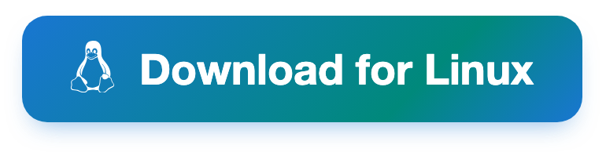
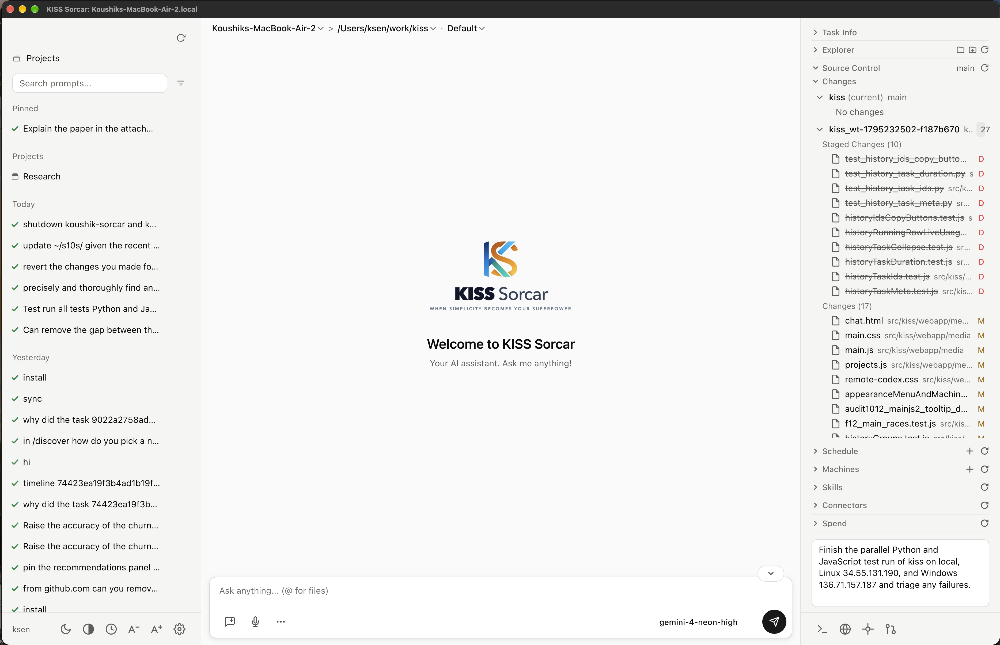

<div align="center">

<picture>
  <source media="(prefers-color-scheme: dark)" srcset="https://raw.githubusercontent.com/ksenxx/kiss_ai/main/assets/logo/kiss-sorcar-logo-dark.png">
  <source media="(prefers-color-scheme: light)" srcset="https://raw.githubusercontent.com/ksenxx/kiss_ai/main/assets/logo/kiss-sorcar-logo-light.png">
  
</picture>

<p>
  <a href="https://github.com/ksenxx/kiss_ai/raw/main/installers/KISS-Sorcar.pkg"></a>
  <br>
  System Settings → Privacy &amp; Security, click Open Anyway.
  <br>
  <sub>macOS 14 or later &middot; Apple silicon and Intel &middot; <a href="#mac-installer-package">how to open it</a></sub>
</p>
<p>
  <a href="https://github.com/ksenxx/kiss_ai/raw/main/installers/KISS-Sorcar-Setup.exe"></a>
  <br>
  Click More info, then Run anyway.
  <br>
  <sub>Windows 10 or 11, 64-bit &middot; <a href="#windows-setup-program">how to run it</a></sub>
</p>
<p>
  <a href="https://github.com/ksenxx/kiss_ai/raw/main/installers/KISS-Sorcar-Linux.run"></a>
  <br>
  Open a terminal and run <code>bash ~/Downloads/KISS-Sorcar-Linux.run</code>
  <br>
  <sub>64-bit Linux &middot; x86-64 and ARM64 &middot; <a href="#linux-installer">how to install it</a></sub>
</p>

[](https://pypi.org/project/kiss-agent-framework/)
[](LICENSE)
[](https://www.python.org/)
[](https://kisssorcar.github.io/)
[](https://arxiv.org/abs/2604.23822)

*"Everything should be made as simple as possible, but not simpler." — Albert Einstein*

</div>

# KISS Sorcar

### Open-source general-purpose recursively self-evolving AI agent for long-horizon tasks and AI discovery and optimization

**KISS Sorcar is a free, simple, local-first, bring-your-own-key AI agent framework.** It runs as a browser/mobile web app served by a local daemon, and offers a Python client API for scripting tasks. Your prompts and code go directly to the model provider or local endpoint you configure, never through our servers. Multi-model workflows take a paragraph of prompt, not a pipeline: complex AI systems and techniques can be replaced with a paragraph of prompt in KISS Sorcar.

```bash
curl -fsSL https://raw.githubusercontent.com/ksenxx/kiss_ai/main/scripts/install.sh | bash
```

This README is the quick start. The detailed references are:

- [FEATURES.md](FEATURES.md): the complete feature inventory, checked against the source tree.
- [src/kiss/server/README.md](src/kiss/server/README.md): every `sorcar.run()` option, tools, hooks, and the Sorcar Extension Agent authoring guide.
- [src/kiss/agents/third_party_agents/README.md](src/kiss/agents/third_party_agents/README.md): the messaging and service agents, sign-in, and worked examples.
- [MODELS.md](MODELS.md): the full per-provider model list.
- [kisssorcar.github.io/docs](https://kisssorcar.github.io/docs/index.md): installation, CLI, API, and messaging guides.

______________________________________________________________________

<details>
<summary><strong>Table of Contents</strong></summary>

- [Terminal-Bench 2.0](#terminal-bench-20-kiss-sorcar-vs-pi-codex-cli-and-claude-code)
- [What is in the Name](#what-is-in-the-name)
- [Installation](#installation)
  - [Install](#install)
  - [Docker](#docker)
  - [Python package install](#python-package-install)
  - [Configure model access](#configure-model-access)
- [Using KISS Sorcar](#using-kiss-sorcar)
  - [Web and mobile app](#web-and-mobile-app)
  - [Python client API](#python-client-api)
  - [Sorcar Extension Agents (SEAs)](#sorcar-extension-agents-seas)
  - [Skills, MCP servers, and customization](#skills-mcp-servers-and-customization)
- [Messaging & Third-Party Agents](#messaging--third-party-agents)
- [Models Supported](#models-supported)
- [Contributing](#contributing)
- [License](#license)
- [Citation](#citation)

</details>

<div align="center">
  
</div>

## Terminal-Bench 2.0: KISS Sorcar vs Pi, Codex CLI, and Claude Code

The [HarnessTax](https://harnesstax.github.io/) study (Pan, Yang, Arabzadeh, Chiang, Stoica, Zaharia; UC Berkeley and Arena Intelligence) holds the model fixed, swaps the harness between Claude Code, Codex CLI, and Pi, and finds that the harness moves cost far more than it moves what gets solved. We added KISS Sorcar to their Terminal-Bench 2.0 table on the same tasks, models, attempts, and verifier (the run settings that differ are listed below the table):

- **Tasks and attempts**: The same 30 sampled tasks across the same seven models, with three attempts per task, graded by the official Terminal-Bench 2.0 verifier.
- **System prompt**: Cut to 727 words of coding rules.
- **Overall solve rate**: Averaged over the seven models, KISS Sorcar solved 75.6% of attempts, compared to Pi at 70.0%, Codex CLI at 65.7%, and Claude Code at 65.1%, with the best point estimate on every model.

| Model | KISS Sorcar solved | $/att. | Pi solved | $/att. | Codex CLI solved | $/att. | Claude Code solved | $/att. |
|---|---:|---:|---:|---:|---:|---:|---:|---:|
| Claude Fable 5 | **80.0** | 1.50 | 71.1 | 1.08 | 72.2 | 0.98 | 75.6 | 1.55 |
| Claude Opus 4.8 | **74.4** | 1.21 | 72.2 | 0.76 | 72.2 | 0.85 | 68.9 | 0.90 |
| Claude Sonnet 4.6 | **76.7** | 2.23 | 65.6 | 0.61 | 63.3 | 0.55 | 62.2 | 0.67 |
| Claude Haiku 4.5 | **51.1** | 0.39 | 47.8 | 0.25 | 31.1 | 0.21 | 41.1 | 0.26 |
| GPT-5.6 Sol | **85.6** | 0.69 | 83.3 | 0.42 | 78.9 | 0.76 | 71.1 | 1.35 |
| GPT-5.6 Luna | **78.9** | 0.05 | 76.7 | 0.05 | 72.2 | 0.06 | 70.0 | 0.10 |
| Kimi K3 | **82.2** | 1.14 | 73.3 | 0.38 | 70.0 | 0.45 | 66.7 | 0.52 |
| **Mean of 7 models** | **75.6** | 1.03 | 70.0 | 0.51 | 65.7 | 0.55 | 65.1 | 0.77 |

- **Metrics**: Percentage of attempts solved and cost per attempt in USD on the study's 30-task Terminal-Bench 2.0 sample (three attempts per task). Bold marks the best point estimate per row.
- **KISS Sorcar configuration**: 630 attempts run on 25 September 2026, no turn cap, $50 budget per attempt, and providers' default request parameters.
- **Baseline columns**: Published numbers from the HarnessTax study (100-turn cap, high reasoning effort, priced on a 1 September list).

<div align="center">
  
</div>

### Paired Rerun Against Pi

Thirty tasks is a small sample (the pooled 95% interval, 63.8 to 85.9, contains all three published means), so we reran Pi ourselves in a paired comparison on Claude Fable 5 with no turn cap and the same price table:

- **Study's 30 sampled tasks**: KISS Sorcar solved 80.0% of attempts vs. Pi's 68.9%, a gap of +11.1 points (95% interval +3.3 to +20.0) for five cents more per attempt.
- **57 unsampled tasks**: KISS Sorcar solved 82.5% of attempts vs. Pi's 71.9%, a gap of +10.5 points (95% interval +2.9 to +18.7) for 63 cents more per attempt. Two of the 59 unsampled tasks (`qemu-alpine-ssh` and `qemu-startup`) are left out because their verifier failed for KISS Sorcar before running any test while it worked for Pi; with them kept, the gap is +6.8 points (95% interval -2.3 to +15.8).

## What is in the Name

- **KISS Agent Framework**: A deliberately small agent runtime organized around the [KISS principle](https://en.wikipedia.org/wiki/KISS_principle) ("Keep it Simple, Stupid").
- **Sorcar**: Pays homage to [P. C. Sorcar](https://en.wikipedia.org/wiki/P._C._Sorcar), the legendary Bengali magician, evoking the idea of an agent that performs feats that appear magical yet are grounded in disciplined engineering. Sorcar also means government in Bengali.

## Installation

### Install

```bash
curl -fsSL https://raw.githubusercontent.com/ksenxx/kiss_ai/main/scripts/install.sh | bash
```

- **One-liner workflow**:
  1. Clones or updates `~/.kiss/kiss_ai`.
  2. Runs `install.sh` from the directory where you invoked the command so the daemon serves that directory.
  3. Serves your home directory instead if the command was run inside `~/.kiss` or a brand's home (such as when the daemon updates itself from its own clone).

From a local checkout, run the equivalent command:

```bash
git clone https://github.com/ksenxx/kiss_ai.git && cd kiss_ai && ./install.sh
```

- **What it needs**: `install.sh` asks no question and needs no administrator password, no compiler and no Homebrew. It downloads what is missing (uv, Python, Chromium, cloudflared) into your home directory.
- **Windows**: The one-line command above is for macOS and Linux. On Windows, use the [Windows setup program](#windows-setup-program), or open Git Bash in a checkout and run `./install.sh` there.

### Mac installer package

[Download KISS-Sorcar.pkg](https://github.com/ksenxx/kiss_ai/raw/main/installers/KISS-Sorcar.pkg) and open it. It runs the same `install.sh` for the logged-in user on macOS 14 or later (Apple silicon and Intel) and needs no Homebrew, no git and none of Apple's developer tools. The Mac must be online: the installer downloads Python, the libraries and Chromium, about 1 GB.

- **First open**: The package is not signed with an Apple Developer ID, so macOS blocks it when you double-click it. Open **System Settings > Privacy & Security**, click **Open Anyway** next to the message about the package, and confirm with an administrator password. Or install it from Terminal, which is not blocked:

  ```bash
  installer -pkg ~/Downloads/KISS-Sorcar.pkg -target CurrentUserHomeDirectory
  ```

- **After the install**: KISS Sorcar opens in its own window. Enter the API key of a model provider in **Settings** before your first task.
- **Building it**: `scripts/build-macos-pkg.sh` builds the package from a checkout. `scripts/release.sh` builds `installers/KISS-Sorcar.pkg` for every release and commits it with the version bump; with `KISS_PKG_SIGN_IDENTITY` (a "Developer ID Installer" certificate) and `KISS_PKG_NOTARIZE_PROFILE` set, the released package is signed and notarized, and macOS opens it without the extra step.
- **Checking it**: `scripts/check-macos-pkg-vm.sh <tart image> ANTHROPIC_API_KEY` installs the package on a clean virtual Mac of another macOS version and runs a task there; `scripts/check-macos-install.sh` runs the same check on a Mac that has KISS Sorcar installed.

### Windows setup program

[Download KISS-Sorcar-Setup.exe](https://github.com/ksenxx/kiss_ai/raw/main/installers/KISS-Sorcar-Setup.exe) and open it. It runs the same `install.sh` for the user who opens it on 64-bit Windows 10 and Windows 11 (ARM PCs run it through Windows' built-in emulation; x64 parts of the install, such as `cloudflared`, need Windows 11 there) and needs no administrator rights, no git, no Python and no bash on the PC. The PC must be online: the installer downloads Python, the libraries and Chromium, about 1 GB, which takes a few minutes.

- **First open**: The program is not signed, so Windows SmartScreen shows "Windows protected your PC" for a downloaded copy. Click **More info**, then **Run anyway**. To install without a window, run it from a terminal with `/S`:

  ```
  KISS-Sorcar-Setup.exe /S
  ```

- **What it does**: It unpacks a copy of the sources into `%USERPROFILE%\.kiss\kiss_pkg` and runs `install.sh` through Git Bash. A PC without Git for Windows first gets the portable Git for Windows in `%LOCALAPPDATA%\Programs\Git`. `install.sh` builds the app in `%USERPROFILE%\.kiss\kiss` and starts the `kiss-web` daemon, which also starts at every logon of that user (a per-user "Run" registry entry, without a console window). It adds a **KISS Sorcar** shortcut to the Start Menu, puts the `sorcar` command (`sorcar.cmd`) in `%USERPROFILE%\.local\bin` and adds that folder to the user's PATH.
- **After the install**: KISS Sorcar opens in its own window. Enter the API key of a model provider in **Settings** before your first task.
- **Updating**: Windows cannot replace the files of a running program, so on Windows the installer stops `kiss-web` before it updates the app and starts it again afterwards (on macOS and Linux the daemon keeps running during an update). It refuses to update while tasks are running.
- **Uninstalling**: Open **Settings > Apps > Installed apps** (**Apps & features** on Windows 10), find **KISS Sorcar** and click **Uninstall**. This removes the app, the Start Menu shortcut, the logon start and the `sorcar` command. Your settings, API keys and history stay in `%USERPROFILE%\.kiss`.
- **Building it**: `scripts/build-windows-exe.sh` builds the program from a checkout with NSIS (`makensis`: `brew install makensis` on macOS, `apt install nsis` on Linux). `scripts/release.sh` builds `installers/KISS-Sorcar-Setup.exe` for every release and commits it with the version bump.

### Linux installer

[Download KISS-Sorcar-Linux.run](https://github.com/ksenxx/kiss_ai/raw/main/installers/KISS-Sorcar-Linux.run), open a terminal and run it:

```bash
bash ~/Downloads/KISS-Sorcar-Linux.run
```

It runs the same `install.sh` for the user who runs it on 64-bit Linux (x86-64 and ARM64) and needs no root, no git, no Python and no curl: `wget` is enough, which is what an Ubuntu desktop ships. The machine must be online: the installer downloads Python, the libraries and Chromium, about 1 GB.

- **What it does**: It unpacks a copy of the sources into `~/.kiss/kiss_pkg` and runs `install.sh`, which builds the app in `~/.kiss/kiss`, puts the `sorcar` command in `~/.local/bin` and starts the `kiss-web` daemon as a systemd user service, which also starts whenever the machine starts. The daemon's working folder is the directory you ran the command from, your home directory in a new terminal.
- **After the install**: KISS Sorcar opens in its own window; on a machine without a display (a server reached over ssh) the installer prints the address to open from another device and the remote-access password. Enter the API key of a model provider in **Settings** before your first task.
- **Tested on**: Ubuntu 24.04 LTS, 26.04 LTS and 26.10, Debian 13, Fedora 44 and 45, openSUSE Tumbleweed and Arch Linux, on x86-64 and ARM64 (Arch Linux on x86-64 only).
- **Chromium's libraries**: A desktop install has the system libraries the agent's browser needs. A minimal system (a server, a container) may lack them; the installer installs them when it runs as root or `sudo` asks no password, and otherwise prints the command that does: `sudo ~/.kiss/kiss/.venv/bin/python -m playwright install-deps chromium`.
- **Building it**: `scripts/build-linux-run.sh` builds the installer from a checkout; it needs only `tar` and `gzip`. `scripts/release.sh` builds `installers/KISS-Sorcar-Linux.run` for every release and commits it with the version bump.
- **Checking it**: `scripts/check-linux-run.sh <image> ANTHROPIC_API_KEY` installs it in a clean container of a distribution (`ubuntu:26.04`, `fedora:45`) and runs two tasks there; `scripts/check-linux-vm.sh <template> ANTHROPIC_API_KEY` does the same in a virtual machine ([lima](https://lima-vm.io) templates such as `ubuntu-26.04` and `fedora-45`), where it also restarts the machine and opens the app's window on a display; `scripts/check-linux-install.sh` runs the same check on a Linux machine that has KISS Sorcar installed.

### Docker

```bash
./sorcar-docker [PORT] [--rebuild]
```


### Python package install

Install only the Python package if you just need these components:

- The `kiss-web` daemon
- The Python client API
- The messaging-agent entry points

```bash
pipx install kiss-agent-framework
# or
uv tool install kiss-agent-framework
```

- **Python client API**: `pipx` and `uv tool install` keep the package in an isolated environment and expose only its commands. To import `kiss.server.sorcar` from your own code, install the package into that code's environment with `pip install kiss-agent-framework` or `uv add kiss-agent-framework`.
- **Python version**: KISS Sorcar requires Python 3.13+.

### Configure model access

Provide at least one model backend. You can set provider credentials with environment variables such as:

```bash
export ANTHROPIC_API_KEY=...
export OPENAI_API_KEY=...
export GEMINI_API_KEY=...
export OPENROUTER_API_KEY=...
```

#### Default and fast model order

The default and fast models follow the first provider with a configured credential, in the priority order below, so an installation with a key for a single provider never starts with "No model":

1. **Anthropic**: `claude-opus-5-5` (default) and `claude-sonnet-5-5` (fast).
2. **OpenAI**: `gpt-6.1-sol-medium` (default) and `gpt-6-luna` (fast).
3. **Gemini**: `gemini-3.8-flash` (default) and `gemini-3.5-flash-lite` (fast).
4. **OpenRouter**: `openrouter/anthropic/claude-opus-5.5` (default) and `openrouter/anthropic/claude-sonnet-5.5` (fast).
5. **Bedrock**: The cheapest registered `bedrock/` ID of that Anthropic model, or else the dearest (default) or cheapest (fast) registered `bedrock/` model by output price (see Amazon Bedrock below).
6. **Claude Code CLI**: `cc/opus` (default) and `cc/haiku` (fast).
7. **Codex CLI**: `codex/default`.

#### Amazon Bedrock

Claude models can also run through Amazon Bedrock:

- **Model IDs**:
  - The catalog lists Bedrock-served Claude IDs as `bedrock/<Bedrock model or inference-profile id>` (for example, `bedrock/global.anthropic.claude-opus-5-5` or `bedrock/us.anthropic.claude-opus-4-6-v1`), including the standard `-high` and `-max` effort suffixes.
  - Any other ID served by the configured region runs directly by name from the terminal (`sorcar -m bedrock/<id>`), or when a running agent switches to it with its `set_model` tool.
  - A task started through the daemon (the web app or the Python client API) accepts only the models the daemon lists, so add an ID missing from the catalog under Settings -> Custom Models first (name only, no endpoint); the daemon lists it, and the model picker shows it, from the next daemon start.
  - When Bedrock is the only configured provider, the default and fast models are the `global.` profiles of the Anthropic default and fast models.
- **Explicit credentials**: Set either a Bedrock API key or an AWS access key pair, plus the AWS region:

```bash
export AWS_BEARER_TOKEN_BEDROCK=...   # Bedrock API key (bearer token), or:
export AWS_ACCESS_KEY_ID=...
export AWS_SECRET_ACCESS_KEY=...
export AWS_SESSION_TOKEN=...          # temporary credentials only
export AWS_REGION=us-east-1           # default when unset
```

#### Settings: API keys

You can configure API keys, a custom model endpoint, and custom HTTP headers in the Settings panel of the web app.

#### Settings: Custom Models

The Custom Models section of the Settings panel registers your own models (such as a local vLLM or Ollama endpoint, or a provider model absent from the bundled catalog).

#### Settings: Bedrock, Claude Code, and Codex

- **Bedrock section**: Appears after Custom Models and holds the Bedrock API key, AWS access key pair, session token, and region.
- **Claude Code section (`cc/*` models)**: Configures models that run the `claude` CLI:
  - **Auth status**: Shows whether the `claude` CLI is logged in and how it will bill (`claude auth status`).
  - **Bill my Claude subscription for cc/ models**: Enabled by default.
    - When on, the CLI runs without `ANTHROPIC_API_KEY` or `ANTHROPIC_AUTH_TOKEN`, so a `claude auth login` session on a Pro or Max plan pays for the turn instead of API tokens.
    - When off, the CLI inherits the daemon's environment and an API key bills per token.
  - **Subscription token**: Accepts an optional token from `claude setup-token` (`CLAUDE_CODE_OAUTH_TOKEN`) for machines where nobody ran `claude auth login`.
- **Codex section (`codex/*` models)**: Configures models that run the `codex` CLI:
  - **Login status**: Shows whether the `codex` CLI is logged in and how it will bill (`codex login status`).
  - **Bill my ChatGPT subscription for codex/ models**: Enabled by default.
    - When on, the CLI runs without `OPENAI_API_KEY` or `CODEX_API_KEY` so it bills the logged-in ChatGPT plan; turns are refused if the CLI's saved login is an API key from `codex login --with-api-key`, which would bill per token anyway.
    - When off, `OPENAI_API_KEY` bills per token.
  - **Sign in with ChatGPT**: Starts `codex login --device-auth` on the daemon's machine and displays the URL and one-time code to enter in any browser (used to sign a headless machine in to a Plus or Pro plan).
  - **Codex access token**: Accepts `CODEX_ACCESS_TOKEN` (ChatGPT Business or Enterprise) for machines where nobody ran `codex login`.

#### How CLI models run (`cc/*` and `codex/*`)

Both CLIs are driven as plain models with their built-in tools, MCP servers, hooks, and project instructions turned off, operating with Sorcar's system prompt and tools like every other model.


#### Router agents

The model picker lists six bundled router agents under the `Router` group. These are Sorcar Extension Agents (see below), not standalone models:

- **`autorouter`**:
  - Runs its routing session on `claude-opus-5-5-medium` (with pre-run classification off, and web tools and memory on).
  - Splits a task into units with a mechanical acceptance check and dispatches them to the cheapest model tier that passes the check, escalating on failure.
  - Resolves each tier as an ordered candidate list where each direct model is followed by its `openrouter/...` twin, selecting the first candidate the installation can run:
    1. **Small tier**: Opens with `openrouter/z-ai/glm-5.3-flash`, `gpt-6-luna-xhigh`, `openrouter/openai/gpt-6-luna-xhigh`.
    2. **Medium tier**: Opens with `openrouter/meta/muse-wonder`, `gemini-4-argon`, `openrouter/google/gemini-4-argon`.
    3. **Frontier tier**: Opens with `gpt-6-astra`, `openrouter/openai/gpt-6-astra`, `claude-fable-5-2-max`, its OpenRouter twin, `claude-opus-5-5-max`.
  - Keeps work that has no mechanical check in its own loop (plan and final acceptance on the frontier model, execution on the medium pick), and never routes guarded work, final acceptance of the whole task, root-cause analysis after two failed fixes, or prose sent on the user's behalf to the small or medium tier.
  - Switches its own model only at phase boundaries.
- **`bestrouter`**:
  - Starts every task on `claude-opus-5-5-medium`, which answers simple questions and queries directly.
  - Switches to `gemini-4-neon-high` to write human-facing documents, papers, reports, and results (including the final summary).
  - Switches to `claude-fable-5-2-max` for all other work, including software development and analysis; a task that mainly dispatches sub-agents may dispatch, wait, and log on `claude-opus-5-5-medium`, while judgment steps (such as triaging a failed test run or acting on a sub-agent's failure) run on `claude-fable-5-2-max`.
  - Runs `gpt-6-astra-xhigh` to review the work of both models read-only through a non-blocking `run_agent` call on at most 75% of the budget.
- **`orautorouter`**:
  - Restricts `autorouter` to the OpenRouter vendor so a single OpenRouter key runs it.
  - Routes on `openrouter/anthropic/claude-opus-5.5-medium` and populates its tiers only with `openrouter/...` models (the OpenRouter twins of `autorouter`'s candidates, in the same order).
- **`orbestrouter`**:
  - Restricts `bestrouter` to the OpenRouter vendor so a single OpenRouter key runs it.
  - Starts on `openrouter/anthropic/claude-opus-5.5-medium`, works on `openrouter/anthropic/claude-fable-5.2-max`, writes on `openrouter/google/gemini-4-neon`, and reviews with `openrouter/openai/gpt-6-astra-xhigh`.
- **`ccxbestrouter`**:
  - Runs `bestrouter` on the Claude Code and Codex CLIs so a Claude subscription and a ChatGPT subscription run it without API tokens.
  - Starts on `cc/claude-opus-5-5-medium`, works on `cc/claude-fable-5-2-max`, writes on `cc/claude-opus-5-5-max`, and reviews with `codex/gpt-6-astra-xhigh` (`codex/gpt-6-astra` at `xhigh` reasoning effort).
- **`brbestrouter`**:
  - Runs `bestrouter` on Amazon Bedrock's global cross-region inference profiles so one set of AWS credentials runs it.
  - Starts on `bedrock/global.anthropic.claude-opus-5-5-medium`, works and writes on `bedrock/global.anthropic.claude-opus-5-5-max`, and reviews with `bedrock/global.anthropic.claude-fable-5-1-max`.

## Using KISS Sorcar

KISS Sorcar provides three client interfaces:

- **Daemon-served interfaces** (both served by one local daemon):
  - **Web/mobile app**
  - **Python client API**
- **`sorcar` terminal command**: Runs a SorcarAgent directly in the current directory without the daemon:
  - `sorcar -t "Summarize README.md"` runs an inline task.
  - `sorcar -f task.txt` runs the file's content as the task.
  - Exactly one of `-t` or `-f` is required.
  - Run `sorcar --help` for the model, budget, and work-dir flags.

### Web and mobile app

Open the web app in a browser and type or speak your task. The chat interface provides:

- **`@` file and folder mentions**: Provides ranked completion from a persistent index of your working directory and home directory.
- **Git worktree isolation**: Managed automatically by the agent inside a git checkout, with no setting to toggle.
- **Checkpoints and rollbacks**: Top-level tasks in a git checkout provide **`checkpoint(name)`** and **`rollback(name)`**.
- **Model picker**: Lists the available models and default model for the machine shown in the chat header's drop-down.
- **Per-task budget caps**: Sets maximum spend limits for individual tasks.
- **Chat history**: Organizes chats and tasks with tags, editable summaries, sorting, filtering, and live metrics.
- **Wake-word voice chat**
  - Speak "Hey Sorcar, …" via **Voice trigger** in the "…" menu to talk to Sorcar or steer a running agent by voice.
- **Voice dictation**: Click the mic button below the composer (where **Inject promptlet** used to be) to listen without a wake word.
- **Live steering**
  - Inject a message into a running agent or switch its model mid-run.
  - Wrap the message in `<task>…</task>` to queue it as the next task instead (after a click on an earlier task in the Chats panel, it continues that task).
  - A queued `<task>/command …</task>` runs as that slash command, through its SEA, in a run of its own once the current run has finished.
- **Agent questions**
  - When an agent asks a question, every connected surface brings its tab forward and turns the composer into the answer box.
- **Browser tab**
  - Streams a real browser running alongside the daemon to every connected surface, selecting the browser executable in fallback order: `KISS_BROWSER` when set, the machine's default browser when it is Chromium-based, the first installed Chromium-family browser, then Playwright's bundled Chromium.
- **Scheduled automations**
  - Ask in plain language ("every weekday at 9am, summarize my unread Slack messages") and the built-in cron agent creates, lists, pauses, resumes, or removes the schedule; the Schedule panel has buttons for the same actions.

#### Remote access

- **Cloudflared tunnel**:
  - Copy the URL and password from the Settings panel to open the web app on any device.
  - Each browser tab is titled `KISS Sorcar: <machine name>` so multiple servers are easy to tell apart.
- **Per-machine ntfy.sh notifications**:
  - The daemon posts each new tunnel URL, followed by the machine name in parentheses, to a private per-machine ntfy.sh topic linked from the Settings panel.
  - A phone subscribed to topics from multiple machines can distinguish their URLs after a restart.

### Python client API

Any Python process can run a task on the daemon with `kiss.server.sorcar.run` and block until it finishes (up to `timeout`, one hour by default):

- **Web app tab behavior**: The task shows up as a tab in the web app while it runs. Closing that tab hides the task without ending it, and the Python caller still receives its result.
- **Automatic reconnection**: If the daemon drops a connection mid-run, the client reconnects for up to five minutes while `timeout` continues running. The daemon replays missed events, identifying the run by its task ID or, before it has one, by a token the client minted.
- **Session handoffs**: A session handoff (`finish(success=False, is_continue=True)`) does not end the run; the caller continues waiting for the next session.

```python
from kiss.server import sorcar

result = sorcar.run("Summarize README.md", work_dir="/path/to/repo")
print(result.text, result.success, result.cost, result.tokens, result.steps)

# Continue the same chat (the agent sees the prior task as context):
follow_up = sorcar.run("Now fix the typos you found", chat_id=result.chat_id)
```

`run()` accepts keyword options documented in [src/kiss/server/README.md](src/kiss/server/README.md):

- **Chat interface options**: `model`, `work_dir`, `chat_id`, `max_budget`, `model_config`, `use_web_tools`, `use_memory`, `compaction`, `auto_classify`, `tool_profile`, `docker_image`, `timeout`, and more.
- **Agent customization options**:
  - `system_prompt`
  - `add_to_system_prompt`
  - `add_to_prompt`
  - `sea_path`: Runs a Sorcar Extension Agent, a Python file imported and executed in the daemon process whose `settings()` configures the run and whose `tools()` supplies extra tool functions.

### Sorcar Extension Agents (SEAs)

A **Sorcar Extension Agent (SEA)** is a Python file at `<name>/<name>_sea.py` that defines one class deriving from one of the three base classes in `kiss.agents.seas.base.base_sea`.

- Pass the file's path as `sea_path` to `sorcar.run()`, or as the `agent` of the `run_agent` tool (which also takes the name of a registered command).
- On every run, the daemon executes the file, instantiates the class, and calls the methods it defines.
- A SEA builds on another SEA through Python inheritance (`class MySea(ShSea)`, or `sea_class("sh")` from `kiss.agents.sorcar.sea_commands`):
  - The launcher applies base class methods first, so SEA methods never call `super()`.
  - When the model picker checks which SEAs register as models (`register_as_model()`), a base class imported the ordinary way (`from parent_sea import Parent`) is re-executed from its file once that file changes and the derived SEA is loaded again, so editing a base class updates the verdict without a restart.

#### Base classes

A SEA's behavior starts from its base class:

- `BaseSea`: Runs an ordinary Sorcar session with the caller's or user's settings. Every method on `BaseSea` passes its input through unchanged. Its one built-in rule enforces the `summary` cadence: a run that has the `summary` tool must call it at every tenth step of the `Steps:` footer count, and until it does, every other tool call except `finish` runs with `base_sea.SUMMARY_DUE_NOTE` appended to its result asking for `summary(description=...)` as the next call.
- `WorkerSea`: Runs a focused, tool-bound task on the caller's tree:
  - Places `WORKER_DEFAULTS` beneath the subclass's settings (no classifier, no browser, no memory).
  - Drops `create_worktree` and `commit_and_merge` in `tools()`, so a worker edits the caller's tree in place.
- `ChannelSea`: Runs a worker that serves an external service (every behavior is listed in `sea_settings.CHANNEL_BEHAVIOURS`):
  - Runs from `$KISS_HOME/channel_work` unless its own `work_dir` specifies otherwise (as `/cron` does with `cron/work`).
  - Holds its channel workspace and receives the channel preamble.
  - Never inherits settings from a calling task, and locks `work_dir` along with the worker keys.

#### Settings

`settings(self, settings)` receives the dict built by the base classes and returns the dict to use (`settings | {...}`):

- **Per-run `run()` parameters**: `model`, `max_budget`, `tool_profile`, `work_dir`, `chat_id`, `use_web_tools`, `use_memory`, `compaction`, `auto_classify`, `model_config`, and `docker_image`. A relative `work_dir`, whether set in a SEA or in a call option, resolves under the calling task's directory.
- `timeout`: Seconds a `run_agent` call waits for the script before handing back a job ID (3600 by default).
- `locked`: Keys that an explicit `run_agent` argument may not change.
- `hidden`: Setting `True` keeps the SEA out of the command list, so it is neither a `/command` nor a `run_agent` agent name. It remains loadable by path and usable as a base class, and the hidden `sorcar` SEA is what an empty `agent` runs.
- **Removed keys**: Former keys (`kind`, `preset`, `channel`, `allow_fan_out`, `is_parallel`, `inherit`, `extends`, `append_basic_tools`, `use_worktree`, `auto_commit`, and `append_to_*` or `add_to_*` prompt keys) are refused with an error message explaining what replaced them (`sea_settings.REMOVED_SETTINGS`).

Settings resolve in the following precedence order (lowest to highest):

1. **Caller or daemon defaults**: Parameters omitted by the SEA keep the calling task's values, or use the daemon's defaults for a channel (which inherits nothing from the calling task) or when the call passes `inherit: false`.
2. **Base class defaults**: Base class `settings()` values apply first.
3. **Subclass settings**: Keys returned by a subclass override its base class defaults.
4. **Explicit call arguments**: An explicit `run_agent` argument or option overrides the SEA's value unless the SEA lists that key in `locked`.

#### Methods and hooks

While `settings()` supplies data, text, tools, and execution hooks come from the remaining methods:

- `description()`: Returns one sentence summarizing the SEA, defined on every command SEA and printed by `/<name> help`.
- `prompt(self, task)`: Receives the task text and returns the prompt body (`{task_id}` in the returned string becomes the calling task's ID).
- `system_prompt(self, system_prompt)`: Receives the assembled system prompt and returns the prompt to use (return custom text to replace it, or `system_prompt + "\n\n" + more` to append).
- `tools(self, tools)`: Receives the run's toolset and returns the final tool list:
  - `tools + [mine]` adds custom tool callables to the built-in toolset.
  - Setting `"tool_profile": "none"` drops the built-in toolset so the returned callables plus `finish` form the agent's entire tool set.
- **Executor hooks**: Three hook methods run in the task's executor sessions (internal helper sessions are not hooked, and a `run_agent` or `run_parallel` child uses the hooks of its own layers rather than the parent's):
  - `llm_call_hook(self, new_messages)`: Runs before each model call.
  - `llm_response_hook(self, reply)`: Runs after each model reply and before any of the reply's pending tool calls execute (a tool that a CLI-backed model such as Codex ran natively during its turn has already executed). `reply` is an `LLMReply` containing the text, tool calls, call usage with `stop_reason`, step number, and the run's cost and token totals so far.
  - `tool_call_hook(self, name, args)`: Runs before each tool call.
- **`Verdict` return values** (imported from `base_sea` and returned by the response and tool hooks):
  - `ALLOW`: Lets the reply or tool call proceed.
  - `refuse(text)` (tool hook only): Suppresses the call and returns *text* to the model.
  - `allow_with_note(text)` (tool hook only): Lets the call run and appends *text* to its result (`finish` carries no note).
  - `end_run(result, success=True)`: Ends the run with *result* without running the call or any other still-pending call from that reply.

#### Tooling

- `/<name> check`: Loads the SEA class in chat and prints its inheritance chain, effective settings, model, tools, defined methods, and the sample prompt a run would use, or reports the first error.
- `sea lint [paths] [--fix] [--registered]`: Checks SEA files from the shell against the SEA contract:
  - Validates every bundled SEA by default; `--registered` adds the SEAs listed in your `SEAS.md`.
  - `--fix` atomically rewrites renamed and removed keys, old base classes, and verdicts. Any rewrite that would no longer parse is reported as `not fixed <path>: <why>` and the file is left unchanged.
- `sea docs [--check] [pages...]`: Regenerates the settings, base-class, channel, precedence, option, and command tables between `<!-- sea-docs: … -->` markers in documentation files:
  - Updates existing bundled pages by default.
  - `--check` only reports stale blocks without modifying files.
  - Reports `missing: <path>` when a page named on the command line does not exist.

One file is a complete custom agent:

```python
# weather/weather_sea.py — a minimal SEA
from typing import Any

import requests

from kiss.agents.seas.base.base_sea import WorkerSea

def get_weather(city: str) -> str:
    """Return current weather for a city from wttr.in.

    Args:
        city: City name to look up.
    """
    resp = requests.get(f"https://wttr.in/{city}?format=3", timeout=10)
    resp.raise_for_status()
    return resp.text.strip()

class WeatherSea(WorkerSea):
    def description(self) -> str:
        return "Reports the current weather in a city (San Francisco when none is given) from wttr.in."

    def settings(self, settings: dict[str, Any]) -> dict[str, Any]:
        """A worker run whose only tools are get_weather and finish."""
        return settings | {
            "max_budget": 0.50,
            "tool_profile": "none",
        }

    def prompt(self, task: str) -> str:
        return f"Look up the current weather in {task or 'San Francisco'} and report it."

    def system_prompt(self, system_prompt: str) -> str:
        return ("You are a weather assistant. Use the get_weather tool "
                "to look up weather, then call finish with the result.")

    def tools(self, tools: list[Any]) -> list[Any]:
        """With tool_profile "none" above, get_weather and finish are the whole tool set."""
        return tools + [get_weather]
```

```python
from kiss.server import sorcar

result = sorcar.run("Paris", sea_path="weather/weather_sea.py")
```

#### Slash commands

Every SEA folder in a scanned directory whose settings do not mark it `hidden` is registered as a chat slash command and sub-agent:

- **Direct execution**: `/xxx some text` runs `xxx/xxx_sea.py` directly in the active tab with "some text" as the task and the SEA's settings, system prompt, and tools applied to that run (with no relay turn by the chat agent and no nested sub-agent tab).
- **Help**: `/xxx help` prints the SEA's `description()` without making a model call.
- **Sub-task dispatch**: Any task can invoke the same SEA as a sub-task via `run_agent(agent="xxx", task=...)`.
- **Inline command descriptions**: If a task you type names a slash command elsewhere in its text, or an earlier task in the same chat does (such as `... You must use /discover ...` followed by `continue`), each named command's `description()` is appended after the task under `# Slash commands the user named` so the agent knows what the command does before calling it with `run_agent`. A task that itself runs a slash command gets no such block, and neither does a sub-agent's task.
- **Composer completion popup**: Typing `/` at the start of any word in the composer opens a completion popup (a `/` inside a path such as `src/` or `@docs/` does not). Accepting a command replaces the whole command word, including any part after the cursor, while preserving the text before and after it. Because ranking is derived from task history, every surface shows commands in the same order:
  1. The three commands run most recently.
  2. Commands run at least twice, ordered from most-run to least-run.
  3. All remaining commands.

#### Bundled commands

Channel agents (`/slack`, `/gmail`, and others) register as slash commands, along with 34 of the 36 bundled SEAs in `src/kiss/agents/seas/` (the hidden `coding` and `sorcar` SEAs register no command, and the `base` folder holds the base classes rather than a SEA):

- `/ask`: Answers a question about the current task from its persisted events.
- `/sh`: Runs a shell command.
- `/sync`: Commits uncommitted changes in the checkout on the current branch, fetches `origin/main`, merges it into that branch, and pushes.
  - When remote machines are registered, `/sync` runs in three phases so every checkout ends up with what the others pushed:
    1. Runs `run_agent(agent="sync", machine=<name>)` one machine at a time on each machine's checkout of the same repository (located by remote URL regardless of directory path).
    2. Syncs the local checkout on the current machine.
    3. Runs the sync across every registered machine once more.
  - Usage variants:
    - `/sync`: Runs with the SEA's built-in task text.
    - `/sync <remote>/<branch>`: Merges another remote branch instead of `origin/main`.
    - `/sync this machine only`: Skips remote machines (also passed to each remote sub-task so it does not fan out again).
- `/sync_history_and_memory`: Merges `history.db` and `memories/` across the local machine and every SSH-registered machine in one `sync_history_and_memory` tool call with no other tools and a $1 budget.
  - **Three-wave execution**: Connects to every SSH machine concurrently, over one multiplexed SSH connection per machine (machines registered by URL rather than SSH are reported as skipped; a machine that fails in one wave is omitted from later waves and reported as skipped or half-synced):
    1. Finds the Sorcar home directory of the daemon each machine was registered with (`~/.kiss` on a stock install or a branded install's own home directory, allowing stock and branded installs to sync with each other).
    2. Pulls each machine's database rows and memories into the local machine.
    3. Pushes the combined union back to each machine so a single run converges every machine that finishes all three waves.
  - **History merge (`src/kiss/scripts/sync_db.py`)**:
    - Unions tasks by ID and events by `(task_id, seq)`, carrying deletions across unless a row is younger than its deletion (since a reused ID is a new task); a key deleted again after reappearing travels with its newer deletion timestamp.
    - Stamps a task row leaving its home database with that machine's short host name in its `machine` column, keeps the existing name on rows originating from a third machine, and clears the stamp when a row returns to the machine it ran on. The Chats panel on every machine then lists synced tasks under the registered machine that ran them, while rows from unregistered hosts remain listed as local.
    - Holds back still-running tasks whose latest activity (the later of start time and newest event) is younger than 300 s on their home machine (or 24 h for rows still holding the web app's start placeholder) so they travel once finished without data loss.
  - **Memory merge**:
    - Transfers memory pages only when their content hash differs.
    - Holds, on each side during the merge, the same memory lock an agent takes to write or delete a page, ensuring concurrent writes land cleanly before or after the merge.
    - The page with the newer `updated` timestamp wins; two writes no further apart than the measured spread of the machines' clocks are reported as a conflict instead, and each side keeps its own version.
  - **Usage variants**:
    - `/sync_history_and_memory`: Syncs every registered SSH machine.
    - `/sync_history_and_memory <machine>`: Syncs a single machine.
    - `/sync_history_and_memory dry run`: Reports what would travel without making changes.
- `/install`: Runs `./install.sh --non-interactive` concurrently across every SSH-registered machine via one `install_on_machines` tool call with a $1 budget.
  - Executes inside the private kiss checkout (the clone of `https://github.com/ksenxx/kiss.git` in each login's home directory).
  - Reports each machine as ok or failed with the trailing lines of its output and the remote-access password redacted.
  - `/install <machine>[,<machine>]` installs only on the named machines.
- `/good_morning`: Generates the morning greeting shown in the web app.
- `/recommendations`: Generates the stored next-task suggestions shown in the web app.
- `/machine`: Registers, forgets, or lists remote Sorcar machines.
  - **Registration commands**:
    - `/machine add user@host`: Uses SSH once to enroll the local daemon's certificate on the remote machine, then reaches its daemon port over a persistent `ssh -N -L` port-forward using that certificate. Only the SSH port needs to be open, and removing SSH access revokes the machine. The daemon counts the forward as up only after SSH reports the local port bound, switching to a fresh local port if binding fails.
    - `/machine add <name> <https://host:port> <password>`: Registers a remote daemon by HTTPS URL and password.
  - **Remote chats and task routing**:
    - Merges every registered machine's tasks alongside local tasks in the Chats panel, ordered with running tasks first, then pinned ones, then the rest, each newest first.
    - Keeps displaying the page an unresponsive machine last answered with rather than dropping it, both for the unfiltered list and for the latest search or tag view it answered; for any other filtered view, when the machine has never answered, or after its registration changes, it contributes nothing until it answers again.
    - Exposes the machine in the chat header's machine drop-down to run chat tasks remotely, and supports `run_agent(machine=<name>, ...)` to run sub-tasks there using that machine's tools, files, and models (nesting its tab under the caller's on every surface).
- `/rsi7d`: Performs seven-day recursive self-improvement on the bundled SEAs from their logged runs.
  - Passes each SEA to `/discover`, which edits the SEA script in place in a detached worktree at `<scratch dir>/rsi7d/discover/<name>`, evaluating one replay of a past run per candidate point.
  - Copies the resulting script into the checkout only when the child reports success, modified nothing outside the script and its test file, and leaves a script that compiles, loads, and passes `sea lint`.
  - Removes the detached worktree afterward while keeping evaluated commits under `refs/discover/<child task id>/`.
- `/merge`: Resolves a conflicted git merge.
- `/task_update`: Generates a progress report on a task.
- `/autorouter`: Routes tasks across models automatically (see [Router agents](#router-agents) above).
- `/bestrouter`: Runs the multi-model router protocol (see [Router agents](#router-agents) above).
- `/orautorouter`: Model router variant (see [Router agents](#router-agents) above).
- `/orbestrouter`: Model router variant (see [Router agents](#router-agents) above).
- `/ccxbestrouter`: Runs the `/bestrouter` protocol on Claude Code and Codex models.
- `/brbestrouter`: Runs the `/bestrouter` protocol on Amazon Bedrock's Claude models.
- `/skillopt`: Optimizes a skill or prompt constant against an evaluation set.
- `/write_paper`: Writes a research paper.
- `/review_paper`: Reviews a research paper.
- `/revise_and_review_paper`: Iterates on revising and reviewing a research paper.
- `/write_patent`: Drafts a utility patent application in the 37 CFR 1.77 layout with proofreader gates and a DOCX/PDF build.
- `/review_patent`: Reviews a draft or published patent like an examiner, claim by claim: prior-art search, eligibility, novelty, obviousness, and definiteness.
- `/git_extract_knowledge`: Builds and maintains a repository's durable memory.
- `/memory_consolidate`: Merges near-duplicate memory pages without losing a fact.
  - Takes up to 10 groups of pages at similarity 0.9 or more that fit in one page together (`--limit N` changes the number), the most similar first. The task's model writes the page that would replace each group; a model of another family where one is configured (`--judge <model>` names it) writes questions from the original pages, checks that the new page answers every one, and reads both sides for a fact that went missing.
  - A dry run by default: it reports what it would merge and writes nothing. With `--apply` in the task text it merges the groups that pass, keeps the originals in `<memory>/.archive/` and records the groups it left alone for a lasting reason (separate records, a merged page too large, a fact not kept) so the next run moves on to others. A group whose check ended in a reply that could not be used is not recorded and is examined again.
  - `--list` shows past merges, `--restore <merge>` undoes one (without needing `--apply`), and `--memory <name>` narrows the job to one memory.
- `/memory_quiz`: Checks that what your finished tasks learned can be found in memory.
  - For each task of yours from the last 2 days (`--days N`; at most 20 per run, `--limit N`) that ran on this machine and ended in a report, the quiz run's model writes up to 5 questions about the durable knowledge in the report, and the checking model (chosen as for `/memory_consolidate`) confirms that the report states each answer. Memory is then searched as a new task in that directory would search it, and the checking model reads the first 5 results.
  - Each question ends as a hit (found), a retrieval gap (stored, but the search did not bring it up) or a construction gap (never stored). `--task <id prefix>` questions one task.
  - Writes only its log, `<memory root>/.quiz/log.jsonl`, unless the task text holds `--write`; then the facts of a task's construction gaps go into one new page marked `writer: quiz`, each with the report sentence it came from.
- `/write`: Writes prose for a general audience.
- `/devtools`: Drives a web app like a developer in DevTools (`/devtools <page or app, what to do or what is broken>`):
  - Verifies every click with `evaluate_script`, `list_console_messages`, `list_network_requests`, and `wait_for` rather than re-reading the accessibility tree.
  - Switches browser tools on automatically and reaches your own Chrome via `attach_to_chrome` or `use_my_chrome`.
- `/discover`: Runs the AI discovery loop inside a git repository (loop instructions live in the SEA and are appended to its system prompt, not in `SYSTEM.md`):
  - **Commit refs**: Stores every evaluated idea as a commit under `refs/discover/<task id>/<id>` so it outlives resets and squash merges.
  - **Discovery loop steps**:
    1. Fixes a dev / held-out split along with its evaluation command and noise floor (the held-out split is off-limits afterward and read only by the held-out check).
    2. Profiles the baseline and searches the state of the art.
    3. Writes and pairwise-judges candidate ideas, implements the winner on its parent point's commit, evaluates it, and commits the result.
    4. Maintains a Pareto frontier of winning commits (each linked to its parent) against the user's metrics, logging each evaluated idea as KEPT, TIE, or FAILED (TIE and FAILED ideas are never retried; evicted frontier points are logged as DOMINATED).
    5. Draws a single random number from a Bash call to pick the next operator:
       - A variant of a frontier point reasoned from its observations.
       - A composition of two frontier points covering different aspects (or, if no pair qualifies, a fork of the oldest frontier point that is an ancestor of another so the two can compose later).
       - Fresh ideas from a web search, `gpt-6-astra`, or `gemini-4-argon`.
    6. Checks any frontier or TIE point that meets the goal on dev metrics once on the held-out split:
       - Ends the loop if held-out metrics also meet the goal, are no worse than the baseline on the task's first-priority metric, and are neither dominated nor equaled by the baseline's held-out metrics.
       - Evicts the point as OVERFIT otherwise (restoring the baseline to the frontier if eviction leaves it empty).
    7. Stops at the budget or round limit (100 rounds unless the task specifies otherwise), runs held-out checks across frontier and TIE points in the task's metric-priority order, selects the first point that is no worse than the baseline on the first-priority metric and is neither dominated nor equaled by it (or falls back to the baseline), resets the working tree to that commit, and reports it with its dev and held-out metrics.
  - **Read-only and research modes**:
    - Tasks asking only for research, ideas, or a ranking still execute the loop and rank candidates by measured dev metrics.
    - Tasks forbidding changes to the repository run the loop in a lab copy of the artifact's current files at `<scratch dir>/lab` (with its own `git init` and `create_worktree`), returning the best point as `<scratch dir>/best.patch` from `git diff --binary` for the user to apply.
- `/discover_viz`: Turns the persisted trajectory of a `/discover` run into one self-contained HTML animation of its Pareto frontier (`/discover_viz <task id or its first six or more characters>`; no id animates the newest `/discover` run, and the id of a task that is not itself a `/discover` run but dispatched some animates the newest of those, saying so in the tool's reply; a task that ran no discovery loop is refused with a list of recent runs):
  - **What the page shows**:
    - The evaluated points appear one by one, each drawn under its parent; a compose is joined to both of its points.
    - Hovering or focusing a point shows its `pareto.md` fields as a tooltip (for a point that never entered the frontier, the fields of its `explored-ideas.md` row).
    - Every round takes two steps: how the idea was picked (first idea, variant, compose, fork or fresh, with the logged draw and the reason), then whether the point was added to the frontier or discarded (TIE or FAILED) and which points it pushed off (DOMINATED, OVERFIT).
    - Play, pause, step, a slider, a speed setting and a switch that hides discarded ideas; `#frame=N` in the URL opens a given step.
  - **How it stays faithful to the run**:
    1. The `discover_trajectory` tool lists, in order, every `Write`, `Edit` and shell command of the trajectory that touched `pareto.md`, `explored-ideas.md`, `ideas.md` or `split.md`, every `Read` of the first two, every random draw and every `decide` call, plus the copies still on disk.
    2. The model reads that evidence and writes the run as a JSON story, because the layout of these files differs from run to run.
    3. The `render_discover_viz` tool refuses a story that is malformed, that the loop could not have produced (a parent evaluated later or never on the frontier, an eviction of a point that is not on the frontier, a promotion other than the baseline put back or a TIE point, an empty frontier, a best point off the frontier), or that quotes a detail, score, draw or decimal number the run did not record; otherwise it writes the page.
    4. The agent opens the page, runs its self-check (`window.discoverViz.selfCheck()`), looks at a screenshot and shows the page in the Browser tab.
  - Writes to `reports/discover-viz-<first 8 characters of the task id>.html` unless the task names another path.
- `/gepa`: Runs GEPA, the reflective text optimizer, from pseudocode adapted from the official `gepa-ai/gepa` implementation and appended to the SEA's system prompt (`/gepa <the texts to optimize, the train and validation data, the evaluation command or metric with its feedback, and the budget>`):
  - **Optimization iterations**:
    1. Scores the system's seed texts (prompts, instructions, code, configuration) on the validation set.
    2. Draws a candidate from the per-example Pareto front on each iteration and runs it on a minibatch of 3 training examples.
    3. Passes the full outputs and feedback to the SEA's `reflect` tool, which makes one fresh call to the reflection model (the run's model unless the task names another) on the official reflection prompt with no tools and no memory of the run to rewrite a single component. The agent never writes or edits candidate texts itself.
    4. Keeps the rewrite only when the minibatch total improves, then scores it across the whole validation set (running the official merge of two frontier candidates when the task requests it).
    5. Stops at the task's metric-call budget (10 validation passes when none is given).
  - **Engine script and saved state**:
    - The agent writes `gepa.py` once from the pseudocode to handle bookkeeping (Pareto fronts, seeded draws, and budget), and `gepa.py` alone runs the evaluation command so the metric-call count matches the official engine.
    - Stores `state.json`, `log.jsonl`, `candidates/`, and `records/` in `<scratch dir>/gepa`, allowing a continued run to resume.
- `/remember`: Adds a standing instruction in `~/.kiss/AGENTS.md`.
- `/forget`: Removes a standing instruction from `~/.kiss/AGENTS.md`.
- `/timeline`: Draws the sub-agents of a task as an SVG Gantt chart from the task history and shows it in the result (`/timeline <task id or its first six or more characters>`):
  - One thin bar per sub-agent in the order they started, coloured by role. The model reads how the sub-agents' task texts open (the `timeline_agents` tool) and names the roles; the `draw_timeline` tool draws everything else from the history and refuses roles that leave a sub-agent out.
  - Dashed lines mark task updates and `/ask` questions, numbered lines the messages you sent to the running task, and numbered shaded bands every stretch of over 10 minutes that the task spent in one tool call while no sub-agent ran; a note under the chart says what the task was waiting on.
  - A sub-agent with no recorded end (still running, or killed) is drawn pale, up to the end of the run.
  - Writes `reports/timeline-<first 8 characters of the task id>.svg` in the work dir unless the task names another path.

Additional bundled SEA rules and registration:

- **No pinned models**: Routers aside, none of these commands pins a model in its settings: each runs on the caller's model.
- **Hidden bundled SEAs** (`"hidden": True` in `settings()`, so neither registers a slash command):
  - `sorcar`: The plain sub-agent `run_agent` uses when `agent` is empty.
  - `coding`: The unattended benchmark harness whose generated per-trial SEAs are loaded by path.
- **Custom SEA registration and docs**:
  - List custom SEA folders, one per line, in `~/.kiss/SEAS.md`; changes are picked up within two seconds.
  - Full documentation for the `settings()` contract, type checking, hooks, and dispatch flow is in [src/kiss/server/README.md](src/kiss/server/README.md) and [docs/sea-commands.md](https://kisssorcar.github.io/docs/sea-commands.md).

### Skills, MCP servers, and customization

#### Agent Skills

- Loaded from the following locations:
  - `~/.kiss/skills`
  - `<project>/.kiss/skills`
  - Claude skill directories
  - `.agents/skills`
  - The git-ignored `src/kiss/agents/claude_skills/` folder of the checkout, where Claude Code plugins can be dropped (`<plugin>/skills/<name>/SKILL.md`, loaded as `<plugin>:<name>`).
- A `SKILL.md` file whose YAML frontmatter does not parse still loads without metadata, using its first paragraph as the description.
- No skills ship with the repository itself.
- The web app's **Skills** panel adds a skill from the [skills.sh](https://skills.sh) registry to `~/.kiss/skills` after a security check:
  - Only a skill kept in a GitHub repository can be added, and one whose name the agent already has is refused.
  - A skill may hold at most 500 files, 5 MiB in one file, and 20 MiB in all, in folders at most 32 deep, and nothing but plain files (no links, no sparse files).
  - The skill is taken from the default branch of its repository. The repository archive may be at most 256 MiB, with 100,000 entries and 2 GiB unpacked, and a download may take 5 minutes.
  - A file name with a backslash, a colon, a control or invisible character, or bytes that are not UTF-8 is refused.
  - The model that reads the skill is the default model of the first configured provider. If it declines, a model of another family is asked and the skill needs your review. `KISS_SKILL_JUDGE_MODEL` names the models to ask instead, separated by commas.
  - `KISS_SKILLS_REGISTRY_URL` and `KISS_SKILLS_ARCHIVE_URL` replace the addresses the registry (`https://skills.sh`) and the repository archives (`https://codeload.github.com`) are read from.

#### MCP servers

- **Discovery**:
  - Discovers server configurations from `~/.kiss/mcp.json`, `<project>/.kiss/mcp.json`, and `<project>/.mcp.json`.
- **Authentication**:
  - Signs into remote servers that follow the MCP authorization spec (Notion, Linear, Asana, or any URL) directly from chat via the `connect_mcp_server` tool (`zoom` is also supported using a pre-registered app named by `KISS_MCP_ZOOM_CLIENT_ID`).
  - Stores tokens under `~/.kiss/mcp_auth/`, one file per server name and URL, so a server with the same name at another URL is never handed another server's token.
- **Config locking and runtime behavior**:
  - Holds a single lock at `~/.kiss/mcp.lock` across every config edit (such as saving a signed-in server or removing one) instead of leaving a `.lock` file next to a checked-in `.mcp.json`.
  - Refuses to overwrite any file that is not valid `{"mcpServers": {...}}` JSON, preserving existing servers if a hand-edited file contains a syntax error.
  - Reads each server's tool list page by page using `tools/list` cursors.
  - Cancels an active MCP tool call immediately on the session loop when stopped by the user instead of waiting it out.
- **Input schema normalization** (reduces each MCP tool's input schema to the subset every model provider accepts):
  - Retains `type`, `description`, string `enum`, `properties` with `required`, and `items`.
  - Normalizes `anyOf`, `oneOf`, or a list-valued `type` into `anyOf`, the single union keyword supported by Gemini's declaration schema.
  - Replaces local `$ref` pointers (`#/$defs/Name`, emitted by Pydantic and FastMCP for nested models) with their targets and expands `allOf` into its members: sibling keywords override inlined ones while `properties` and `required` are merged across all members, and chained alias references are followed in turn.
  - Stops recursive expansion at the target's type when hitting a reference already being resolved (a self-referencing model or cycle of aliases) or once the declaration grows to 5,000 nodes.
  - Omits remote or dangling `$ref` pointers, `additionalProperties`, `format`, bounds, and similar keywords.
  - Declares any node without an explicit type as an object when it has `properties`, an array when it has `items`, or a string otherwise.
- **Deferred tool loading**:
  - Includes every configured server's tool definitions in every model request by default.
  - Defers servers when configured (off by default: set `"alwaysLoad": false` in a server entry, or set an `mcp_upfront_tool_chars` budget in `config.json`), exposing their tools on demand through `mcp_tool_search` and `mcp_tool_call`.
  - Deferring saves tokens at the cost of some accuracy and, in the evaluation run for it, did not improve reasoning.

#### Tricks

- Loads "Tricks" (inject-instruction snippets) from `~/.kiss/MY_INJECTION.md` and the bundled `src/kiss/INJECTIONS.md`.
- The Inject panel, opened by **Inject promptlet** in the composer's `...` menu, lists, inserts, edits, and deletes promptlets.
- A promptlet added or edited there must not be empty and cannot contain a line that is a bare `##` or starts with `## ` (the delimiter used to split sections in the file; `###` headings are allowed).

## Messaging & Third-Party Agents

KISS Sorcar includes 44 third-party agents that act on messaging services, mailboxes, devices, and web services on your behalf (see [src/kiss/agents/third_party_agents/README.md](src/kiss/agents/third_party_agents/README.md) for the complete catalog, credentials, and 26 worked examples).

### Channel agents

32 of the 44 agents are messaging-channel agents:

- BlueBubbles
- DingTalk
- Discord
- Email (IMAP/SMTP)
- Feishu
- Gmail
- Google Chat
- Home Assistant
- iMessage
- IRC
- LINE
- Matrix
- Mattermost
- Microsoft Teams
- Nextcloud Talk
- Nostr
- ntfy
- Phone Control
- QQ
- Signal
- SimpleX
- Slack
- SMS
- Synology Chat
- Telegram
- Tlon
- Twitch
- Webhook
- WeCom
- WeiXin
- WhatsApp
- Zalo

### Service agents

10 agents are service agents that provide authenticated API tools for productivity and data services:

- Brave Search (`kiss-brave`)
- Firecrawl (`kiss-firecrawl`)
- GitHub (`kiss-github`)
- Google Calendar (`kiss-gcal`)
- Google Docs (`kiss-gdocs`)
- Google Drive (`kiss-gdrive`)
- Google Sheets (`kiss-gsheets`)
- Notion (`kiss-notion`)
- Overleaf (`kiss-overleaf`)
- PostgreSQL (`kiss-postgres`)

### Infrastructure agents

2 infrastructure agents complete the set of 44:

- **A2A agent** (`kiss-a2a`), exposing Sorcar over the agent-to-agent protocol.
- **OpenAI-compatible server** (`kiss-oai`).

### Dispatch, CLI, and inbound gateways

- **Chat dispatch**:
  1. State what you want in a chat task (for example, "send 'running late' to Alice on WhatsApp" or "list my open GitHub PRs").
  2. Sorcar dispatches the matching agent through its `run_agent` tool (`run_agent(agent="whatsapp", task=...)`).
  3. The channel SEA (a class deriving from `ChannelSea`) runs in `$KISS_HOME/channel_work`:
     - Inherits nothing from the calling task.
     - Runs with the channel's authenticated tools and its own system-prompt preamble.
- **CLI entry points**: Each agent provides its own CLI entry point (`kiss-slack`, `kiss-gmail`, `kiss-whatsapp`, and others).
- **Inbound gateways**: Gateway-capable channels also operate **inbound**:
  - Requesting a gateway in chat (for example, "an always-on Telegram gateway") sets up a recurring poll tick.
  - Each poll tick runs every new message as a Sorcar task with thread continuity, sender allow-lists, and an optional pairing handshake.

### Sign-in

- **On-demand connection**:
  - Every service agent carries `check_<service>_auth` and `authenticate_<service>` tools so a task can connect a service on the spot.
  - Clicking an unconnected service in the Connectors panel of the web app starts a task that runs this connection flow.
- **OAuth flows**:
  - Gmail, Google Calendar, Docs, Drive, and Sheets connect through Composio because Google only lets verified OAuth apps request Workspace scopes, so no Google token is stored locally.
  - Google Chat, the sixth Google agent, differs: Composio has no managed Google Chat app, so signing in as yourself needs a custom Composio auth config (`KISS_COMPOSIO_AUTH_CONFIG_GOOGLECHAT`), and the agent can instead act as a Chat bot from a service-account key kept locally at `$KISS_HOME/third_party_agents/googlechat/service_account.json`.
  - GitHub, Microsoft Teams, Slack, and Discord use public OAuth apps with device-code or PKCE flows and no client secret. No KISS-owned app is registered for them yet, so the sign-in asks for the client ID of an app you registered, set in `KISS_<PROVIDER>_CLIENT_ID`.
- **Browser completion**:
  - A browser sign-in (OAuth, Composio, or a QR code) finishes on a page that only you may complete, displayed in the Browser tab under the daemon; the agent never asks for your password in these flows, and no sign-in tool takes a 2FA code.
  - The other connectors take a credential as a tool argument: API-key services (Brave, Notion, Telegram, and others) open the provider's developer portal so you can copy a token, Email and BlueBubbles take a password, IRC an optional server password, Nextcloud Talk an app password in place of its browser sign-in, and PostgreSQL a connection URI that carries one.
- **Linux credential isolation**:
  - On Linux, credentials for the 18 Muse-covered connectors are isolated by default behind a local auth daemon that starts on demand (managed with `python -m kiss.agents.third_party_agents.muse_auth status|grant|revoke|audit|stop`).
  - The daemon swaps opaque surrogate tokens for real tokens at the network edge and enforces an allow/deny/ask policy with an audit log.
  - Set `KISS_MUSE_AUTH=0` to opt out.

## Models Supported

KISS Sorcar ships a catalog of **1005 models** across **7 provider categories**:

- **Catalog metadata**:
  - **Built-in prices**: Standard token rates, plus `image_output_price_per_1M` for generated image tokens on image-generation models (Gemini image models bill generated image tokens well above their text output rate; models without `image_output_price_per_1M` bill image tokens at their text output rate).
  - **Context lengths**.
  - **Capability flags**:
    - `fc`: function calling
    - `gen`: generation
    - `emb`: embedding
    - `dec`: typed decisions via OpenRouter's `/api/alpha/decisions`
- **Catalog files and provider grouping**:
  - Source of truth: [src/kiss/core/models/MODEL_INFO.json](src/kiss/core/models/MODEL_INFO.json).
  - Per-provider counts and full model list: [MODELS.md](MODELS.md).
  - Models are grouped by the provider that routes them:
    - `cc/*` (Claude Code CLI) and `codex/*` (Codex CLI) are categories of their own.

### Effort aliases

- **Vendor effort ladders**: Any model whose reasoning effort the updater could set is listed once per accepted level on the vendor's ladder (every level up to the highest accepted by the probe):
  - OpenAI family: `-low`, `-medium`, `-high`, `-xhigh`
  - Claude and Moonshot/Kimi models: up to `-max`
  - Gemini (`gemini-*`, including the Gemini flash and `gemini-4-argon` families): `-low`, `-medium`, `-high`
- **Alias behavior**:
  - Each alias sets `alias_of` to its base model, keeps the same prices and context length, and pins a `thinking` level.
  - The level suffix is stripped before calling the provider.
- **Claude Code CLI (`cc/*`) entries**:
  - `cc/claude-*` entries are never probed because the `claude` CLI runs an unsupported level at the highest level below it instead of rejecting it; each `cc/claude-*` entry mirrors the level and aliases of its direct `claude-*` twin.
  - `cc/opus`, `cc/sonnet`, and `cc/haiku` name no fixed model and carry no effort aliases.
- **Gemini (`gemini-*`) thinking configuration**:
  - Direct `gemini-*` models are probed on Gemini's `low`/`medium`/`high` scale and send the level via `thinking_config.thinking_level`.
  - Requesting `xhigh` or `max` through `reasoning_effort` maps to `high`.
  - When `model_config` specifies neither a level nor a budget, the entry's catalog `thinking` level is sent (so `gemini-4-argon-high` runs at high).
  - `include_thoughts` remains enabled unless `model_config` sets it to false, so thinking output appears in the UI.
  - If a reply is cut short by the output cap, the low-effort retry is skipped when the configured level is already low.

### Cost and budget tracking

A request or turn is billed in one of two ways: a call whose model adapter returns a cost (the charge an `openrouter/*` response reports, the price of a `cc/*` or `codex/*` turn an API key paid for) is billed that amount, and every other call is priced from the catalog and scaled by the tier its response reports.

## Contributing

Contributions in the form of issues are welcome, and KISS Sorcar can help implement and review them.

## License

Apache-2.0. See [LICENSE](LICENSE).

## Citation

If you use KISS Sorcar in your research, please cite:

```bibtex
@misc{sen2026kisssorcar,
  title         = {KISS Sorcar: A Stupidly-Simple General-Purpose and Software Engineering AI Assistant},
  author        = {Sen, Koushik},
  year          = {2026},
  eprint        = {2604.23822},
  archivePrefix = {arXiv},
  primaryClass  = {cs.SE},
  url           = {https://arxiv.org/abs/2604.23822}
}
```

